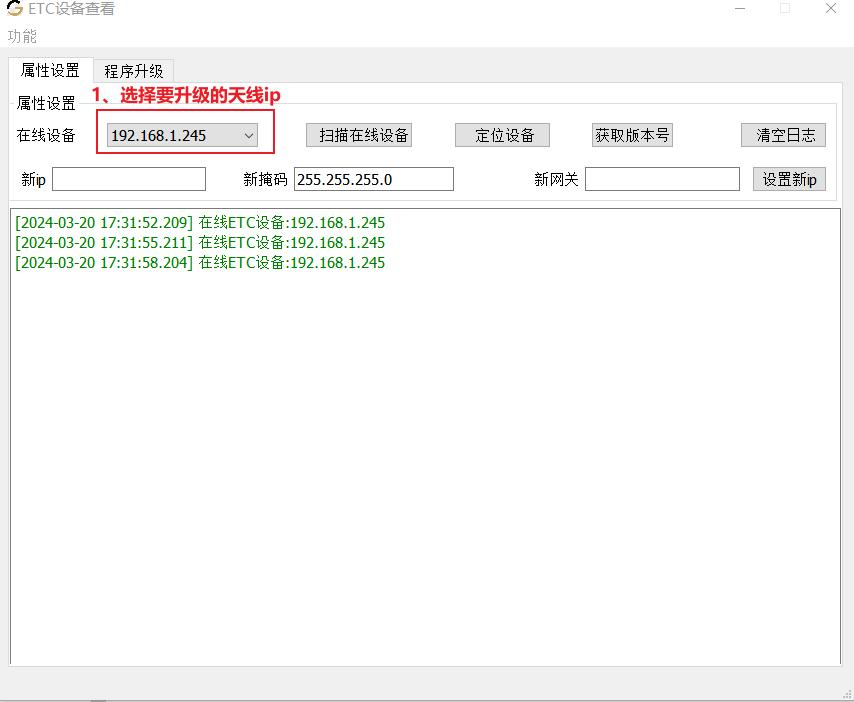
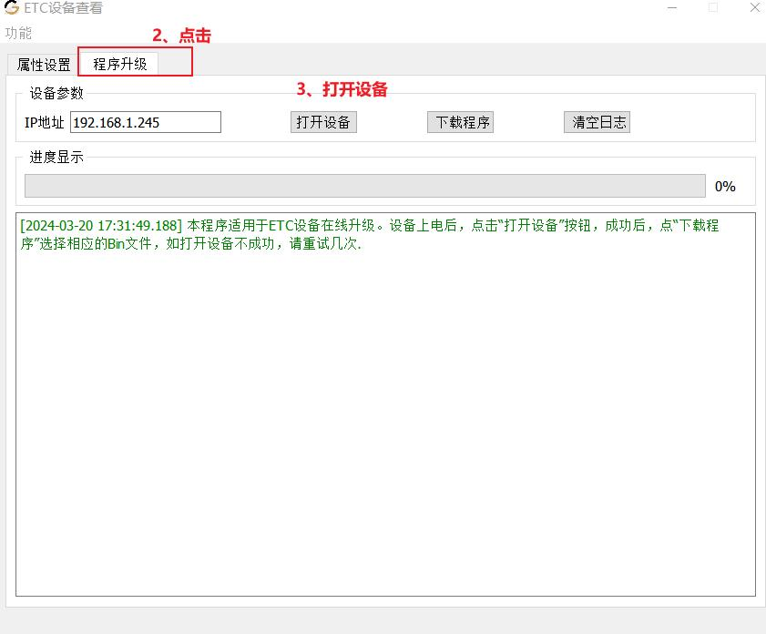
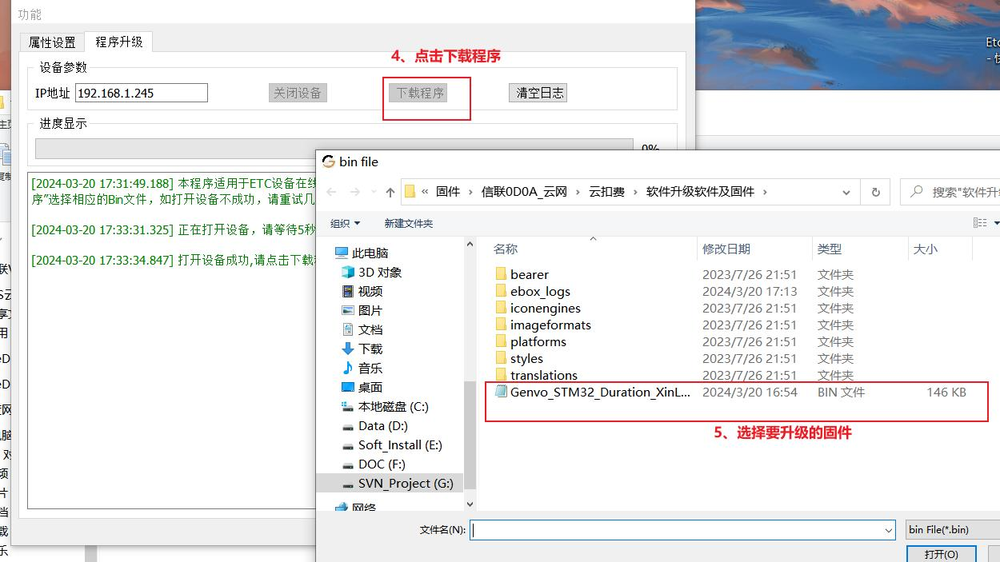
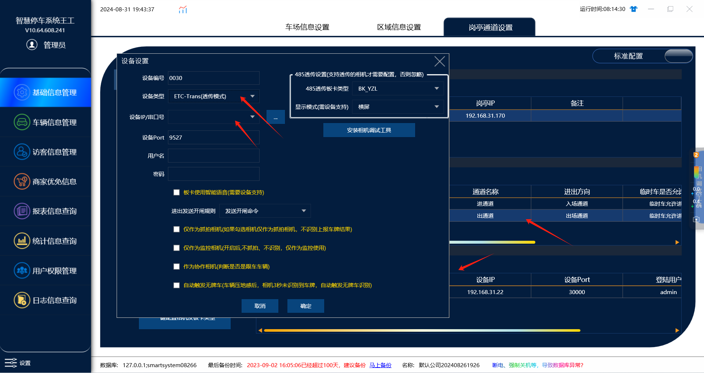
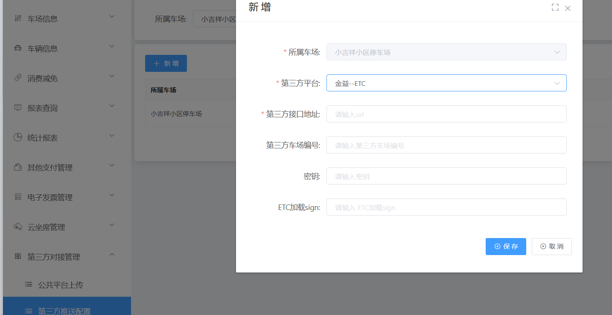

## 1.配置 IP（若 ip 已经配置过，则跳过）

打开电脑本地连接，点击【属性】，点击【TCP/IPv4】，手动修改 IP 地址，配置为 192.168.5.x
地址（不要与设备默认 IP192.168.5.245 相同，否则 IP 冲突，无法正常连接设备）。

## 2.升级设备无卡程序

:::caution
图片缺失：
:::升级程序类型售后获取

## 3.软件上绑定设备

在对应出口通道下面在添加一个etc设备

设备类型：ETC-trans（透传模式）

设备IP：XXX

然后点击确认添加就行了，其他的都默认不需要修改

## 4.收费端软件授权etc设备

这一步联系我们售后处理，在收费端系统设置里面软件升级把里面授权码发给我们售后

## 5.车场管理平台绑定etc

在第三方推送配置里面选择车场添加金溢-etc

第三方接口地址：[https://xlapi.etcsd.cn:8093/xl-api/common/gateway](https://xlapi.etcsd.cn:8093/xl-api/common/gateway)

第三方车场编号：etc的appid

密钥：88882020070810001287

etc加载sjgn：联系售后获取
