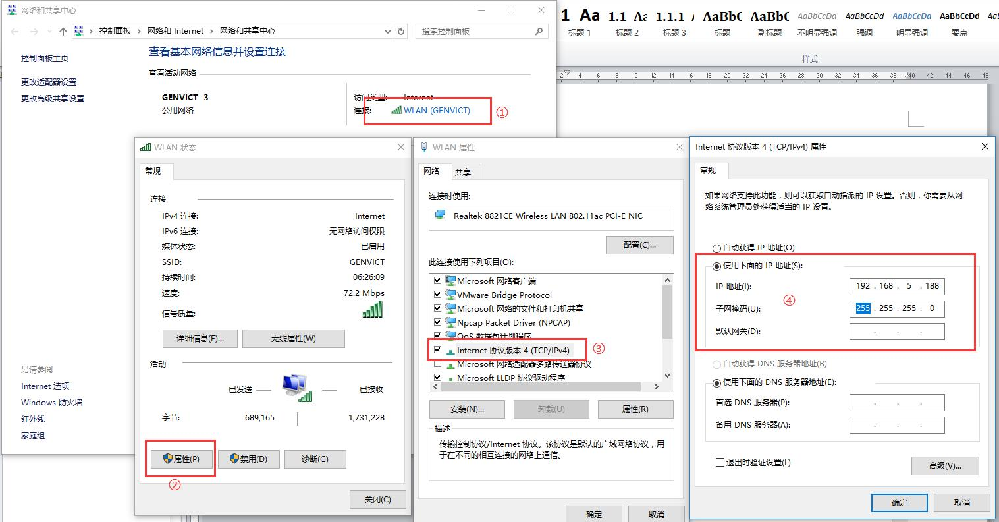
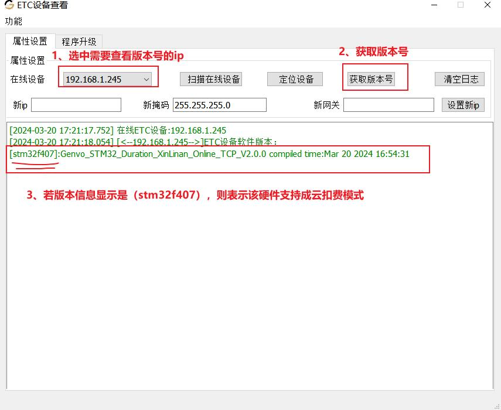
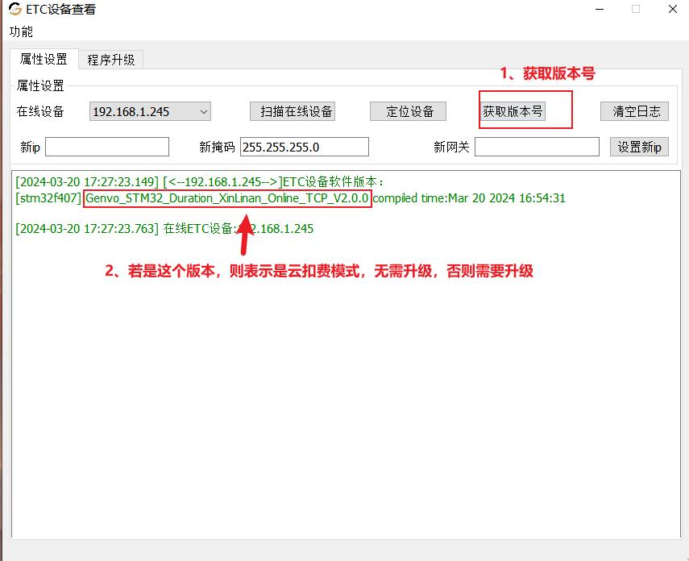
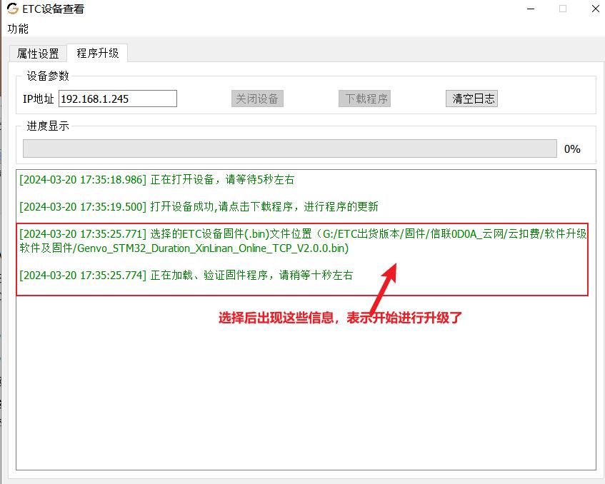
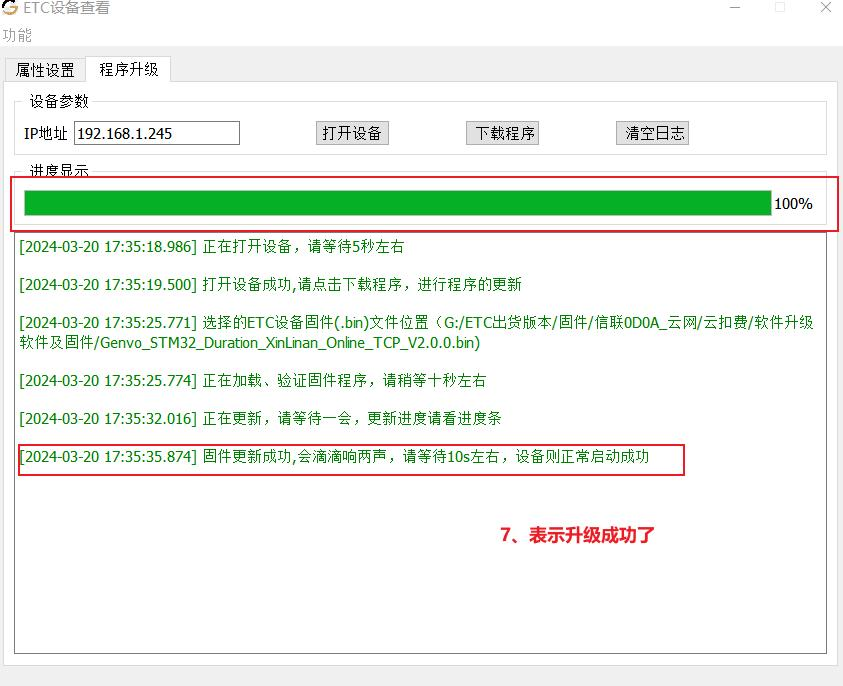
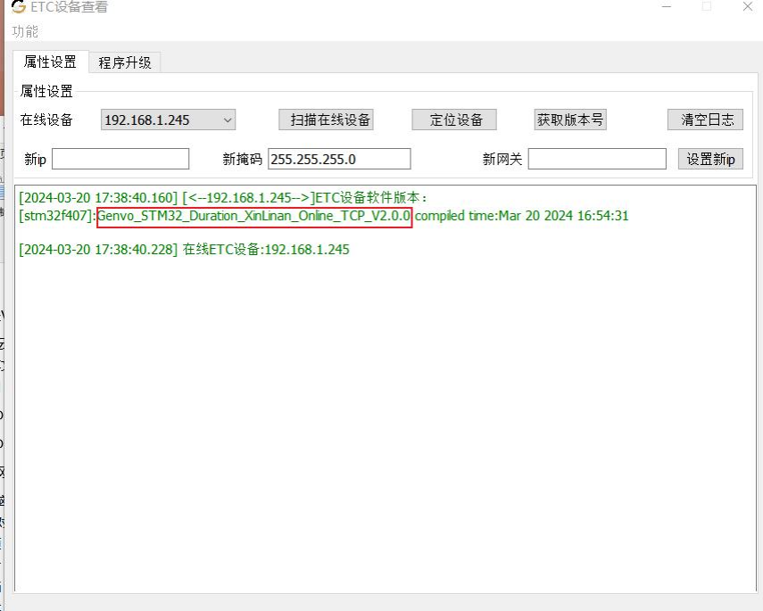
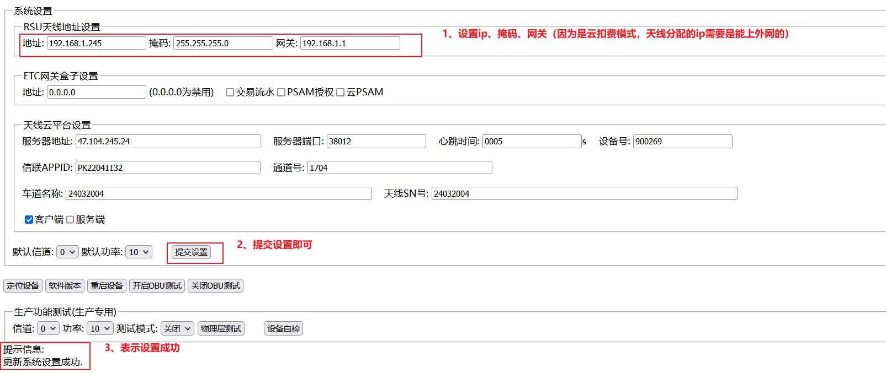
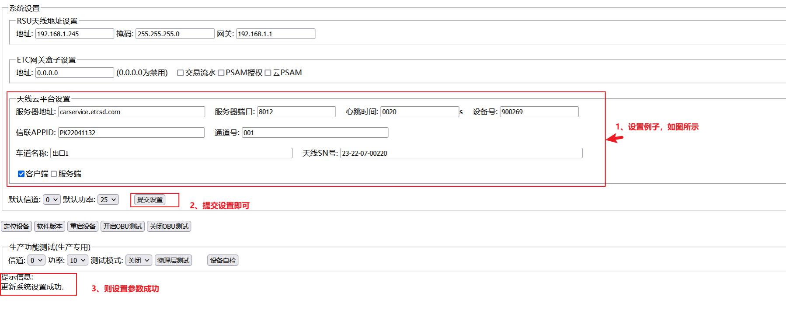
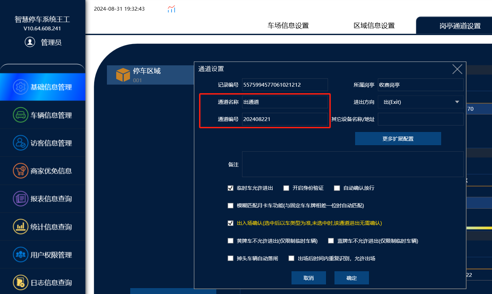
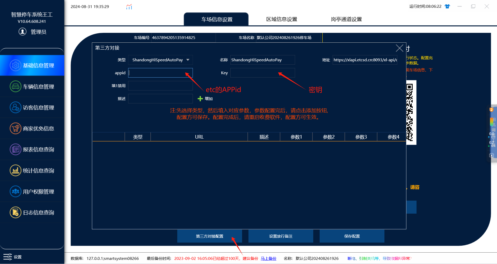

## 1.配置 IP（若 ip 已经配置过，则跳过）

打开电脑本地连接，点击【属性】，点击【TCP/IPv4】，手动修改 IP 地址，配置为 192.168.5.x
地址（不���与设备默认 IP192.168.5.245 相同，否则 IP 冲突，无法正常连接设备）。

## 2.打开搜索ip工具升级设备

查看软件版本号（若是云模式版本，则无需升级）

## 3.软件升级（软件版本号不是云扣费模式）

## 4.查看升级成功的版本号

若软件版本号如上所示，表示升级成功了，若不是，则重来一次。

## 5.ETC 天线参数配置

打开浏览器，在地址栏输入etc设备ip：

注意事项：如下的参数，应要都先获取到，然后统一设置，否则参数变更，需要通知结算平台，重新录入，
较为麻烦。

服务器地址：carservice.etcsd.com（必填）
服务器端口：8012（必填）
心跳时间：0020（必填）
设备号:(默认即可)
信联 APPID：由业主或者第三方平台,向信联申请停车场的生产环境的 appid（必填）
通道号：道闸端应该叫车道号（lane_id），参数长度麻烦控制在 12 个字符以内，应该与道闸端一致，
对应匹配上（必填）
车道名称：与道闸端一致，对应匹配上（必填）
天线 SN 号：etc 天线靠近网口位置的数字编号（必填）
客户端/服务端：只选中客户端(默认即可)
当修改完毕之后，记得提交设置

车道号和车道id就填添加上的通道名称和通道编号。

## 6.最后在添加上车场管理里面第三方配置绑定etc的APPid和密钥

密钥联系售后获取
