### 目录

1. 修改设备IP
2. 管理端软件添加设备类型及需要勾选的功能设置
3. 收费端入场刷人脸并查询记录
4. 月租车白名单信息添加方式
## 1. 修改设备ip

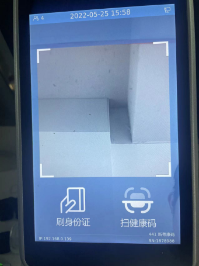

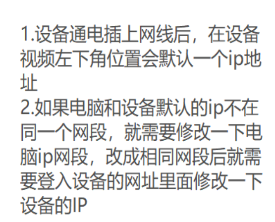

:::caution
图片缺失：
:::

设备网址：就是设备的ip,在浏览器输入设备ip

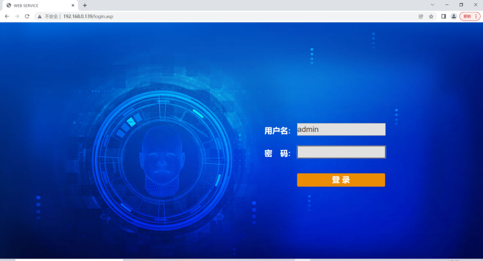

默认账号和密码都是：admin

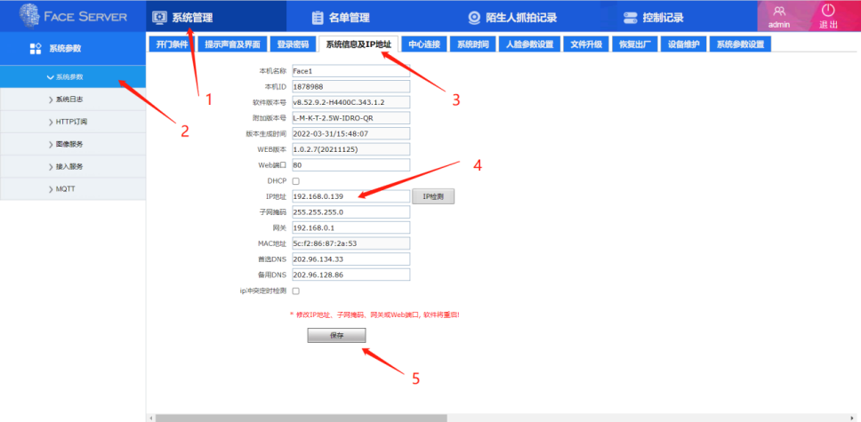

在系统信息及ip地址这里修改设备ip

总结：设备连接后默认ip比如是192.168.1.139  电脑外网IP是192.168.0.121 设备和电脑必须要在同一个网段,所以���把电脑IP改成192.168.1.121 在到浏览器里面输入设备ip 192.168.1.139  在设备网址里面修改IP 改成192.168.0.129  然后在把电脑IP改回之前的192.168.0.121就可以正常连接了
## 2.管理端软件添加设备类型及需要勾选的功能设置

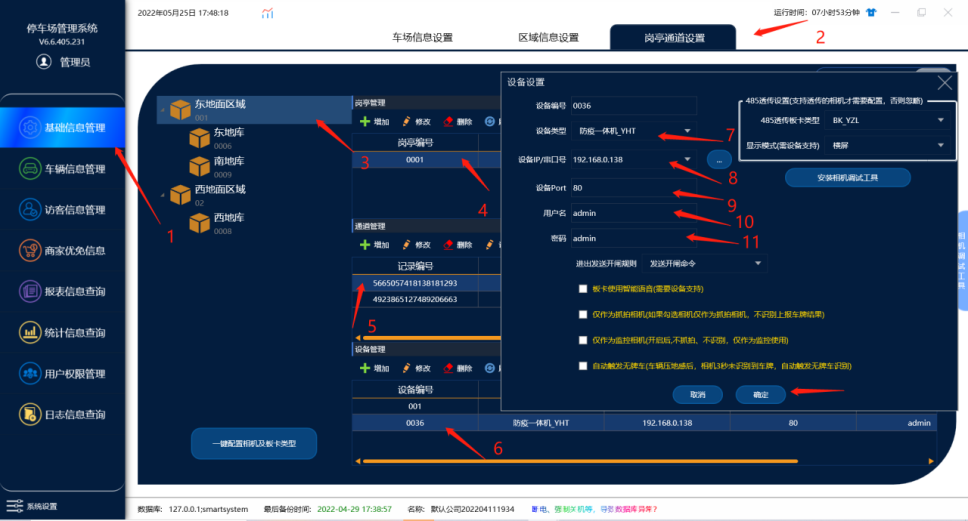

在设备管理下面添加一个设备类型

设备类型: 人脸一体机_YHT

设备ip:   输入设备的ip

设备port：端口80

用户名：admin

密码：admin

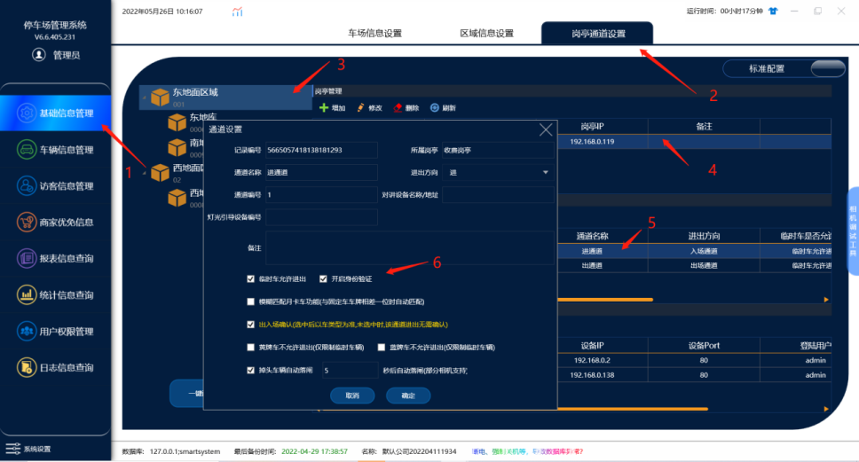

管理端通道管理里面需要勾选开启身份验证的功能

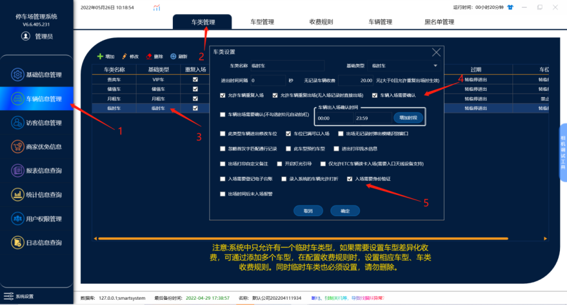

管理端车类管理里面需要勾选入场确认和入场开启身份验证的功能

总结：在通道管理里面添加一个设备设备类型：一体机_YHT
在输入设备的ip 端口：80 在输入用户名和密码,在通道管理里面在勾选开启身份验证的功能和在车类管理里面勾选入场确认和入场开启身份验证的功能
## 3.收费端入场人脸并查询记录

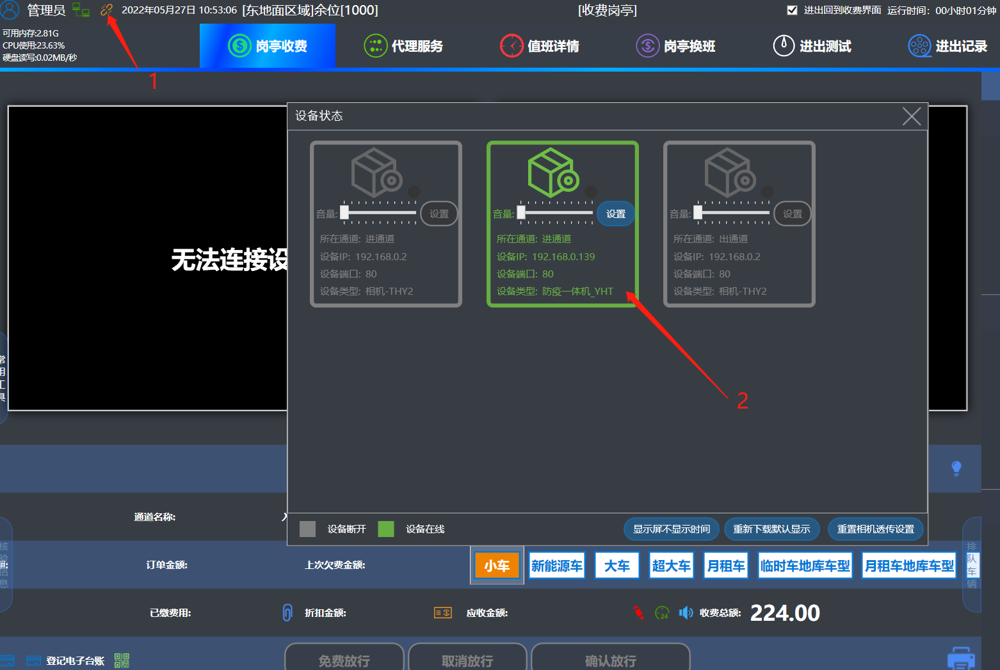

在设备状态的位置这里可以看到这个设备是否连接成功显示绿色就代表连接成功了

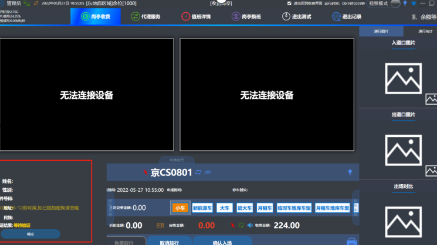

临时车在入场确认的情况下,左边会弹出这个验证信息,当车主刷脸成功之后,设备提示请通行,车辆就自动入场了,不需要在手动点入场确认

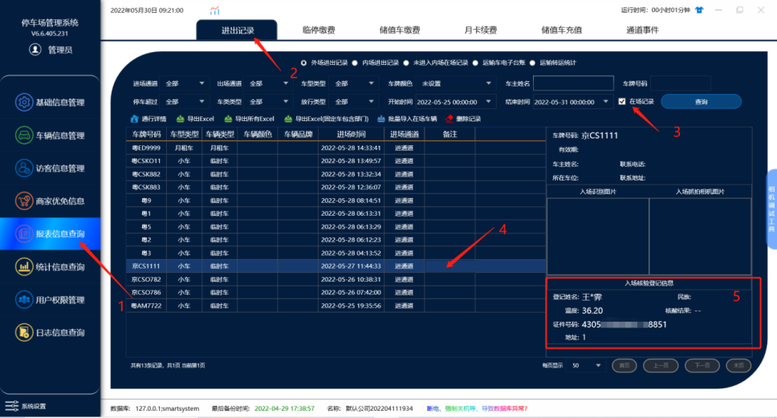

入场成功后就能在管理端报表信息在场记录里面查到入场核酸登记信息

总结：在收费端设备连接状态哪里看设备是否连接成功的,连接成功后临时车进口相机识别车牌后,车在入场确认的情况下刷人脸 验证成功后软件上就默认算车自动入场了,入场成功后可以在管理端报表信息在场记录里面查到入场核酸登记的信息
注：\{如果收费端查询设备连接成功的情况下 临时车在进口相机识别后入场确认的情况下 车主去刷核酸码和人脸设备提示请通行后,收费端没有反应,没有接收到设备那边的信息,这个时候需要关闭电脑的防火墙就可以处理\}
## 4.月租车白名单信息添加方式

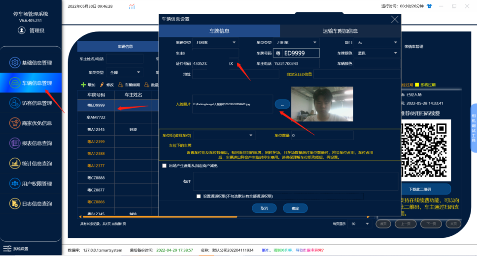

在管理端车辆信息里面对应的月租车牌号里面添加证件号码和上传一张人脸图片

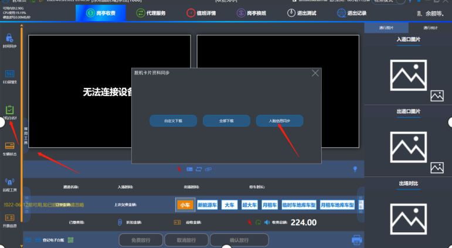

然后在收费端的常用工具然后点脱机白名单然后点人脸信息同步

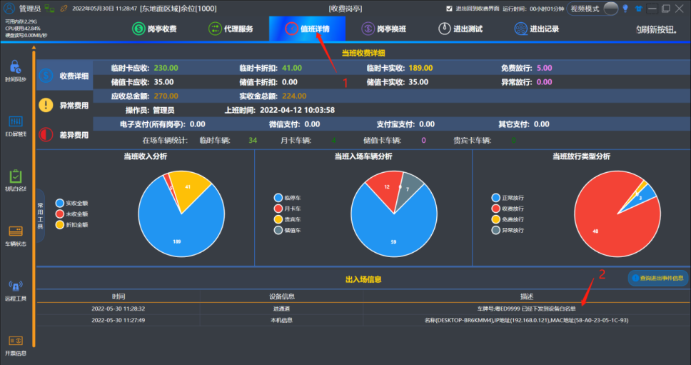

点了人脸信息同步后可以在值班详情通道事件里面查到下发成功的记录

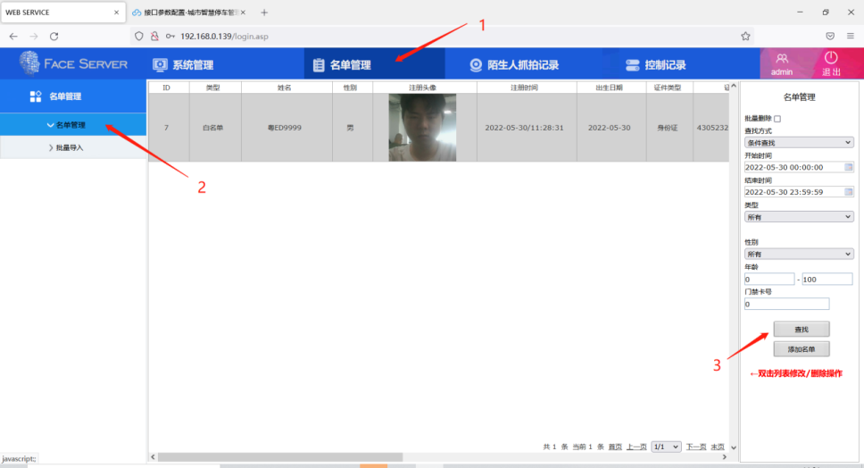

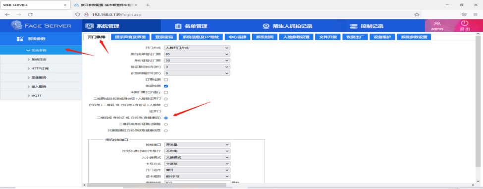

白名单信息下方成功后在设备调试软件里面白名单里就能查到记录然后在系统参数-开门条件-的参数改成二维码或身份证或白名单,之后月租车在收费端确认入场的情况下直接刷人脸就可以默认入场了。

总结：月租车在车辆信息里面添加身份证号码和上传一张人脸图片在收费端常用工具里下发白名单到设备软件里面之后在设备软件里面把开门条件改成二维码或身份证或白名单,之后月租车在收费端确认入场的情况下直接刷人脸就可以默认入场了。