CXNT-JFJ 对讲本地调试方法
(注意：本地的话是需要两跟网线哦。纯云的只需要一根网线)
(要调试完设备和板卡后才可以去测试呼叫和显示语音播报哦)
调试方法如下：
### 设备调试
1. 打开CXNT-JFJ工具

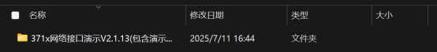

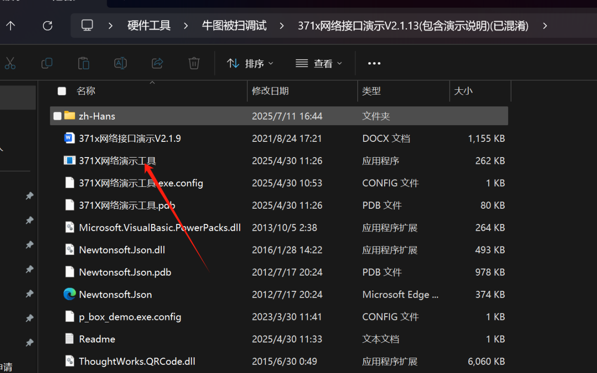

2. 点击搜索设备,并选中调试的设备，并复制好序列号

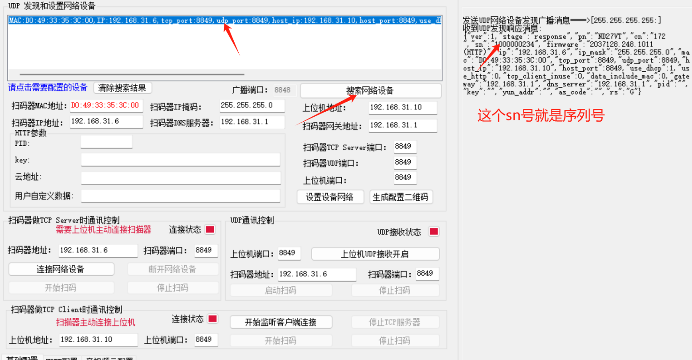

3. 配置好设备的网络，点击设置设备网络

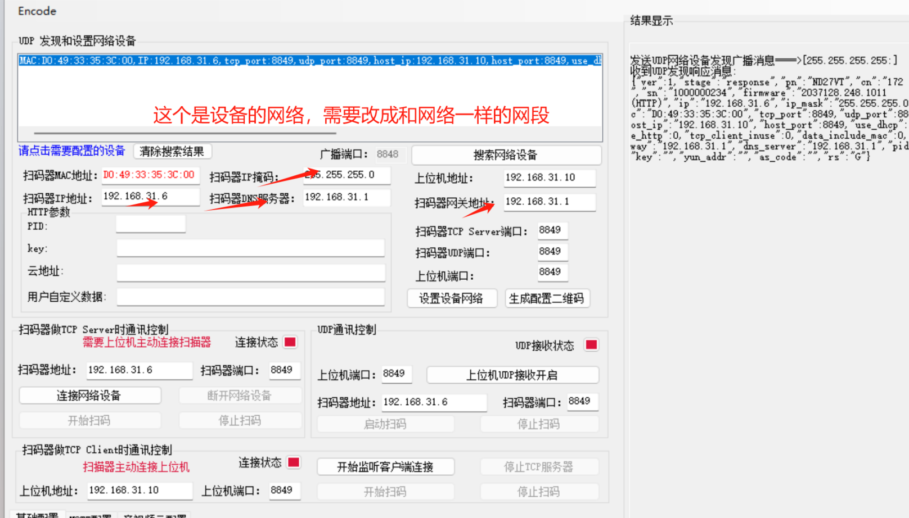

4. 在平台上设备管理去进行添加设备，最后点��保存就好了

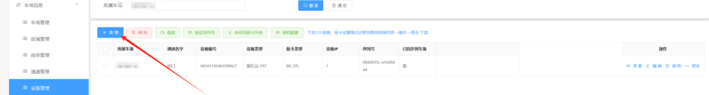

5. 添加好后再平台上设备连接状态那里查看是否在线就好了

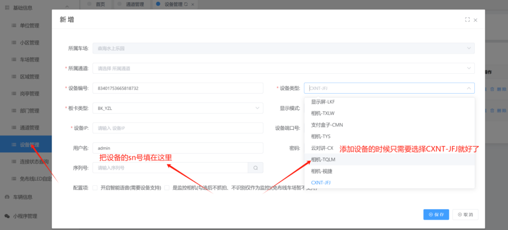

## 板卡调试
1.打开杨宗来板卡工具（没有工具的话可以问售后要）

2点击LED_Designer进入调试界面

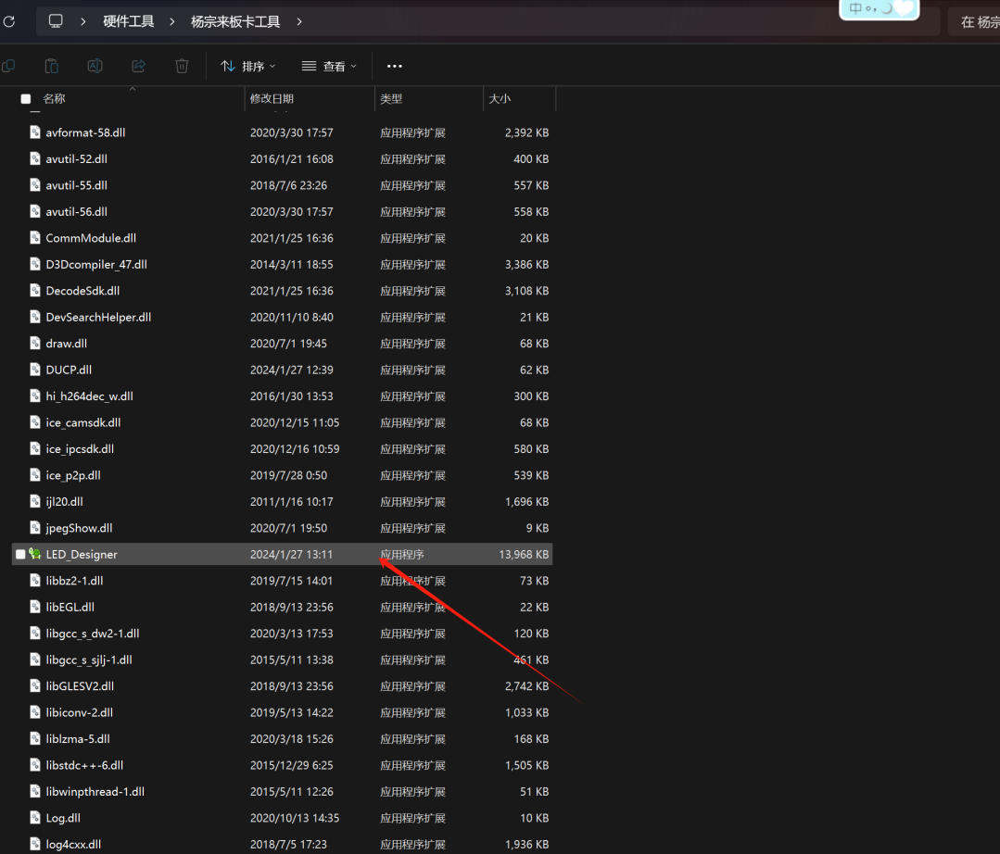

3直接点击下图的按键，就会跳转到网口的lcd主板的搜索界面

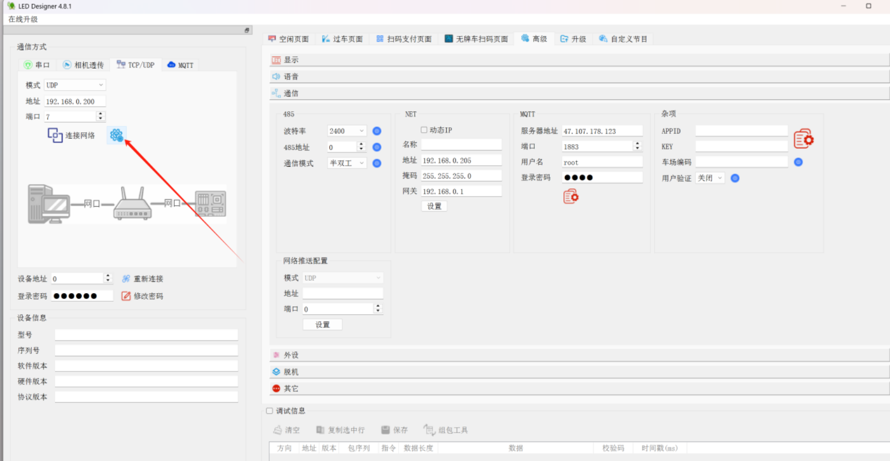

4然后选中设备后改好设备ip

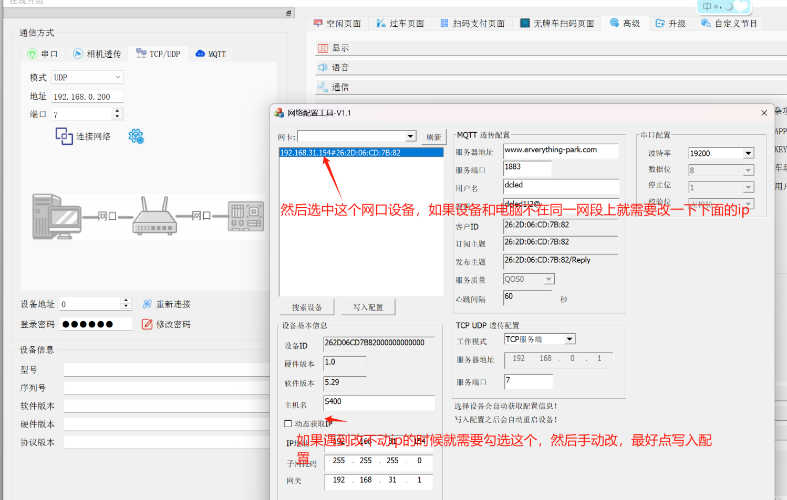

5然后退回上一个界面，把板卡ip输入后进行连接确定是否连接正常

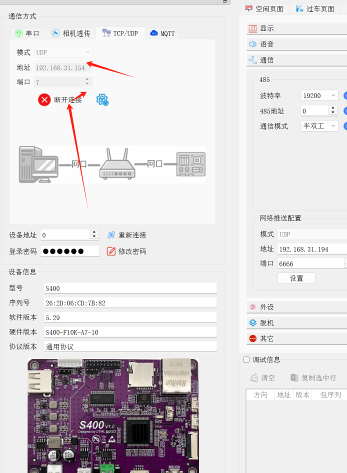

6软件上面添加显示屏-LKF就好了

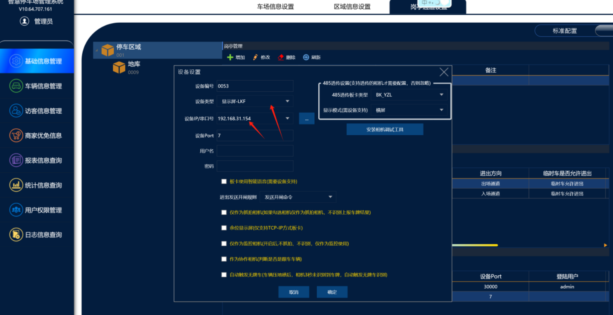

注意：http不能打开哦打开会导致支付抬杠慢哦

