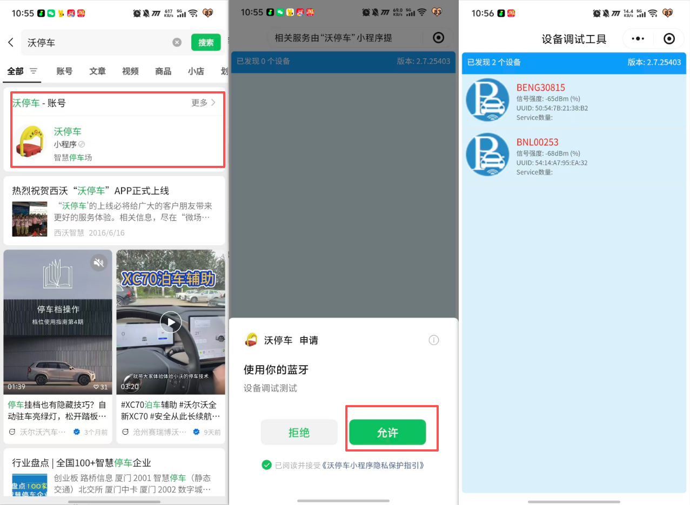
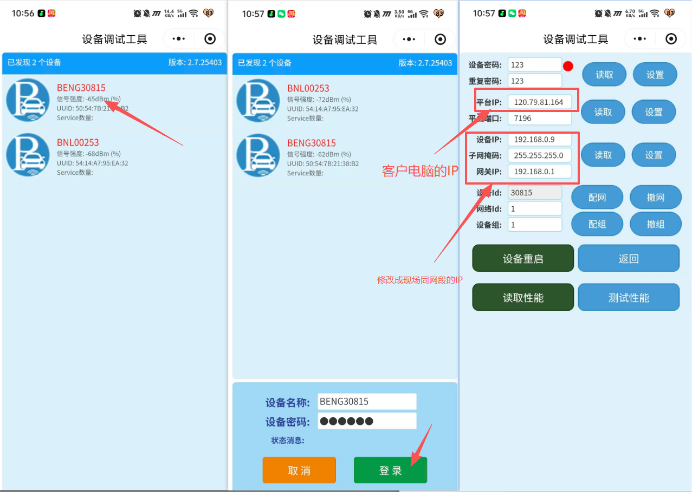
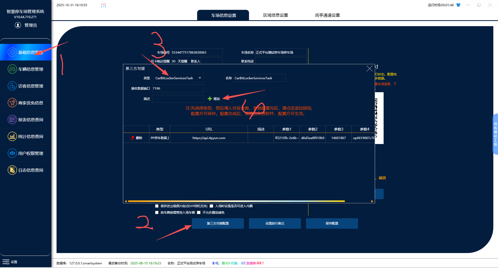
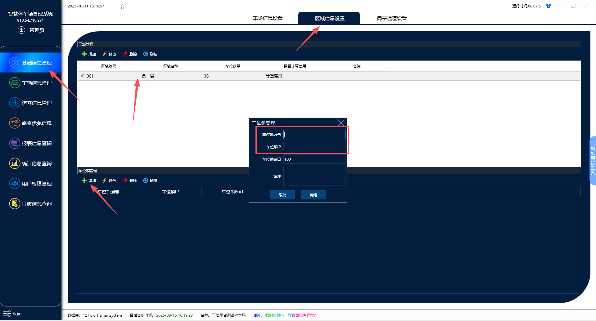
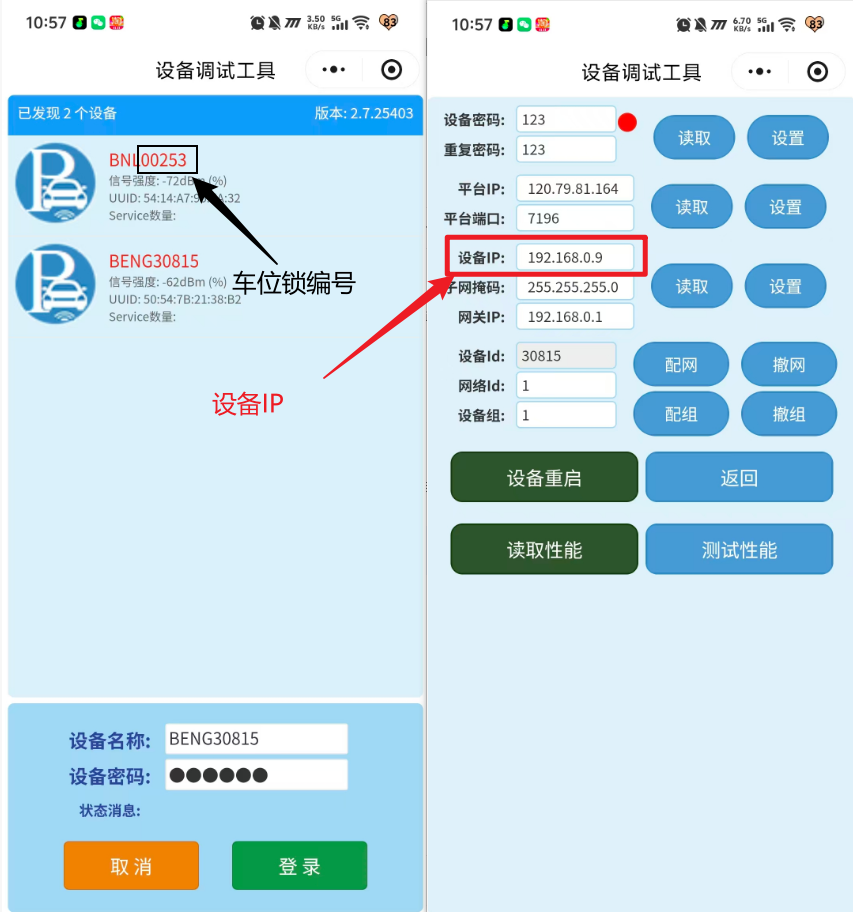
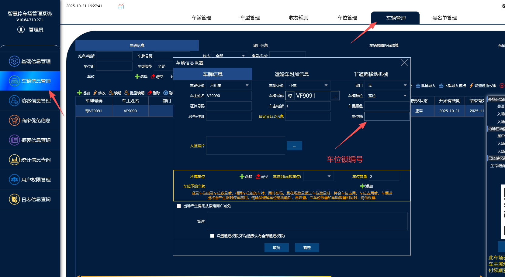

车位锁配置方法：
微信打开小程序“沃停车
打开蓝牙，在设备2米以内搜索到车位锁设备

点击设备BENG开头的设备去进行登陆修改，设备网络和绑定自己电脑ip点击设备BENG开头的设备去进行登陆修改，设备网络和绑定自己电脑ip

软件配置：
1.升级最新版本软件，然后在基础信息管理那里点击第三方配置。然后找到CarBitLockerServicesTask上传类型直接点击添加就好了

2在区域管理这里点击新增
把设备的设备编号以及设备ip填写进去，端口默认100���用去改把设备的设备编号以及设备ip填写进去，端口默认100不用去改

设备编号就是在沃停车小程序搜索到BNL后面的数字，数字前面要加个0哦
例如：BNL00235设备编号就是000235例如：BNL00235设备编号就是000235

车辆录入绑定车位锁的方法：
在车辆管理这里添加车辆的时候找到车位锁的那一栏并把设备编号填进去就可以了

