1打开工具release-v5.2.0（如果没有工具的话可以直接问售后要）、
平台网址47.115.75.169
1往下滑找到LED_Designer点击进去

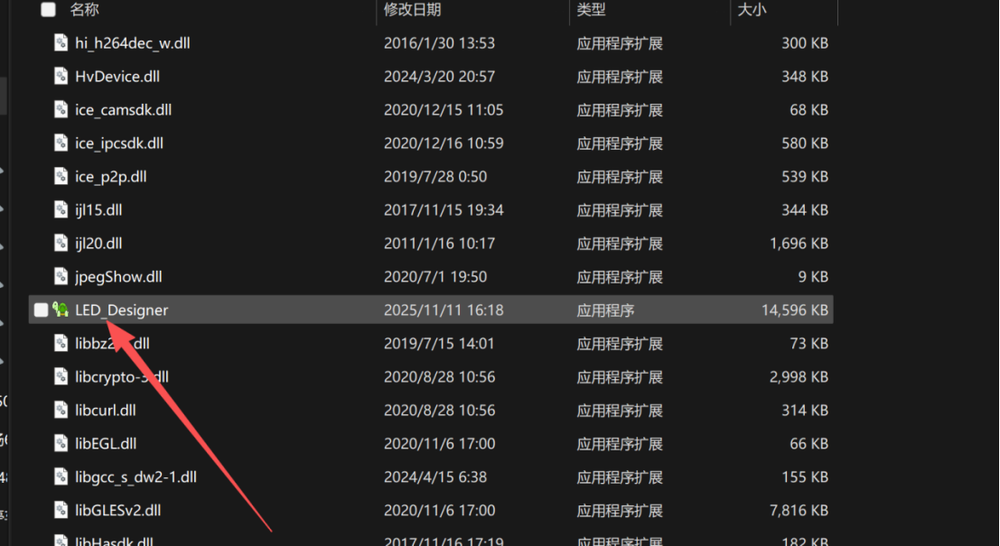

22，找到TCP/UDP,点击配置工具

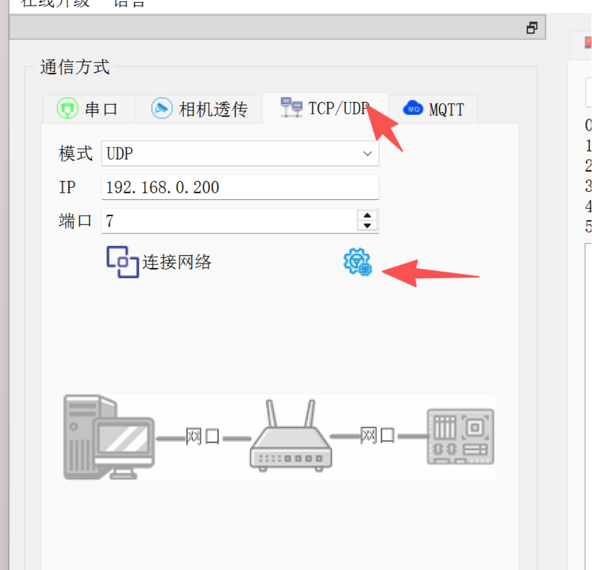

32，点进去后点击搜索查到对应的板卡ip，并把板卡IP改成对呀网络的网段和ip，                          把平台服务地址改成：47.115.75.169改好之后点击写入配置就好了

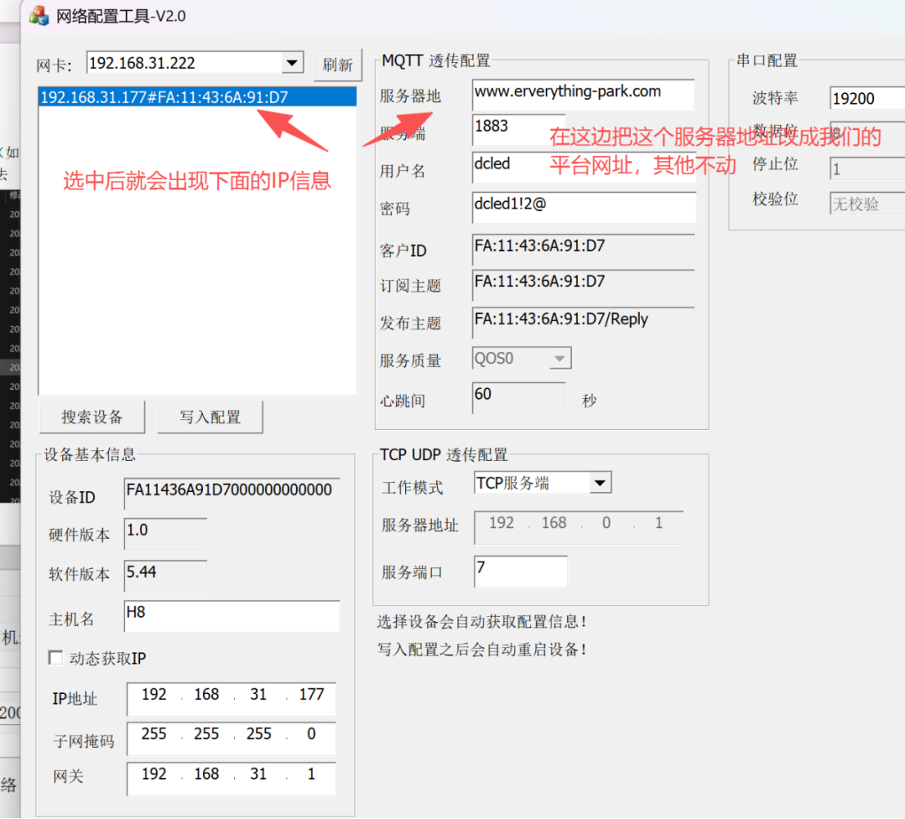

然后在TCP/UDP，输入板卡ip连接上

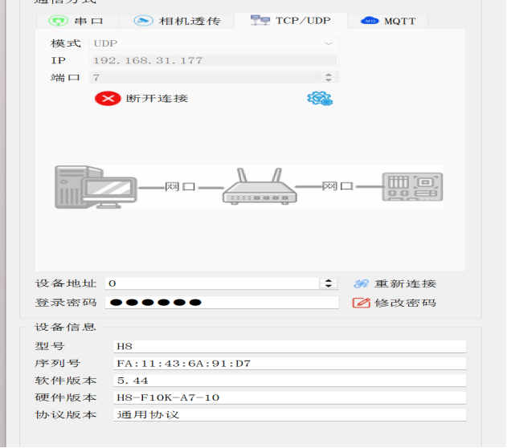

平台服务地址：47.115.75.169

设备id：就是板卡的序列号

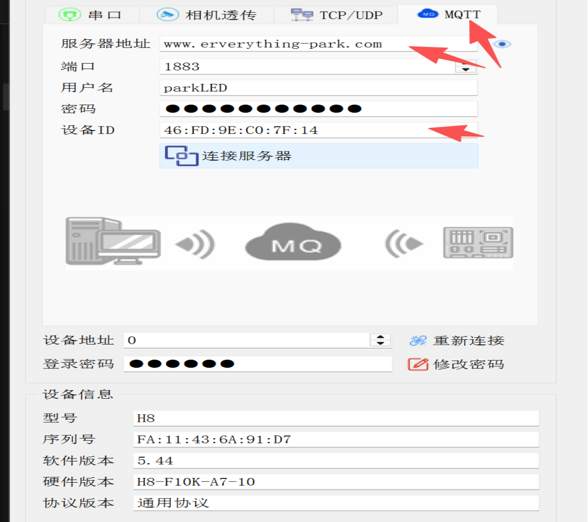

余味追缴屏幕配置：、

选择高级

驱动类型选择24

自定义节目：

选择打开节目文件，选择对应的文件就好了。

（文件如果没有的话可以问售后要）

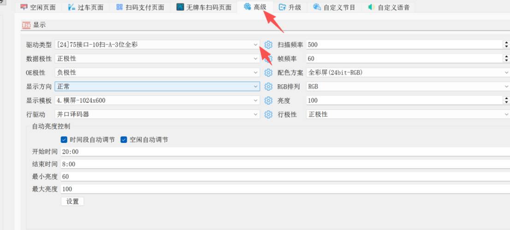

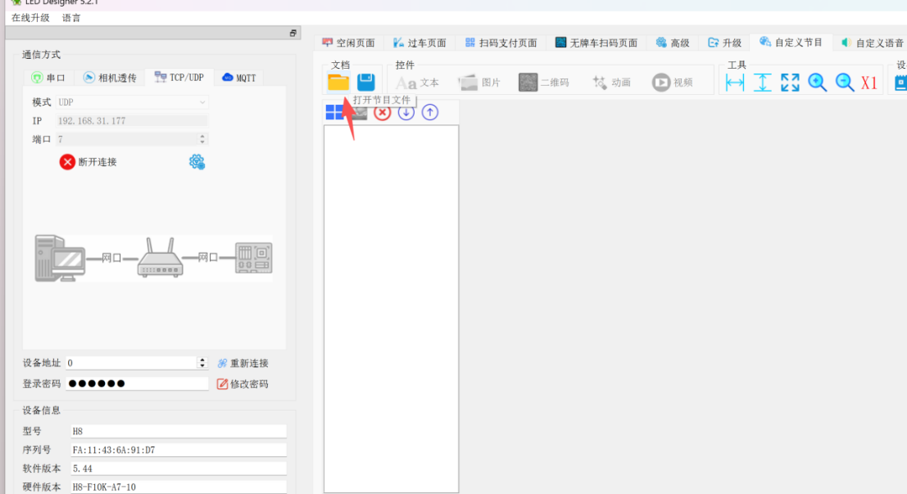

平台配置
在通道管理，选中对应通道选新增，设备类型选择余位追缴屏，把板卡序列号填进去就好了

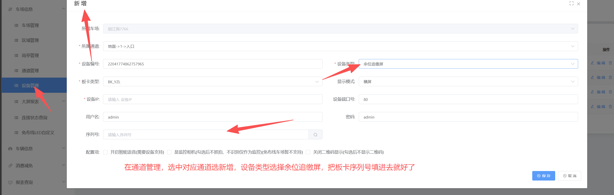

点击更多，点击余位追缴屏配置
点击新增把需要对应显示的点击新增并配置好内容就可以了

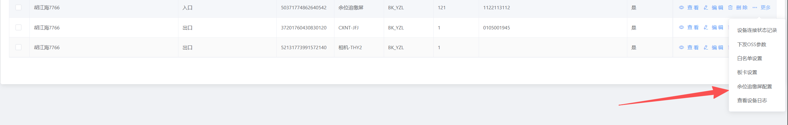

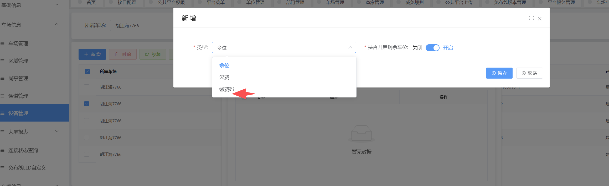

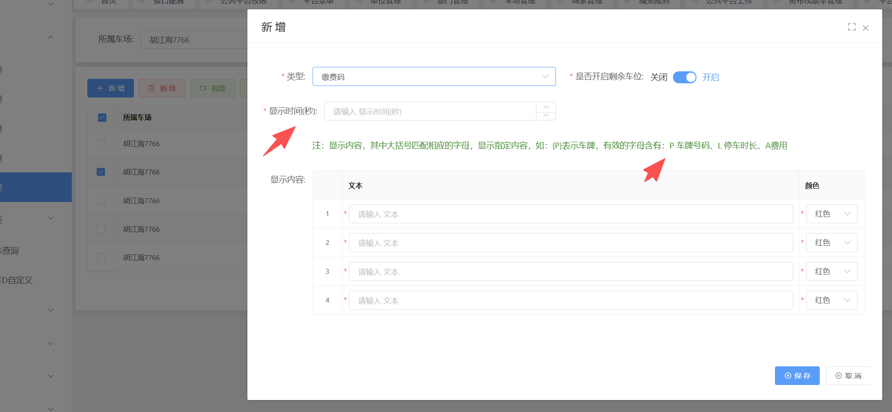
