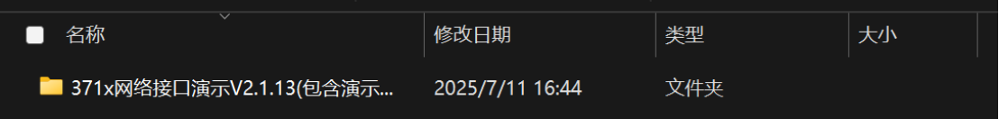
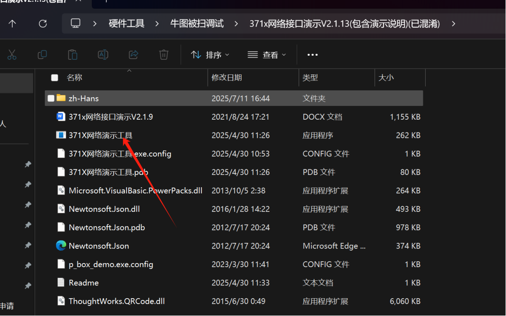
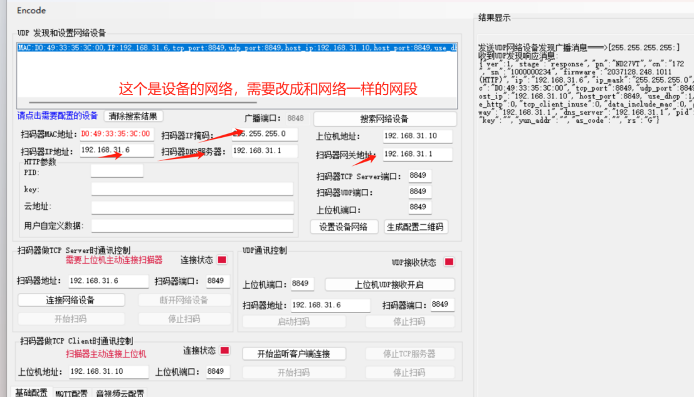
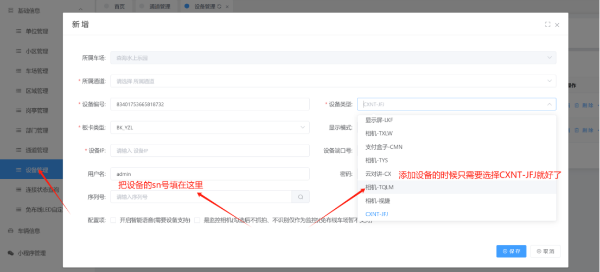
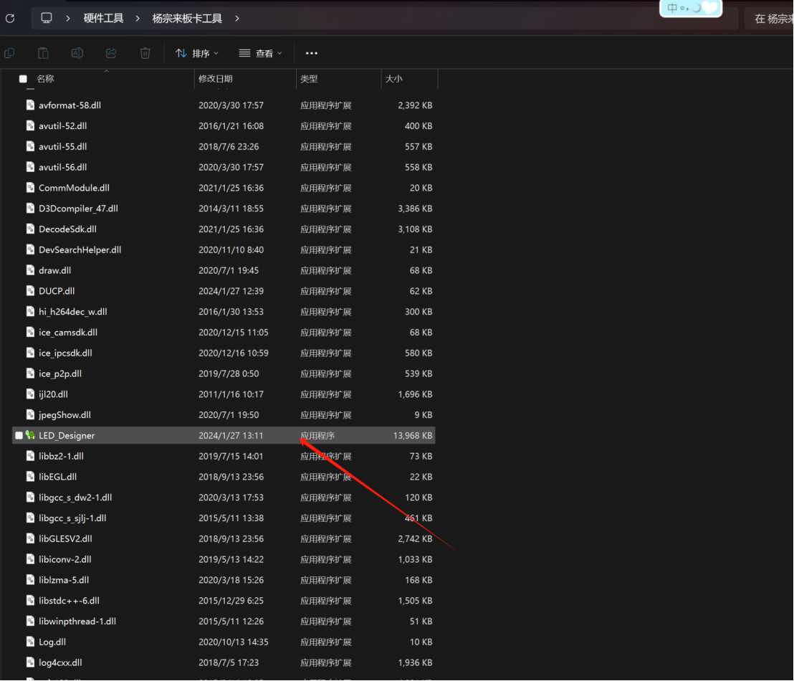
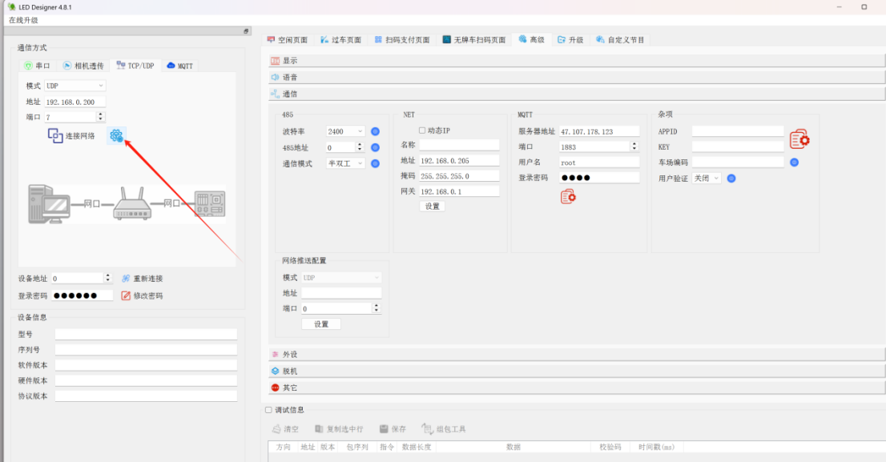
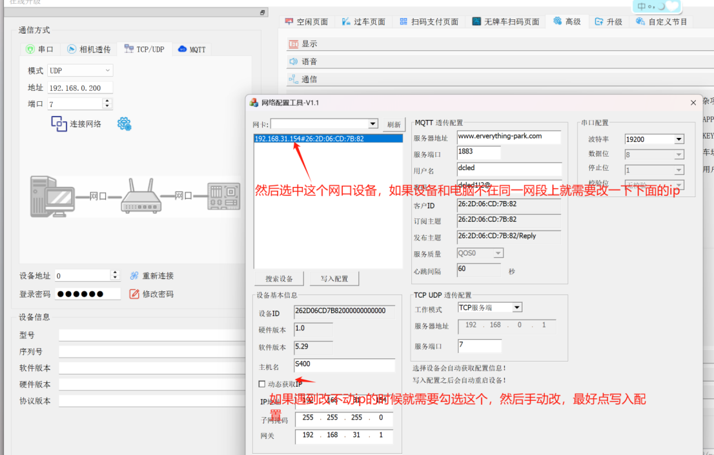
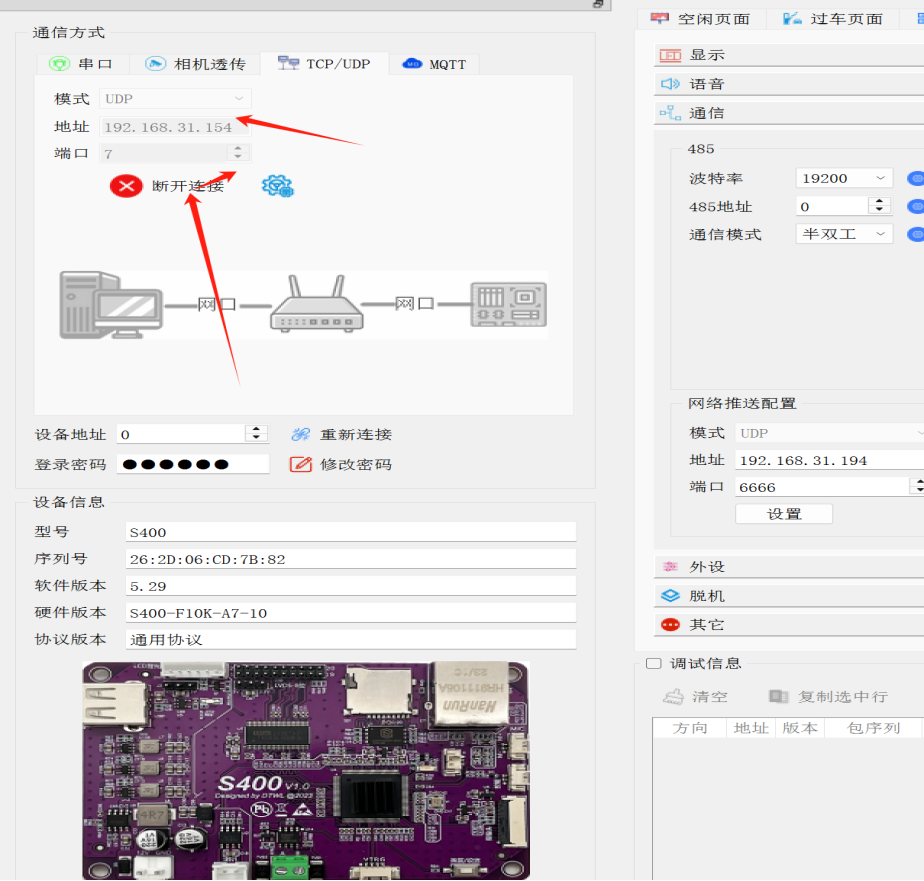
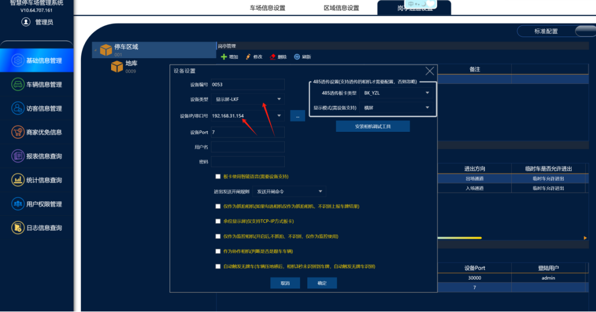

牛图对讲调试

1. 打开牛图被扫工具
工具如下：
[(客户)371x网络接口演示V2.1.13(包含演示说明)(已混淆)(1).zip](https://www.showdoc.com.cn/server/api/attachment/visitFile?sign=c9a7a96173245f3788ea0db91eb7b347 &quot;(客户)371x网络接口演示V2.1.13(包含演示说明)(已混淆)(1).zip&quot;)

2. 点击搜索设备,并选中调试的设备，并复制好序列号

3. 配置好设备的网络，点击设置设备网络

4. 在平台上设备管理去进行添加设备，最后点击保存就好了

5. 添加好后再平台上设备连接状态那里查看是否在线就好了

本地配置：

1.打开杨宗来板卡工具
工具如下：
[LED_Designer-v4.8.1(1)(2).rar](https://www.showdoc.com.cn/server/api/attachment/visitFile?sign=6f60af6b6ee5633b19ef15e352b3e29a &quot;LED_Designer-v4.8.1(1)(2).rar&quot;)

2点击LED_Designer进入调试界面

3直接点击下图的按键，就会跳转到网口的lcd主板的搜索界面

4然后选中设备后改好设备ip

5然后退回上一个界面，把板卡ip输入后进行连接

6.软件上面添加显示屏-LKF就好了

