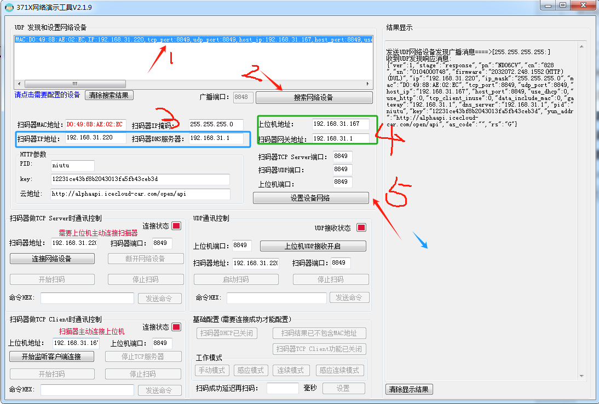
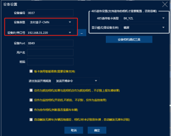

工具如下：
[(客户)371x网络接口演示V2.1.13(包含演示说明)(已混淆)(1).zip](https://www.showdoc.com.cn/server/api/attachment/visitFile?sign=71793788451f6c8b479d20ff2ed788b4 &quot;(客户)371x网络接口演示V2.1.13(包含演示说明)(已混淆)(1).zip&quot;)
1. 拿到设备之后接好电源插好网线

共5个步骤
A. 点击搜索网络设备，然后上面就会出现对应的设备
B. 点击对应的设备再设置下面的参数
C. 扫码器IP地址和 DNS服务器设置好 （设备IP要和电脑一个网段 DNS服务器就是网关，比如我电脑的网段是192.168.31.XX 地址就设置成不冲突的 192.168.31.220 网关就是192.168.31.1）
D. 设置上位机IP和网关地址（上位机就是收费电脑的IP，如果多台电脑的话 1号设备对应A电脑 上位机就填A电脑IP，2号设备对应在B电脑上使用，上位机就填B电脑的IP）
E. 点击设置网络成功之后就设置完成

设备上添加支付盒子-CMN的设备类型 设置好IP地址 其它地方都不要动 保存好 打开收费软件即可使用

碰到支付不了恢复出厂重新设置一下

:::caution
图片缺失：
:::  发送到手机上面  这个二维码给扫码枪扫码即可恢复

