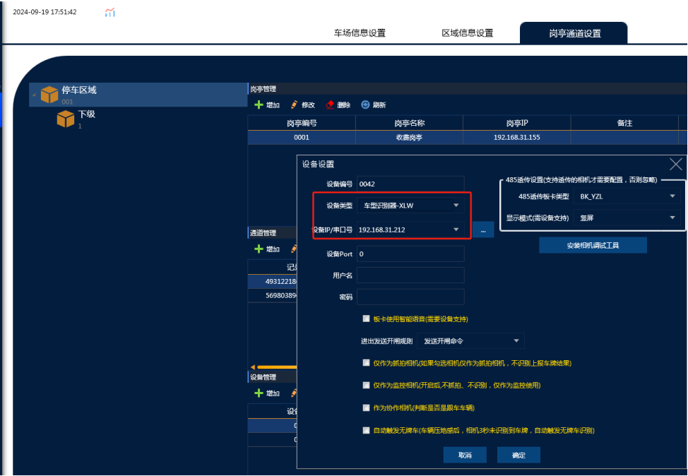
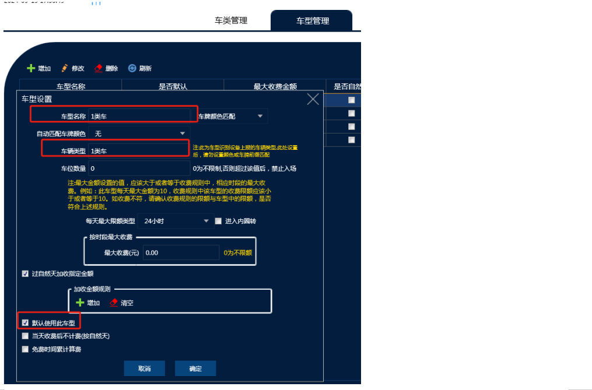
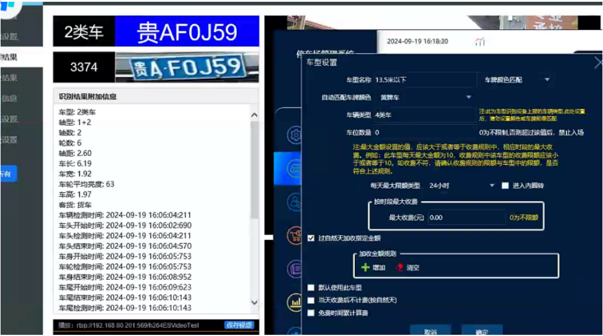

信路通车型识别机设置方式

安装注意：一定得车牌识别相机先识别之后再车型相机识别车型才能正常匹配

设备都是安装在进口，首先在对应的通道加上设备  车型识别机一共三个IP 这里只需要加上主设备的IP就可以  （**设备类型：车型识别器-XLW**），除了类型和IP地址 其它所有设置不需要动

然后把软件车型全部删除，需要车型识别器区分几种车型就增加几个车型

如上图所示：  车型识别器里面车型对应的就是软件的车型  车辆类型里面填上车型设备的车型    **（比如软件添加1-10号车型 然后对应1类车加到10类车）** 然后添加临时车和1-10号车型的收费规则

不同的车类就匹配软件不同的车型达到直接匹配不同收费规则的效果
所有添加的车型必须填上车辆类型，并且不能设置相机匹配车牌颜色