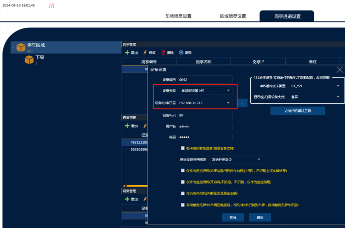
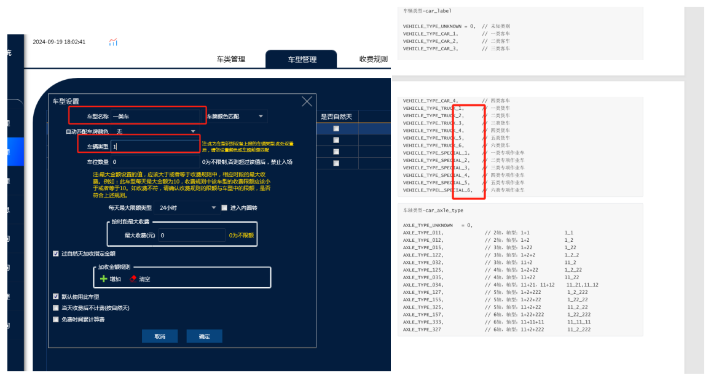

VZ X3车型识别相机软件配置

安装注意：一定得车牌识别相机先识别之后再车型相机识别车型才能正常匹配

设备都是安装在进口，首先在对应的通道加上设备  车型识别机一共三个IP 这里只需要加上主设备的IP就可以  （**设备类型：车型识别器-HY**），除了类型和IP地址 其它所有设置不需要动

然后把软件车型全部删除，需要车型识别器区分几种车型就增加几个车

相机车型识别后会按照对应数字传给软件添加软件上对应的车型名称（自定义）然后车辆类型就填对应的数字  然后软件上增加对应的收费规则达到对应车型自动匹配对应收费规则的功能（软件需要设置一个默认车型，然后无牌车或者传值不在范围内的车牌就自动匹配默认的车型）

所有添加的车型必须填上车辆类型，并且不能设置相机匹配车牌颜色