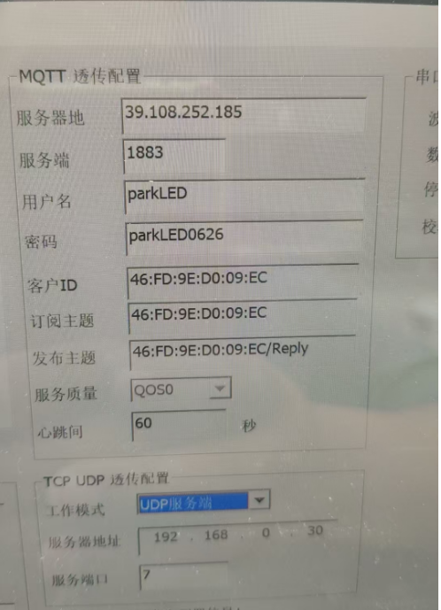
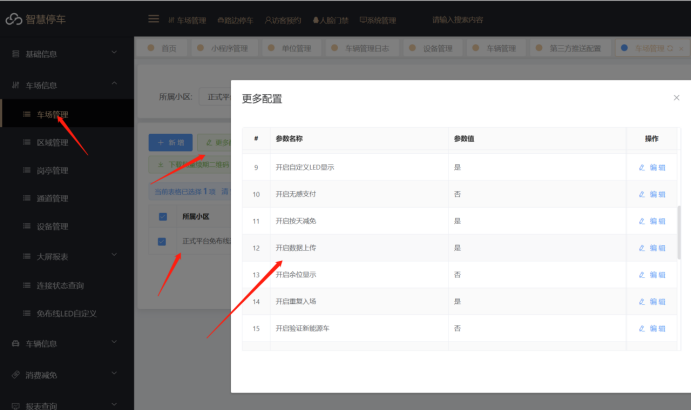
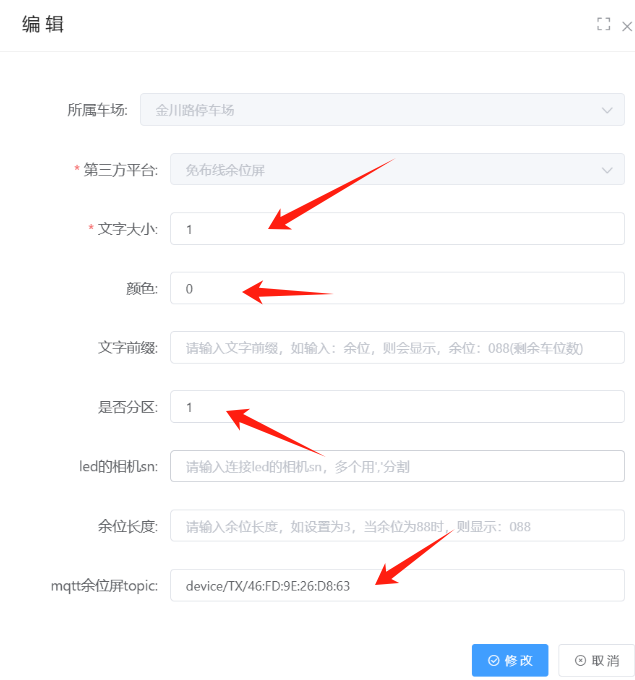
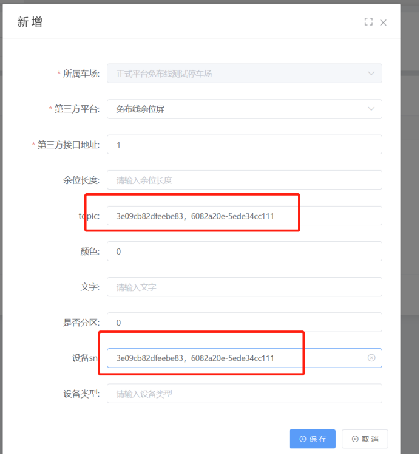
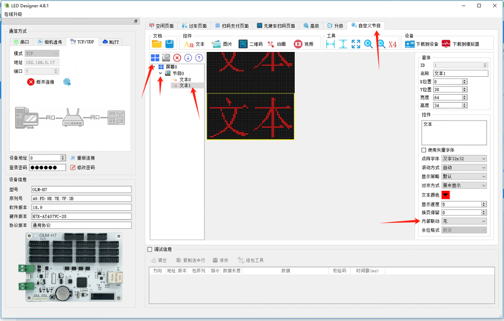

工具如下
[杨宗来板卡工具.zip](https://www.showdoc.com.cn/server/api/attachment/visitFile?sign=4c323dbfdd302acad433548e69bc53e2 &quot;杨宗来板卡工具.zip&quot;)
1. 在管理端设备管理添加设备  （注意：电脑多ip的情况下，岗亭ip必须和设备ip在同一个网段才行）

2. 设备类型选择：显示屏—LKF
3. 添加板卡的ip：192.168.0.111
4. 勾选余位显示屏功能
5. 其他的信息全部由软件这边默认好的不用修改
6. 打开收费端查看板卡连接状态

2.修改设置余位屏显示类容

LED屏设置里面余位屏设置4行信息可以任意添加平显示

注意:设置\{字母\}的意义图中有描述,当前设置的\{S\}是剩余车位数的意思

3.在余位屏主板工具里面修改显示的类容

通过主板工具连上主板，然后在自定义界面里面 添加界面 设置对应宽度和高度，在文本里面内部联动改成关联广告语，这样才会显示软件在led屏里面设置的类容

本地端余位屏的工作模式是UDP服务端
比如2行屏：

第一行文本里面在控件填入：剩余车位

第二行文本里面在控件里面删除填入的内容，然后在内部联动改成关联广告语，这样通过软件设置下发的\{S\}就能显示

这样第一行屏就会显示剩余车位，第二行屏就会显示软件下发的剩余车位

