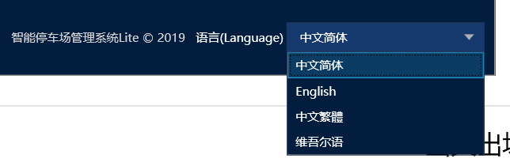
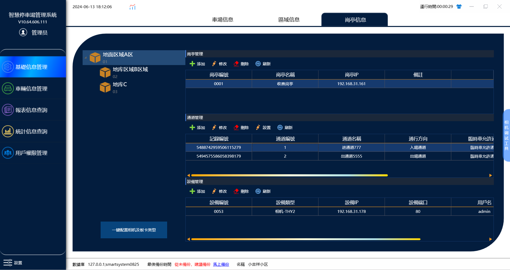
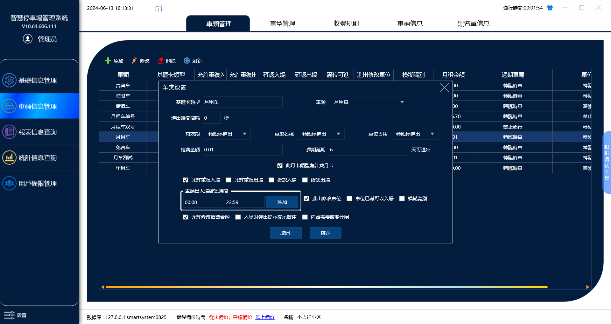
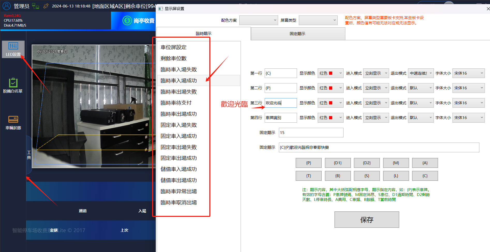
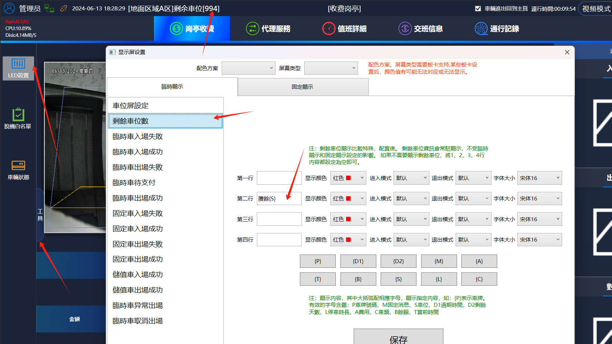

1.多功能语言切换在管理端系统设置--关于--语言，收费端也是一样

2.需要先联系售后人员将软件授权，然后才能进行修改，修改语言后需要重启一下软件

3.目前支持修改：（中文简体）（English）（中文繁体）（维吾尔语）

4.中文繁体

修改后软件是固定不能修改的字体都会变成繁体字

5.软件上的添加区域，岗亭，通道，设备，相机，主板，车牌信息，收费规则还是和之前一样添加。

6.车类里面支持的功能展示。

7.led屏显示的类容修改

在收���端-工具-led设置里面修改临时显示里面的显示类容

比如临时车入场成功默认屏上是显示：第一行：\{C\} ，  第二行：\{P\}，   第三行：欢迎光临，第四行：车牌识别

我们需要把里面的4行显示的类容改成繁体字：第一行：\{C\}， 第二行：\{P\}，第三行：歡迎光臨， 第四行：車牌識別

这里修改之后，临时车入场led屏上就会显示繁体字的类容。

8.剩余车位显示：

在剩余車位數里面设置：賸餘\{S\}

这样在屏上就会显示：賸餘994
