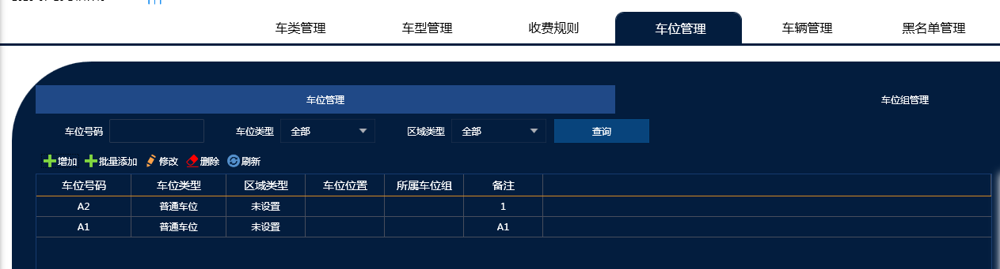
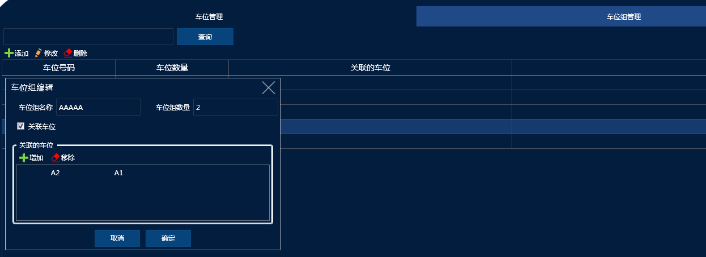
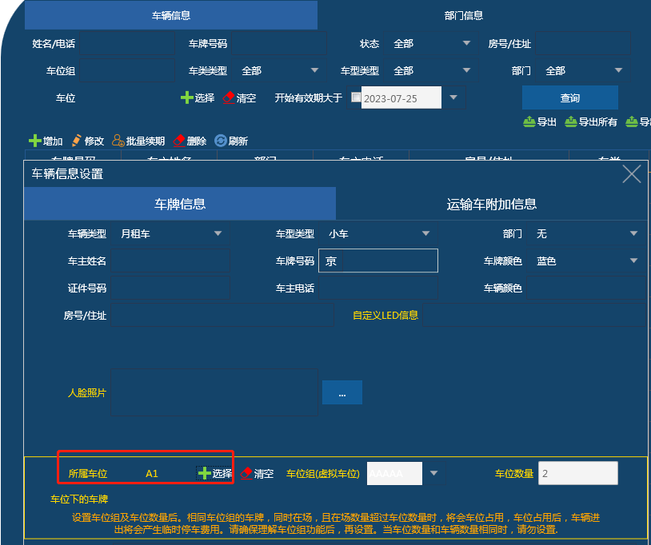

### 1.新增功能车位管理说明 ：

添加好2个车位，注意下面情况 ：

1.车位类型只能去选择普通车位，其它的还在优化 暂时不要选择

2.区域类型选择未设置 表示地上地下通用，选择地上区域表示该车位属于地上 地下区域说明该车位属于地下（地上地下分别收费并且收费不一样的情况下请选择对应区域）

切换到车位组管理 选择添加

添加车位组之后要绑定对应的车位

绑定好之后就可以     如上图 我们添加的就是AAAAA车位组（里面包括A1 A2两个车位）

最后一步的时候添加月卡车 我们可以选择所属车位 ���动就会匹配带车位组

## 2.主要能实现的功能：

1.车位组下面车位有效期可以不一样

比如业主三台车  地下有自己一个购买的车位，地面有一个租的车位

三台车可以都绑定在地下车位上面 实现一位三车，后续租了一个车位  但是只租了2个月 这个时候我们就可以把一台车绑定过去  月租的有效期是根据车位去走的  月租过期之后

这个车位也就过期了 然后会从新变为1位3车 不需要去设置其它的

业主 张三 ABC三台车  N车位绑定AB两台车 然后交管理费 设置对应有效期  M车位地上租的 绑定C车  C车有效期三个月（根据续期情况）  C过期之后 张三名下的车自动会由3车2位 变成了3车1位

2.地上地下收费一位多车

如果 车主三台车 地上1个车位 地下一个车位 可以做到 三台车都进地面的时候 第1台车月租  另外两台按照临时计费  然后1台车可以进地下之后变成月租 只收1台车的钱

如果没有上面的问题 正常的车场是不需要去添加这个车位的 做管控并且有这些情况（1.车位组下面车位有效期可以不一样，2.地上地下收费一位多车）的才用这个功能
