#### 1.MySQL56数据库安装
1. 下载MySQL5.6数据库服务地址

```
https://zbytparkimg.oss-cn-shenzhen.aliyuncs.com/mysql-installer-community-5.6.10.1.rar
```

2. 解压文件

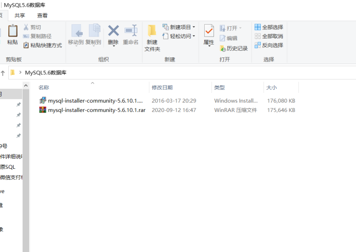

3.打开安装程序

点击第一个Install Updates

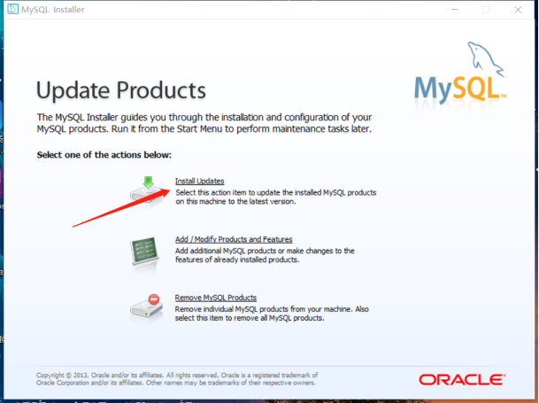

第一步勾选Iaccept 然后点击下一步 Next

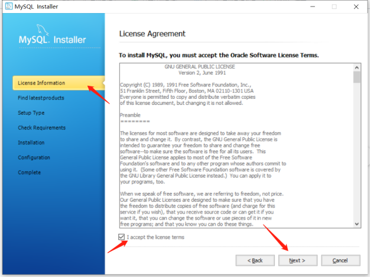

第二步勾选SKip  然后点击下一步 Next

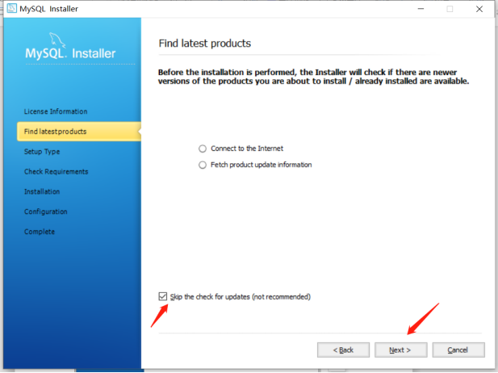

第三步选择第2个Server only然后点击下一步Next

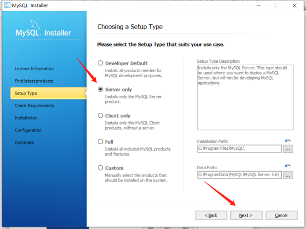

第四步点击下一步Next

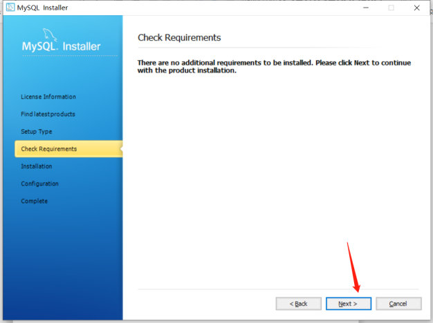

第五步点击下一步Execute

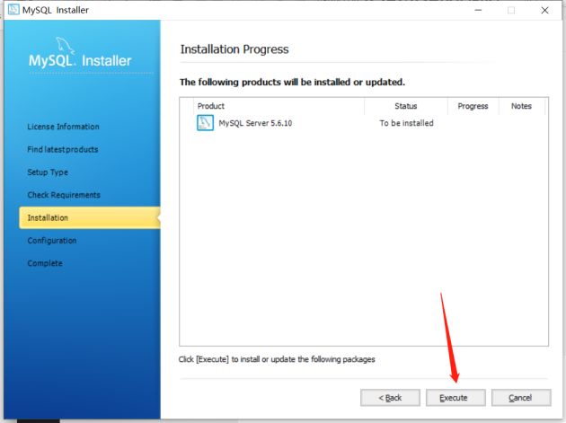

第六步端口改成3308 然后点击下一步Next

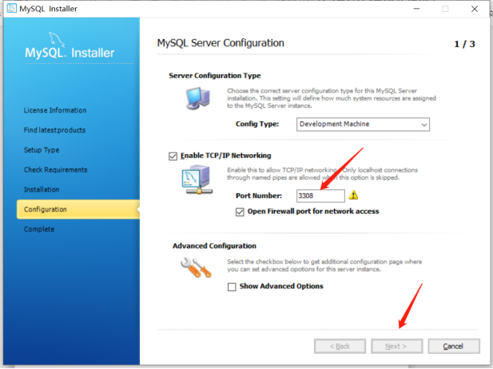

第七步密码设置成123456 然后点击下一步Next

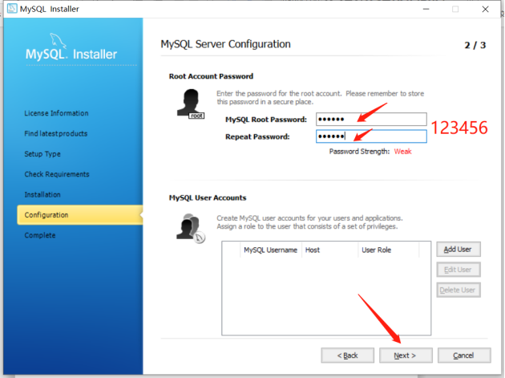

第八步点击下一步Next

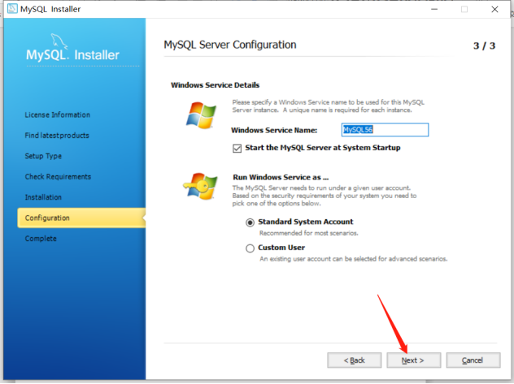

第九步点击Finish完成

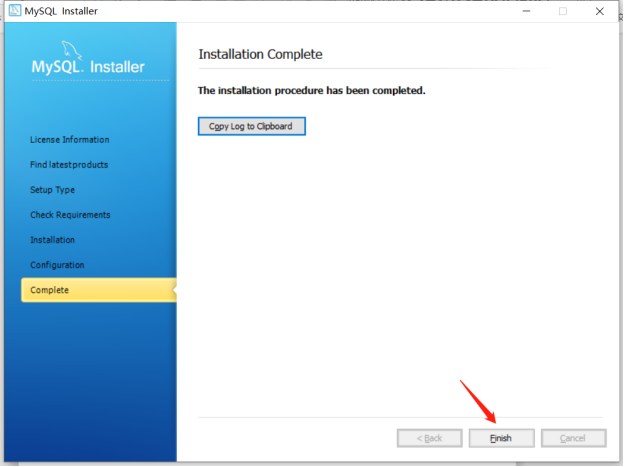

## 2.车场多台电脑的情况下  辅电脑需要连接主电脑的  才需要设置以下步骤
MySQL56数据库服务修改远程连接说明书
下载连接地址：

[https://zbytparkimg.oss-cn-shenzhen.aliyuncs.com/navicat%2Bfor%2Bmysql%2B10.0.11%E7%AE%80%E4%BD%93%E4%B8%AD%E6%96%87%E7%A0%B4%E8%A7%A3%E7%89%88.rar](https://zbytparkimg.oss-cn-shenzhen.aliyuncs.com/navicat%2Bfor%2Bmysql%2B10.0.11%E7%AE%80%E4%BD%93%E4%B8%AD%E6%96%87%E7%A0%B4%E8%A7%A3%E7%89%88.rar)

第一步：下载安装包并解压

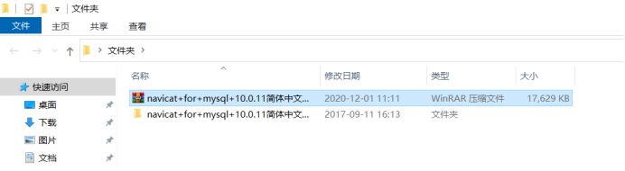

第二步：打开软件  第一次打开点试用然后就到了软件界面

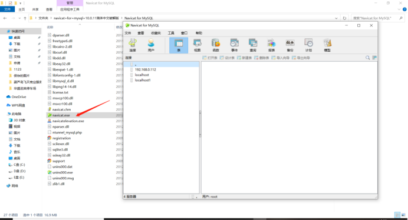

第三步：连接数据库

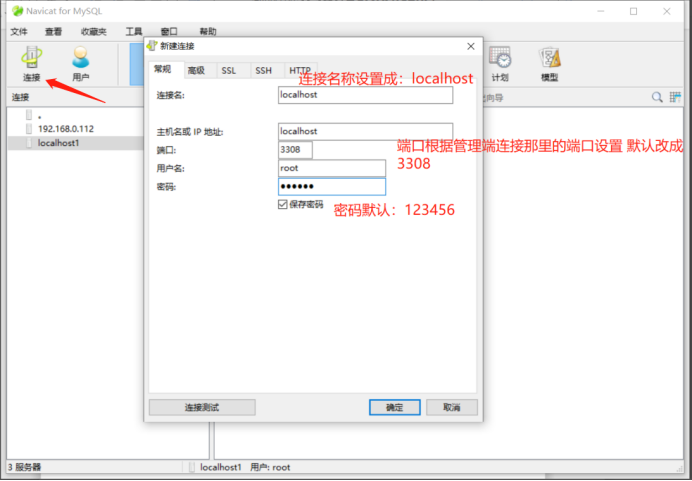

第四步：打开连接  然后打开MySQL数据库 在右击打开最后一个user表 之后点第一个打开表

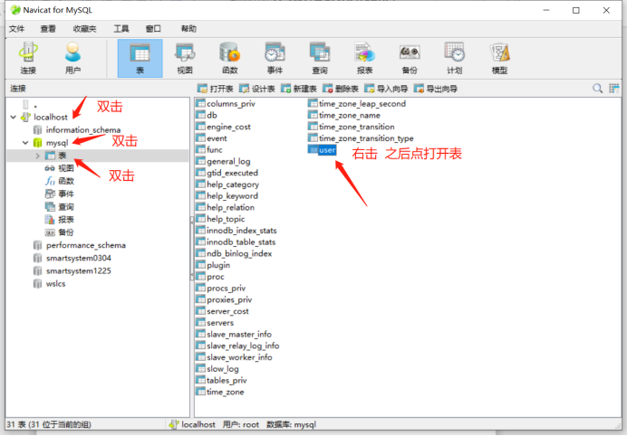

第五步:修改第三行第一个修改成% 然后点一下空白的地方就能保存

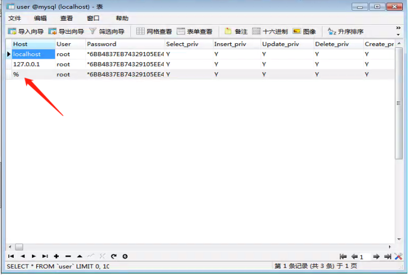

第六步：重启MySQL56的数据库服务

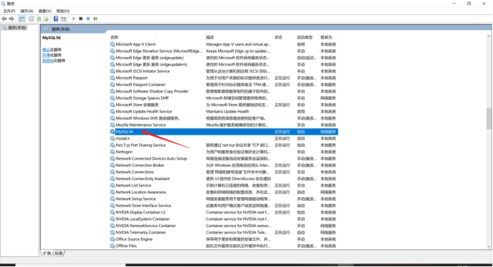

MySQL56数据库服务重启后 辅电脑就能连上主电脑的数据了
