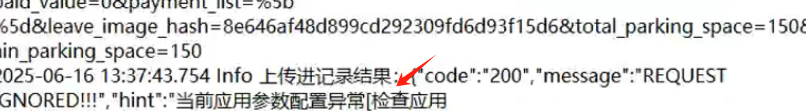
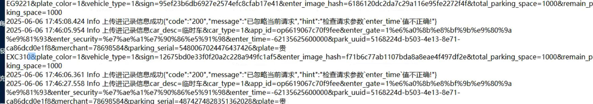

如何查询pp上传日志
1右键收费端软件，点击打开文件所在位置，点击log文件夹，在点击对应的日期在点击pp上传日志去进行查看报错日志
1提示这种的话，说明是在配置pp上传的时候参数填错了要检查一下自己填的参数是否正确是否有空格

2提示这种的话一般都是图片保存目录的问题，检查一下电脑的内存是不是满了，软件默认在d盘电脑是否有d盘如果是主副电脑的话就要检查一下是否设置了共享文件夹

、

3提示这个的话，是说明电脑的时间格式不对，需要把电脑短日期格式改成 yyyy-mm-dd

