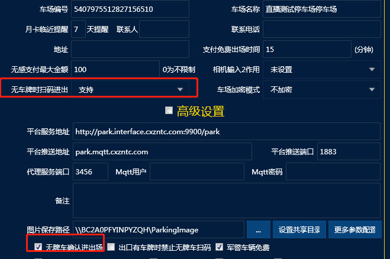

管理端车场管理这个界面

1.无牌车扫码进出（可选支持或者不支持）：选择支持的话就是可以直接扫码进出，选择不支持就是需要压地感扫码进出（选择不支持又没地感触发扫码会提示未识别到你的爱车），仅入口支持（入口直接扫码出口需要压地感扫码）

2.无牌车确认进出场：针对相机直接识别无牌车的设置，与上面扫码进出无关，勾选之后 无牌车不能直接进来 要确认放行 不勾选的话就是直接进场（就是接了地感之后，触发无牌车，你不勾这个就直接抬杆了 所以这个选项需要打勾）

问题：

1.扫码提示未识别到你的爱车 就是无牌车是否支持扫码进出 选择了不支持，但是没有压地感   所以会提示这个

2.设置不支持之后 无牌车地感一触发 就直接抬杆 不需要扫码  这个问题就是下面无牌车确认进出场没打勾
