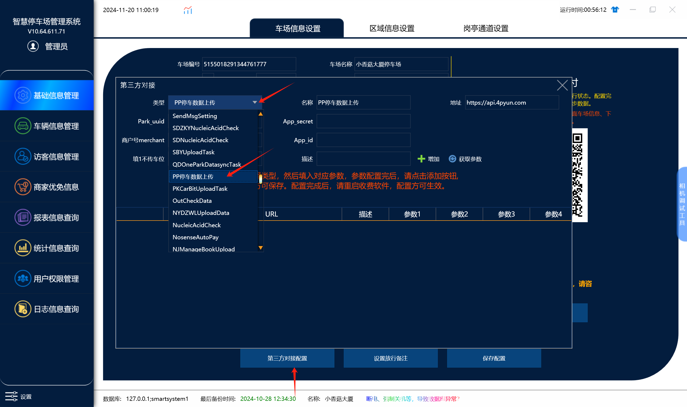
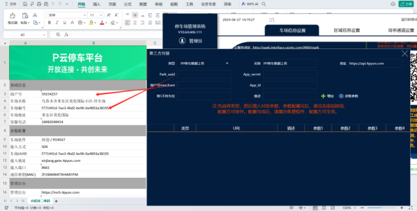
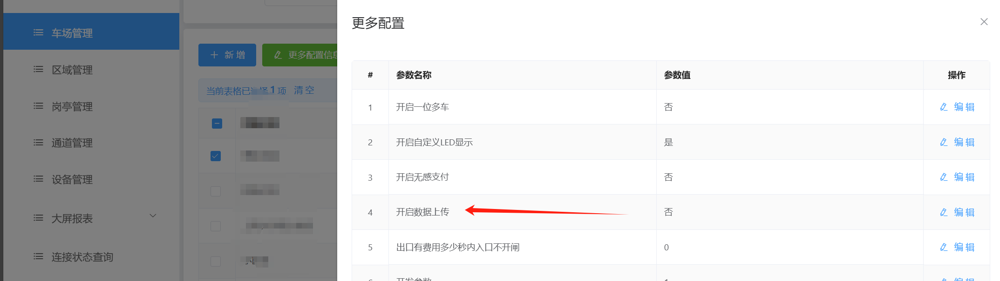
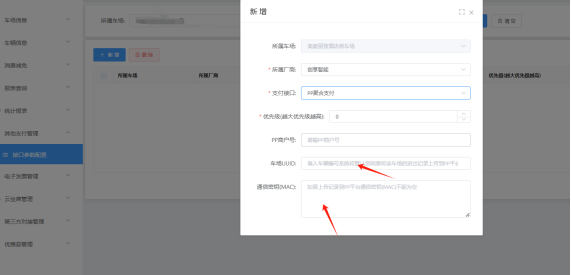

## 本地：

可以直接在软件上进行配置，如下图：

这2个参数填pp商户号文档里面的uuid和商户号

App_id和App_secrct为固定参数：

APP-id       :  op6619067c70f9fee

APP-SECRET  :  d6d3ea8f910b9a3ffadfc9e643e5912f

## 免布线：

首先在车场管理的更多配置信息里面——》开启数据上传

然后在  其他支付管理——》接口参数配置  配置支付（**填写参数时注意不要有空格**）

:::caution
图片缺失：
:::

## 注意：无论免布线还是本地车场，在配置完成后必须重新进出一台车再试支付，无牌车除外！！！