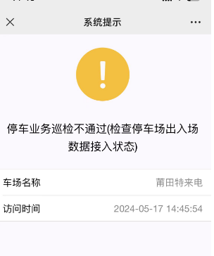
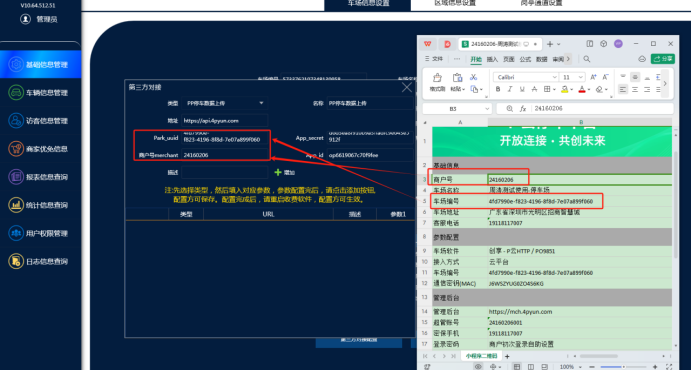
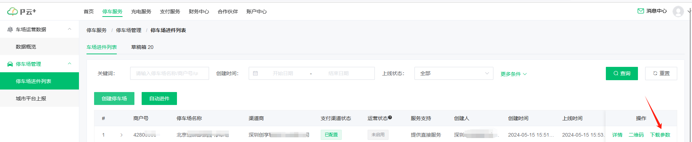

解决方案：

首先把管理软件和收费软件更新到最新版本

1. 打开管理端==》基础信息管理==》车场管理==》第三方对接配置

## 1.本地端车场上传数据

类型选择  ：PP停车数据上传

地址      ：https://api.4pyun.com （系统默认会有）

park_uuid  :  UUID (对应PP参数文档里面的UUID)

APid       :  op6619067c70f9fee

APPSECRET  :  d6d3ea8f910b9a3ffadfc9e643e5912f

商户号merchant: pp商户号（固定8位数）

对应PP文档在哪里申请的就找对应的厂商 要求提供

填好之后重启下收费软件就可以了

## 2.纯云免布线车场上传数据

车场名称和商户文档提供一下给售后，售后人员在平台上配置上传

文档在pp后台下载。

