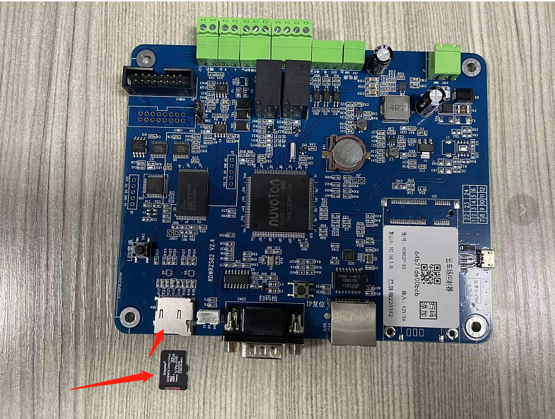

第一种：图片存在我们平台 ，因为线下软件是可以创建一个文件夹保存图片的 ，但是纯云端的车场 图片保存在平台上的话，会占用平台的储存空间，这个是需要收费的，图片存在平台上的话300/1年/1个车场 ，这个钱是阿里那边收的不是我们平台收的。

第二种：客户可以去oss买空间，然后我们可以配置上去 ，也就能储存图片了。

第三种：客户可以买个TF卡，插到板子上 ，买一个32G就可以了，就可以存好几年的的图片了，买了TF卡之后最好是插在免布线设备上，这样方便获取，如图插入TF卡方式。

