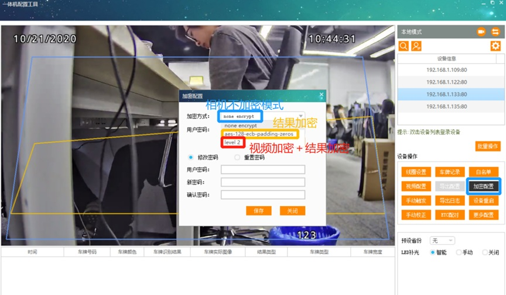
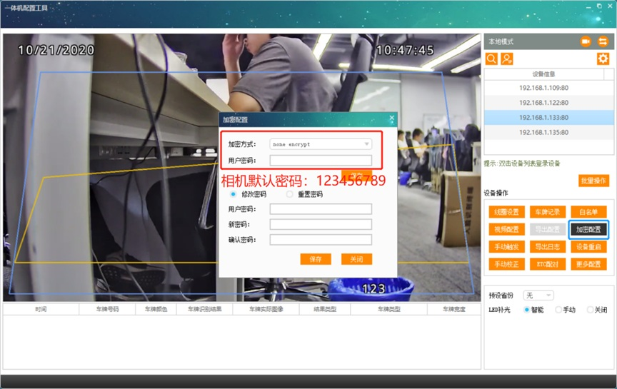

相机加密
1、None encrypt 车牌不加密

2、aes-128-ecb-padding-zeros数据加密。

3、level 2相机登录加密。

相机授权时间加密

加密的作用
1、aes-128-ecb-padding-zeros数据加密：加密车牌号，使软件接收的车牌号乱码。

2、Level2加密：给相机软件登录加密，设置完这个加密后对相机不会操作影响，但是软件登录需要这个密码，否则会出现登录失败或者软件报错出现异常。

3、相机授权时间加密：超过设置好相机授权时间后，相机不能抓拍不会有结果输出，白名单，开闸等都不能用。

如何判断是否加密
1、使用demo打开相机，提示二次登录失败，请检查用户密码是否正确可判断相机加密。

2、Demo打开相机打开加密配置，加密显示显示level2或者aes-128就是相机加密了。

3、Demo打开相机打开授权时间看是否有勾选，如果有勾选可判断相机授权时间加密了。

忘记加密密码
1、返厂

备注
相机默认密码是123456789

