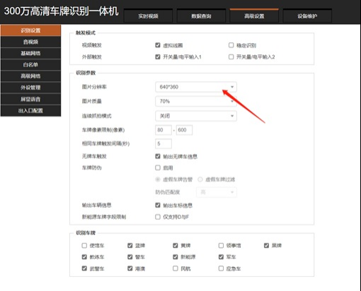
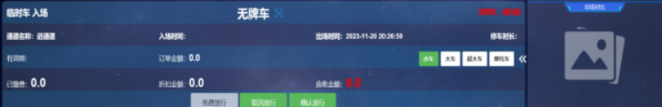
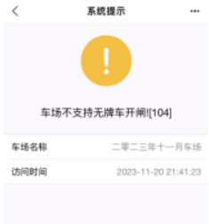
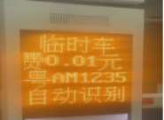
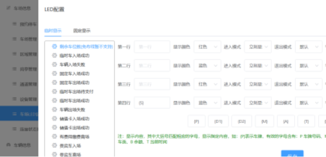

## 1、免布线车场设备所有状态都正常，就是识别车辆进出没有数据
解决方法：一般是车场类型没有授权成免布线车场（把车场名称发个技术授权），授权了的车场要把相机的图片分辨率调低

## 2、免布线车场测试     无牌车是否确认入场功能
在免布线收费系统上也还是显示需要确认才能入场，正常的情况下不勾选应该是能直接入场的。

不勾选这个功能的情况下入场也需要确认扫码入场，功能有问题  不勾选这个功能 一位多车转临停的车可以直接进场（临时车需要确认进场的情况下，月卡过期的车需要确认）

## 3、无牌车时是否支持扫码进出
3.1 勾选功能后，用微信和支付宝扫码入场
微信和支付宝通过手机无牌车扫码都可以直接入场，在免布线收费系统里面也能查到在场记录。

3.2 不勾选功能后，用微信和支付宝扫码入场
使用微信和支付宝扫码都会提示未识别到您的爱车，无法入场！

3.3 不勾选功能的情况下，勾选无牌车是否确认入场和不勾选无牌车时是否支持扫码进出的情况下，用微信和支付宝扫码入场。

微信和支付宝扫码入场都会提示这个车场不支持无牌车开闸，

**线下版本软件这种情况下是允许入场的**。

## 4、屏上显示二维码
勾选屏上显示二维码的功能，临时车粤AC1234和粤AM1234进出

勾选和不勾选屏上显示二维码的功能，临时车粤AC1234和粤AM1234进出都不会缴费显示二维码，扫下载的出口二维码支付是没问题的。

**暂时只支持科发液晶屏**。

## 5、军警车是否免费放行
军警车免费的功能勾不勾选都是没有产生费用放行出场

此功能是否启用，需要沟通，目前默认空，wj，警的免费，考虑只是增加自定义警车规则

## 6、车场LED设置
设置LED显示剩余车位

目前只支持**VZ**剩余车位显示，其他相机需要联系技术人员
