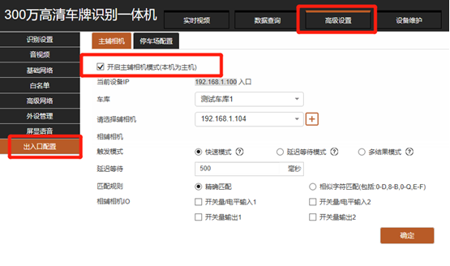
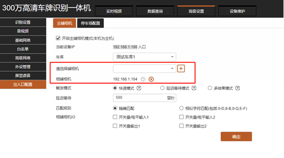
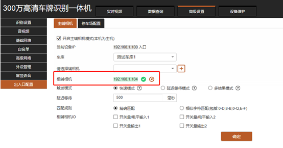

相辅相机组网，主要运用于停车场出入口车道比较宽，进出车辆的来车方向各不相同，造成的相机识别角度大，识别速度慢和识别准确率低的问题。
将两台出入口相机，分别安装在车道的左右两边，再在镜像中做如下配置：
## 2.1.开启相辅模式

**启用“相辅模式”** 后点击“确认”按钮，保存设置，辅相机的IP才能在局域网搜索出来。

**启用**“**相辅模式**”后不点击“确认”按钮，保存设置是搜索不到局域网内其它相机IP的。

## 2.2.选择辅助相机

**选择辅助相机：** 点击“下拉按钮”，选择辅助相机的IP，点击“ **+** ”添加辅助相机，点击“确定”按钮保存设置。

## 2.3.触发模式说明

**快速模式：** 相机先给抓拍结果，设定时间（延时等待时间）内相同结果不做处理（要求：延时等待时间1-3秒）

**延迟模式：** 相机抓拍后，在设定时间（延时等待时间）内等到没有不同结果，就上传单一结果。（要求：延时等待时间600毫秒）

**多结果模式：** 单台相机接入进收费软件相机抓拍的共享结果都会上传给收费软件。

## 2.4.匹配规则说明

**精准匹配：** 相机识别车牌后直接输出结果（建议使用精准匹配）

**相似字符匹配：** 允许相机识别到相似的字符进行输出（目前只有0-D、8-B、0-Q、E-F四类字符）

## 2.5.相辅IO说明

**相辅相机IO：** 指两台相机之间，只需一台相机连接道闸或地感，两台相辅共享控制道闸或地感输出的内容。

## 2.6.组网验证

