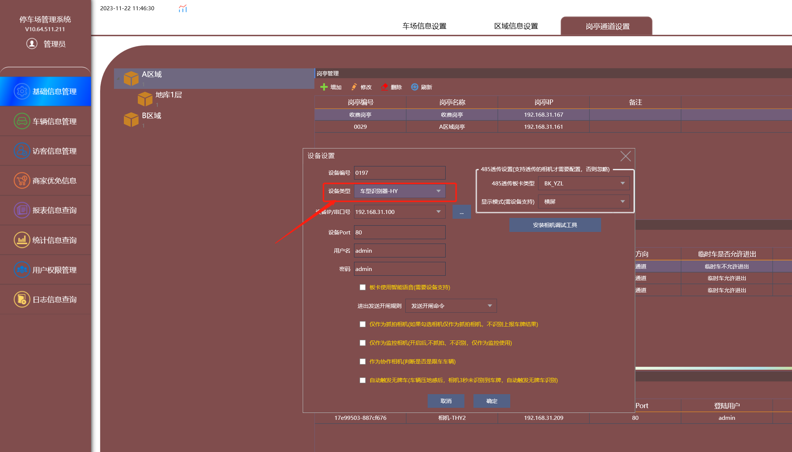
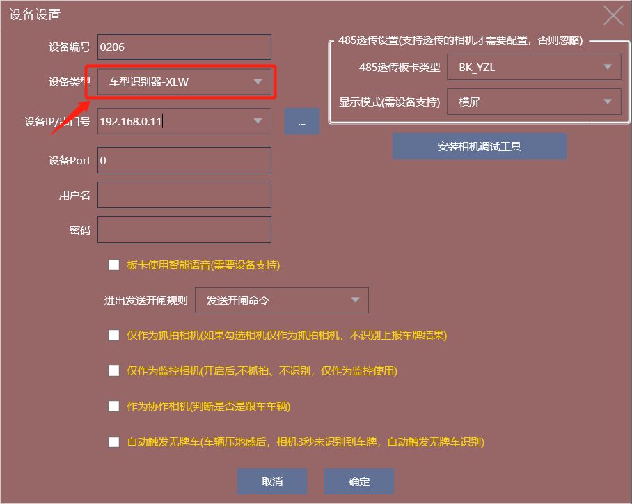
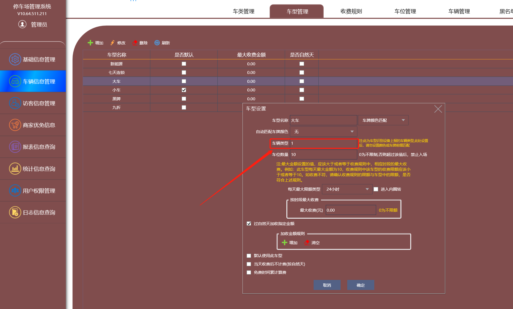
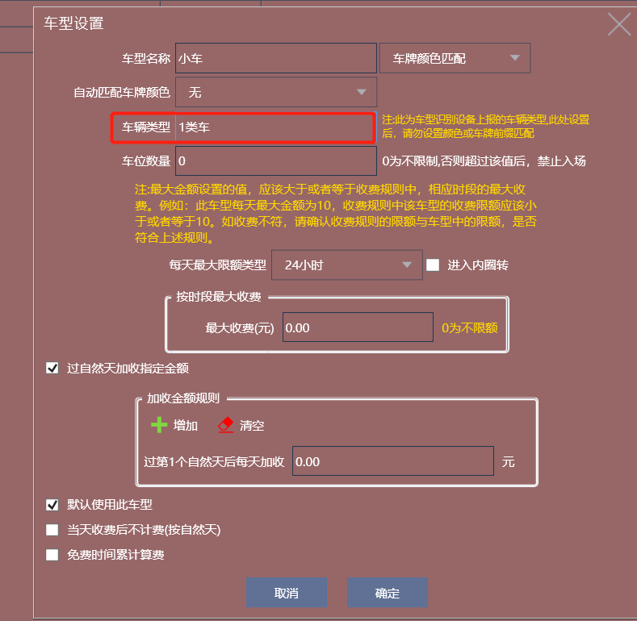

设备位置安装调试好。

1、在通道下面添加对应的设备，设备类型选（**车型识别器-HY**VZ相机）、（ **车型识别器-XLW信路威相机）** .

2、车型里面设置车型，比如相机识别的大车是“ 1 ”类车，那我们在车型管理的大车车辆类型就填 1，相机识别是什么数值车辆类型就对应填好。（VZ相机识纯数字）

信路威识别的是“1类车”，就在车辆类型直接填1类车

注：设置了车辆类型，里面的按车牌颜色匹配或车牌前缀匹配就不能设置了。

3、按照对应车型设置收费规则，这样系统就会自动匹配车型来计费了。
