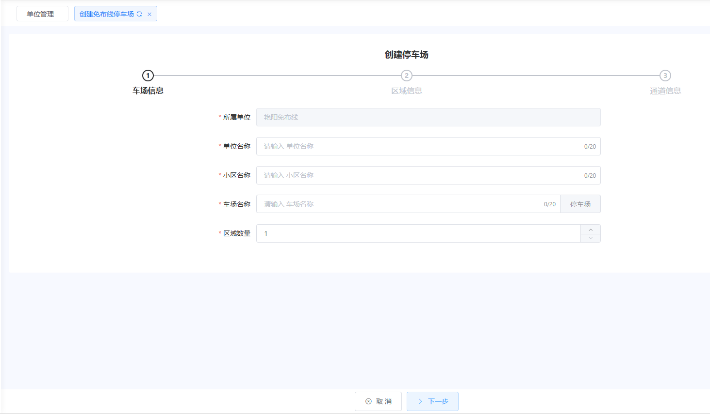
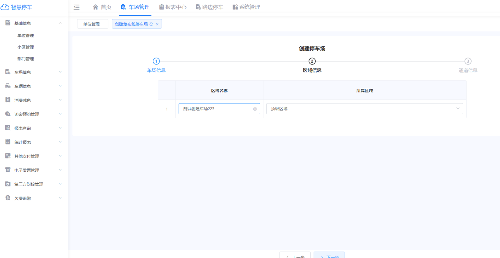
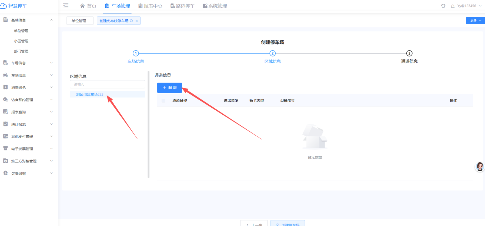
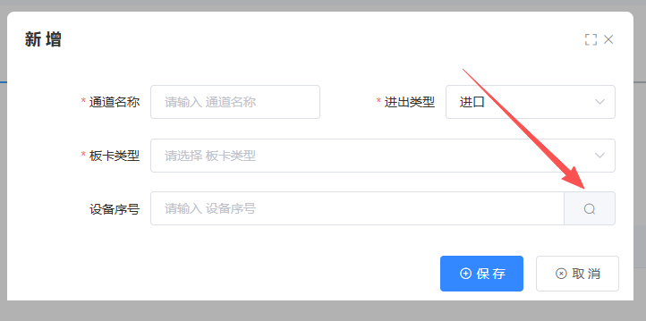
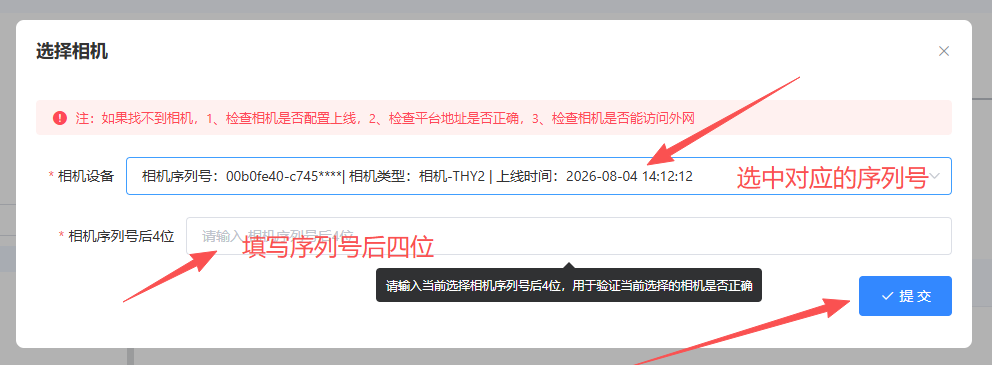
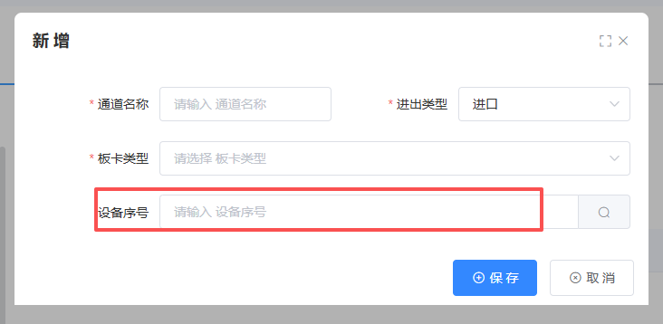
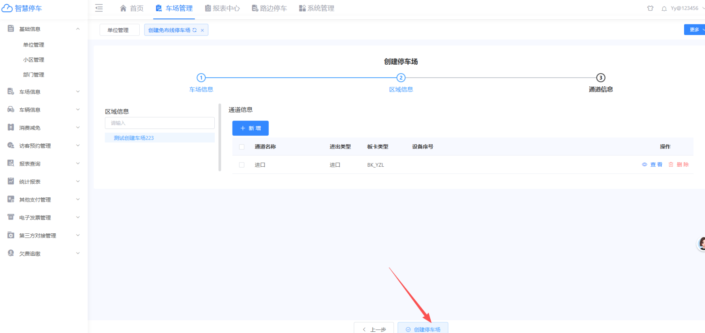

## 1.首先勾选对应单位点击创建免布线车场

## 2.填写对应参数  点击下一步（注意：名称不能与系统中的名称重复）

## 3.填写区域名称  点击下一步

## 4.选择对应区域  新增通道信息

## 5.填写通道信息以及设备信息，设备序号可以直接点击搜索

## 6.根据相机序列号  选择对应设备  然后填入相机序列号后四位  点击提交

如果相机还没有上云，可以直接填写相机序列号或者不填

## 7.添加完设备之后，就可以点击创建车场了

