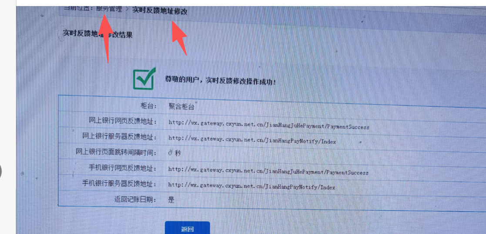
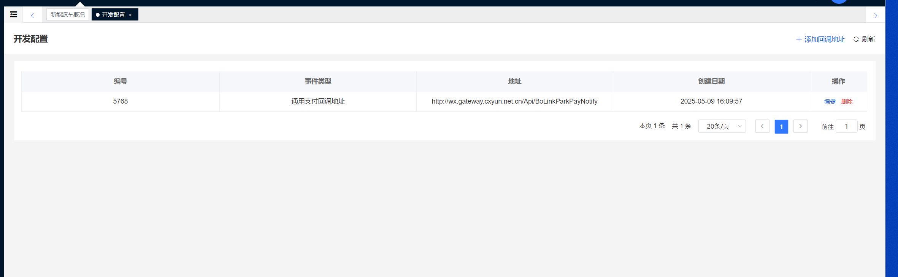

## 1.建行支付和泊链支付都需要格外配置一下回调地址，没有配置的情况下会导致支付成功不会发送开闸命令
###### 1.建行支付配置：
配置参数：
建行支付通知回调地址：
网上银行网页反馈地址：http://wx.gateway.cxyun.net.cn/JianHangJuHePayment/PaymentSuccess
网上银行服务器反馈地址：http://wx.gateway.cxyun.net.cn/JianHangPayNotify/Index
手机银行网页反馈地址：http://wx.gateway.cxyun.net.cn/JianHangJuHePayment/PaymentSuccess
手机银行服务器反馈地址：http://wx.gateway.cxyun.net.cn/JianHangPayNotify/Index

泊链支付通知回调地址：
配置参数：
方式二   通用支付回调地址：http://wx.gateway.cxyun.net.cn/Api/BoLinkParkPayNotify

在开发配置里面添加：（通用支付回调地址）
