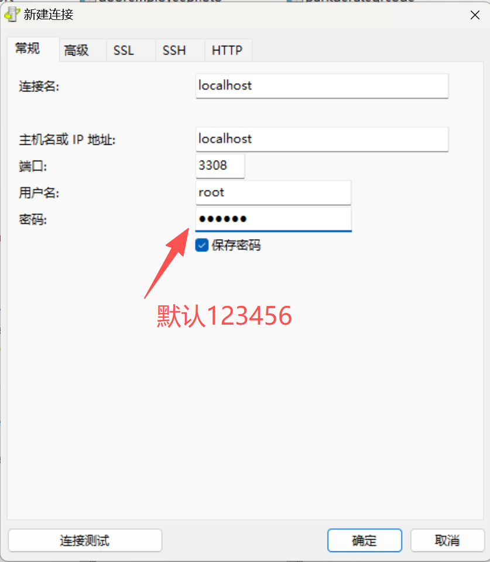
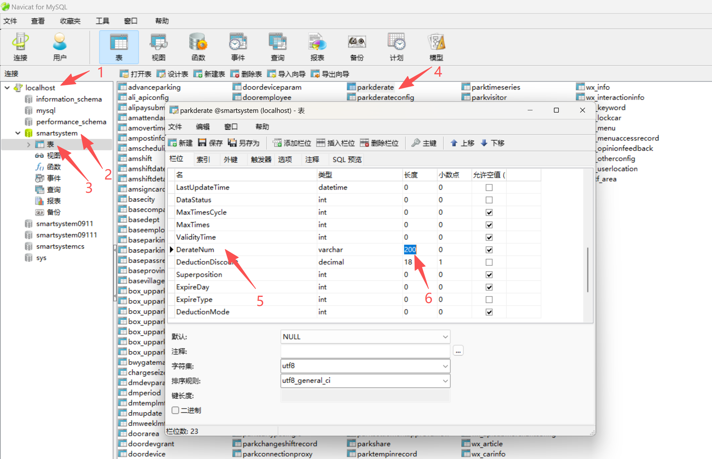

第一种处理方案：收费端打开代理服务器连上的情况下，在平台上修改保存一下减免规则就能同步到软件上
第二种处理方案：如果第一种方案没有解决，可能是添加的减免时间这种规则，添加的时段过多，可以在数据库里面修改减免规则这个可保存时段的长度。

在数据库里面操作 首先连上数据库

在表里面：搜索parkderate 然后右键设计表：找到DerateNum  长度改成200 然后保存一下
 最后在到车场平台上修改保存一下减免规则就能同步到软件上