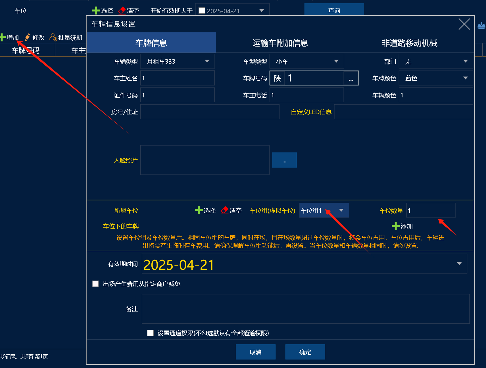
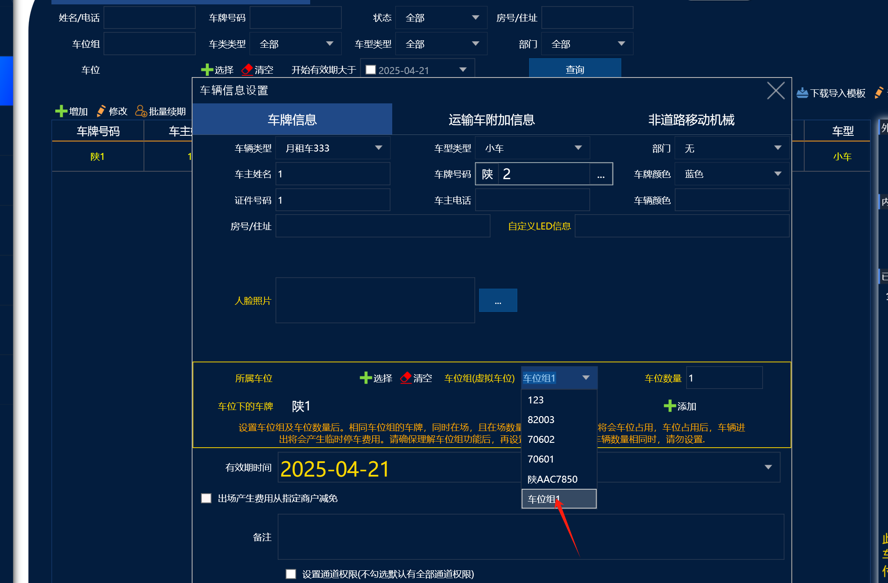
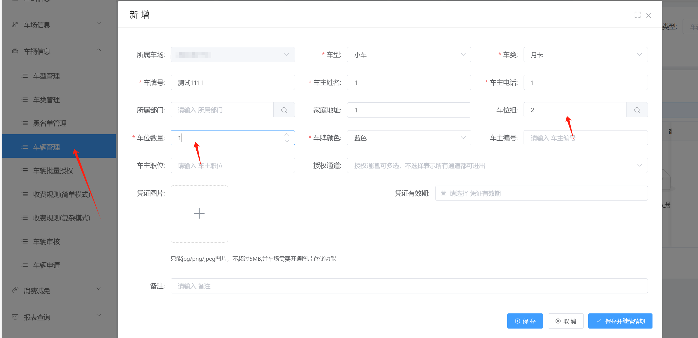
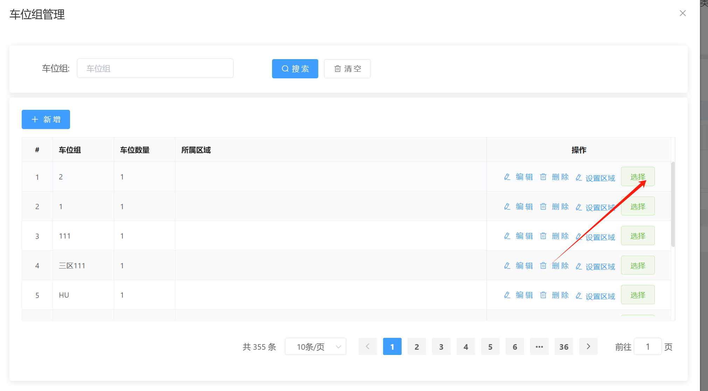
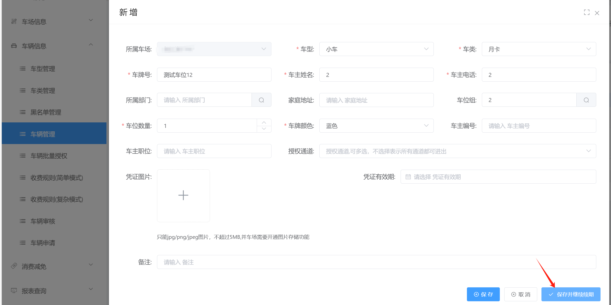

### 本地
1添加月卡的时候在车位组虚拟车位这里添加车位组，客户有几个车位就填几
2添加第二辆车的时候直接在虚拟车位哪里去选择对应的车位组进行绑定就好啦
3注意：添加车位数量的时候要注意，车主续期的时候是按照车位数量来的哦，比如一个月是300，两个车位一个月就是600

## 纯云

1 点击新增月卡，输入对应的车牌信息后，第一辆车先输入车位组，设置好对应的车位数量
2添加第二辆月卡的时候，点击搜索，在选择对应的车位，点击选择  然后保存就好啦
3注意：添加车位数量的时候要注意，车主续期的时候是按照车位数量来的哦，比如一个月是300，两个车位一个月就是600

