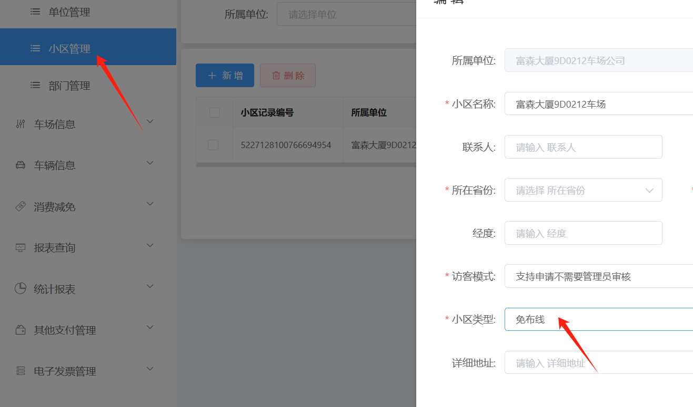
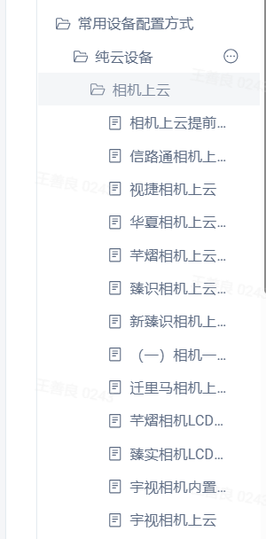
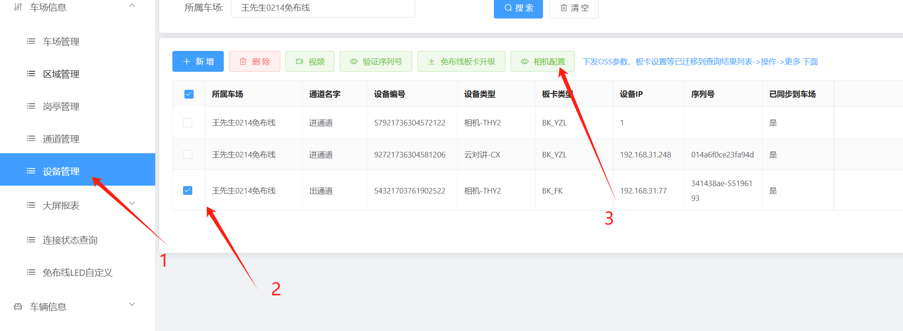
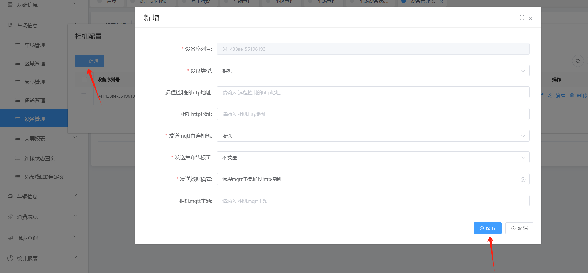
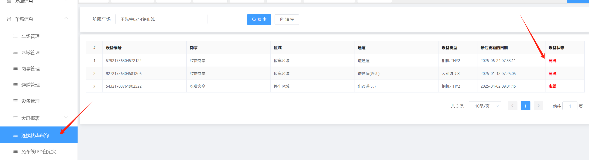
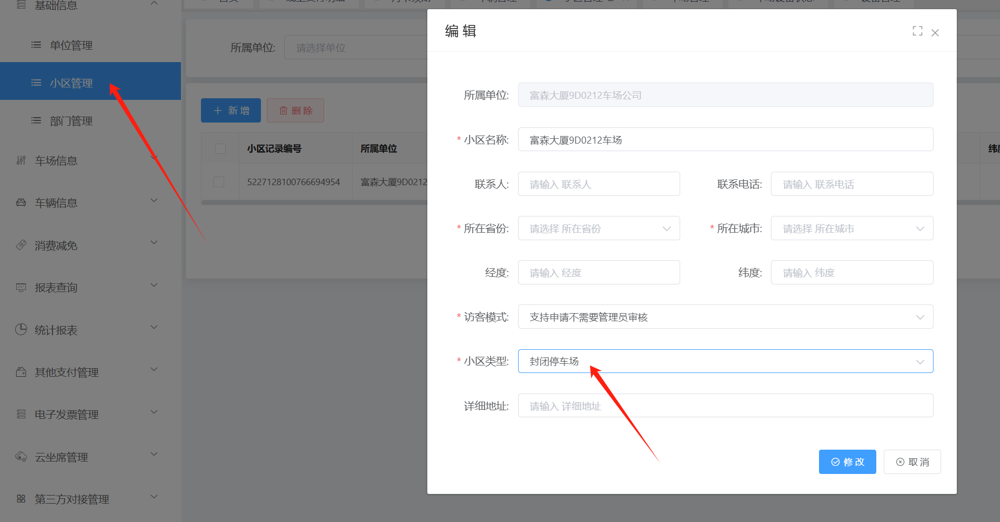
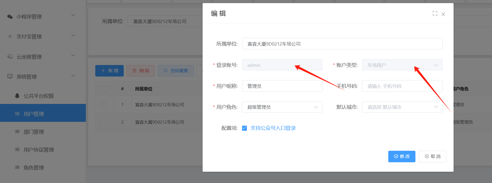
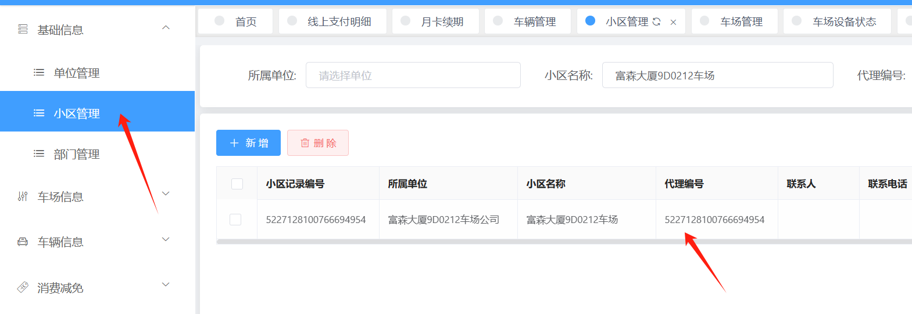

## 一.本地端安装软件的车场切换成纯云免布线车场方案

### 第一步：在平台上小区管理里面修改车场类型，改成免布线车场是纯云车场的类型

### 第二步：相机配置mqtt上云（不同相机在按对应的说明书配置上云）

### 第三步：相机配置上云后，本地端收费端软件就不需要打开了，然后在设备管理里面点击相机配置，添加一下相机的上云，然后检查其他参数是否错误，要确保设备连接状态里面相机是在线的才行

### 第四步：这个相机配��，直接新增然后保存，之后就能查询设备状态了，设备在线就能正常当（纯云车场）使用了

## 二.纯云车场切换成本地端软件车场方案

### 第一步：在小区管理里面把免布线车场类型改成封闭式停车场类型

### 第二步：在浏览器里面打开相机 删除相机上云设置的mqtt设置

### 第三步：在平台上用户管理里面给这个车场单位创建一个admin的车场用户

### 第四步：在电脑上下载软件安装，创建数据库后选第2个从平台恢复数据，然后填写小区管理里面的代理编码去恢复数据

### 第五步：在管理端软件上登入admin的账号和密码，进入软件后在用户管理里面给admin账号绑定一个角色，角色在授权全部的功能权限，然后在打开收费端软件连接设备就行了
