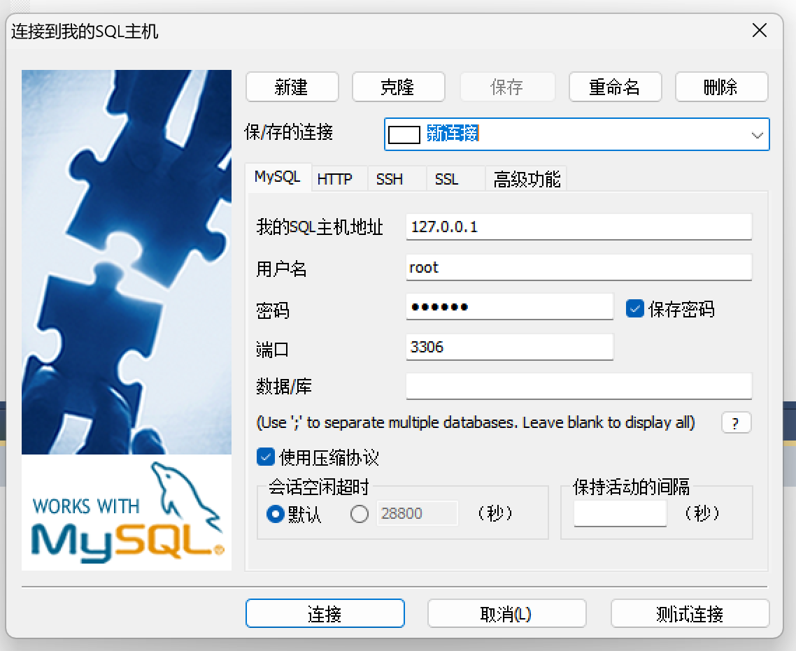
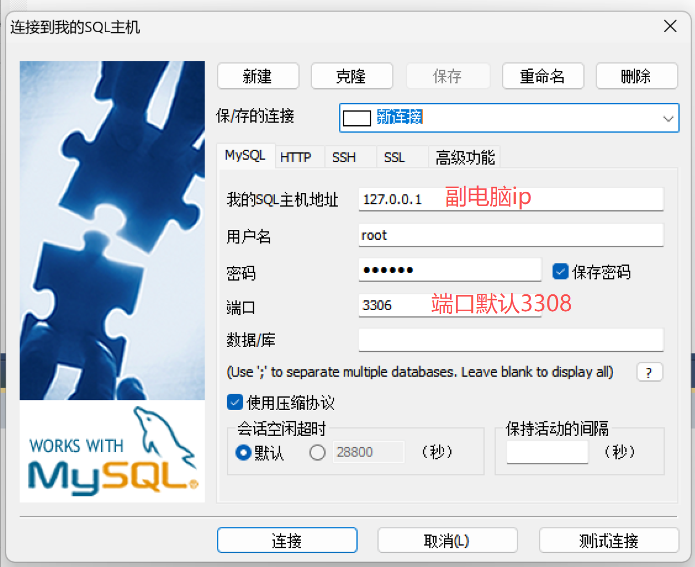
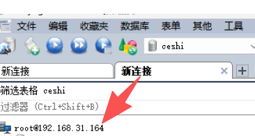
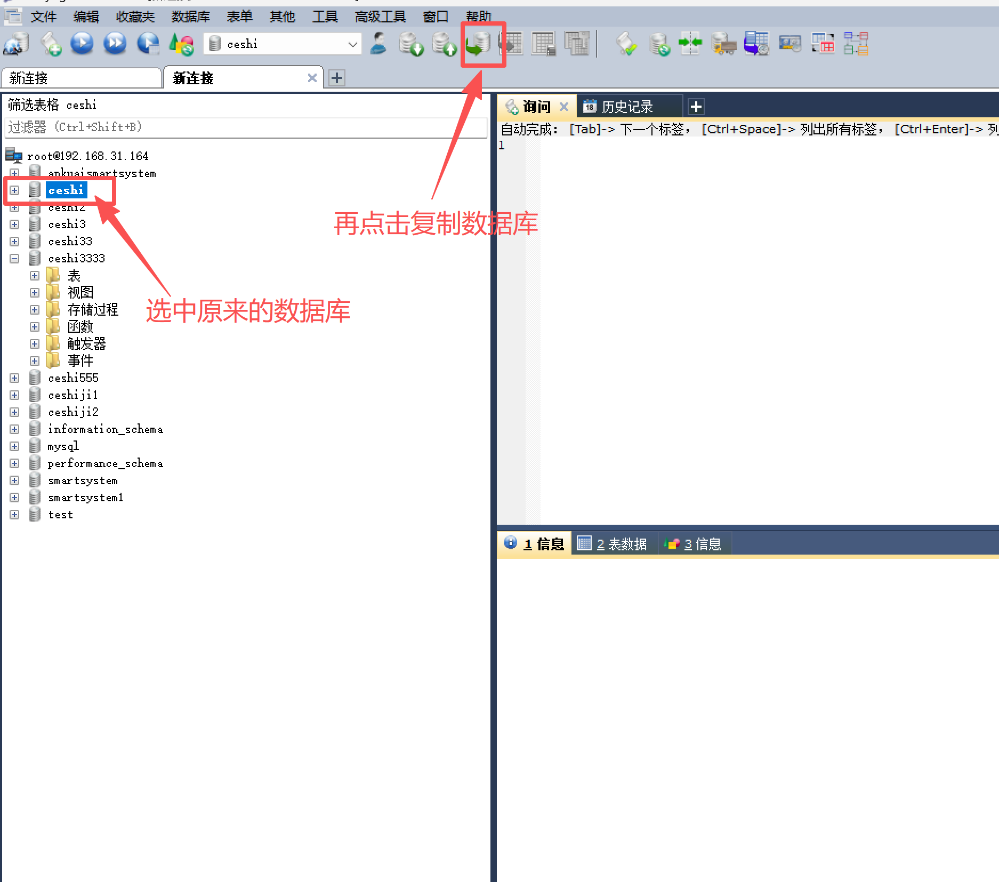
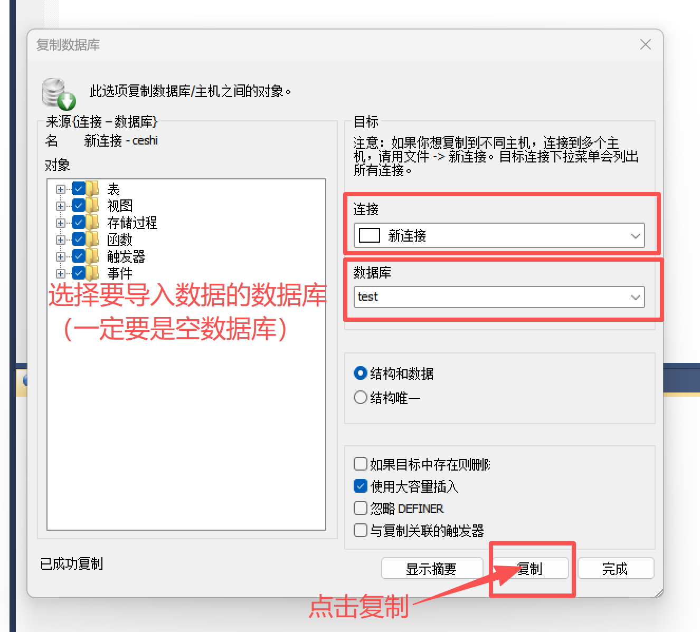
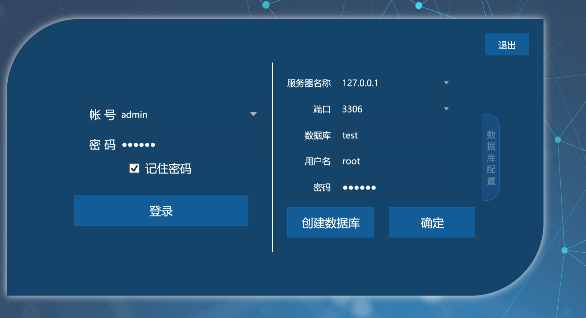

先下载MySQL工具
名称：ddooo
证书秘钥：8d8120df-a5c3-4989-8f47-5afc79c56e7c
建立连接前要把电脑的防火墙关掉
1.新建连接，先连接原电脑的数据库

2.在新建一个连接，连接副电脑的数据库，如果是自带的mysqlcx的数据库服务只需要关闭新电脑的防火墙就能连上数据库（注意：如果是安装的mysql56的数据库，需要在新电脑上数据库里面用户表里面一个参数改成%，然后重启新电脑上的数据库服务，这样才能在原电脑上新建连接的时候链接上新电脑的数据库）

3.连上第新电脑的数据库后右击名称创建一个空的数据库

4.迁移数据

5.软件上选择已经复制好的数据库就好了

