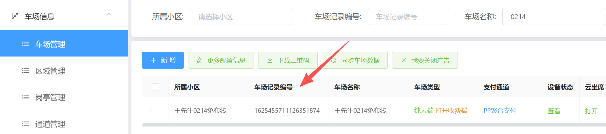
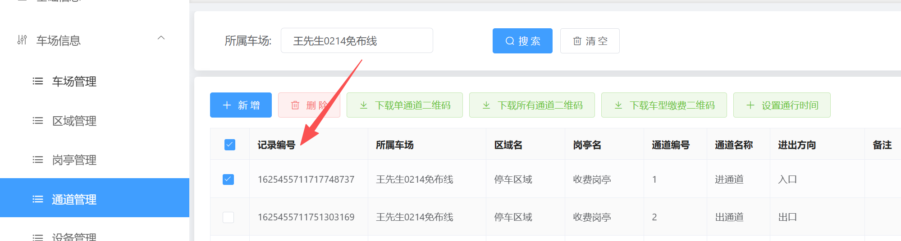
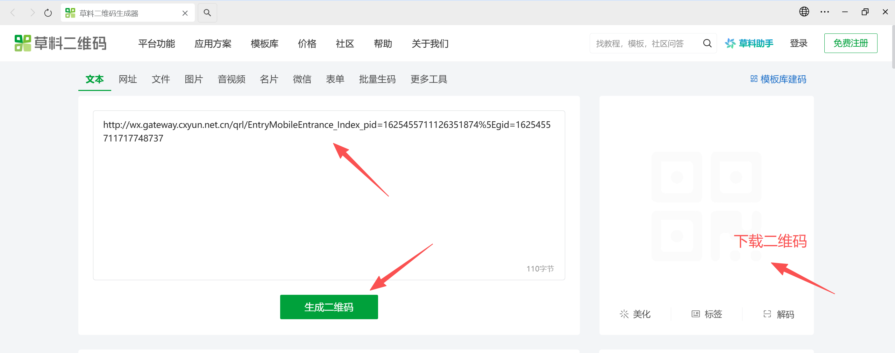

**入口登记二维码连接**：http://wx.gateway.cxyun.net.cn/qrl/EntryMobileEntrance_Index_pid=车场记录编号%5Egid=通道记录编号
车场记录编号在平台上车场管理里面查看

通道记录编号在通道管理里面查看

然后复制入口二维码连接把车场记录编号和通道记录编号修改
http://wx.gateway.cxyun.net.cn/qrl/EntryMobileEntrance_Index_pid=1625455711126351874%5Egid=1625455711717748737

**二维码生成地址：**https://cli.im/

通过这个工具 把地址复制进去生成二维码 随后下载二维码扫码就行了