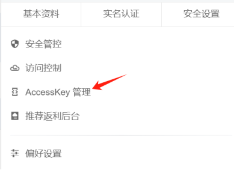
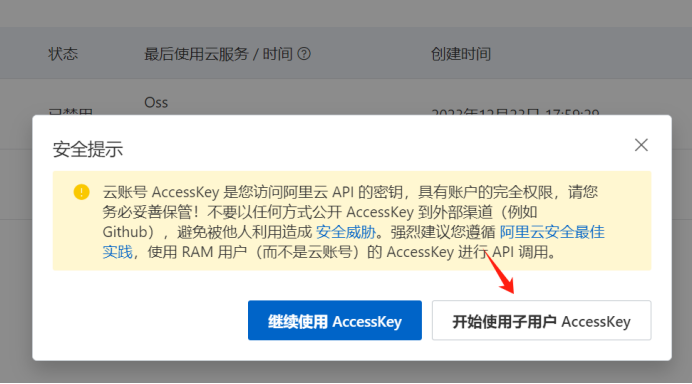
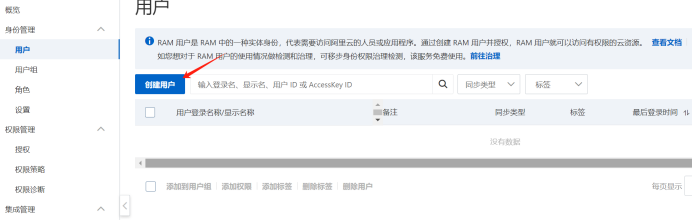
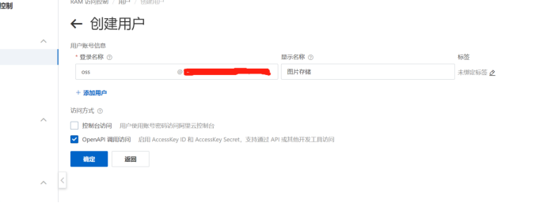
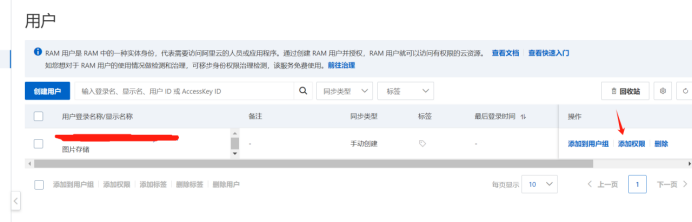
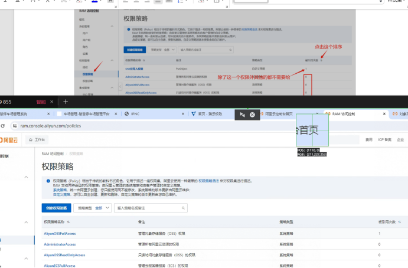

## 1、登录阿里云控制台：https://account.aliyun.com/login/login.htm

## 2、选择

## 3、选择开始使用子用户

如下图可尝试选择：“继续使用AccessKey”，如果列表中间有值，由于权限很高在没有特殊情况下建议禁用

## 4、选择“开始使用子用户AccessKey”

## 5、创建用户

## 6、填写用户信息，登录名称显示名称可以自定义

## 7、添加权限

添加AliyunOSSFullAccess权限就可以了

