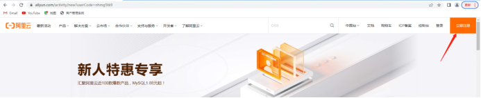
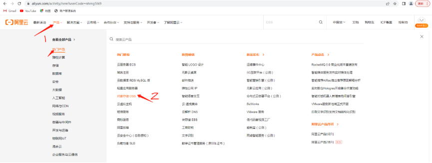
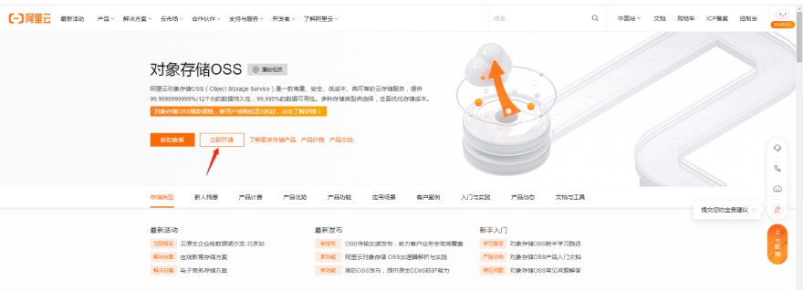
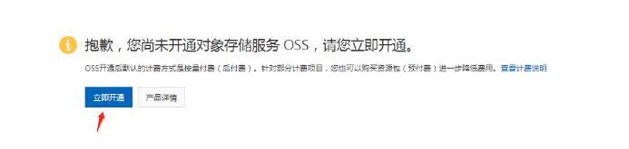
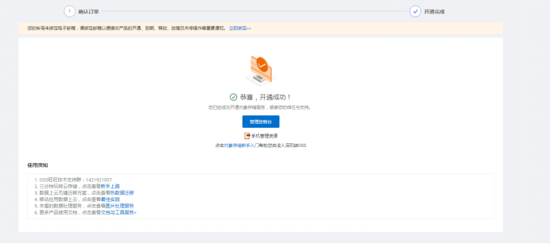
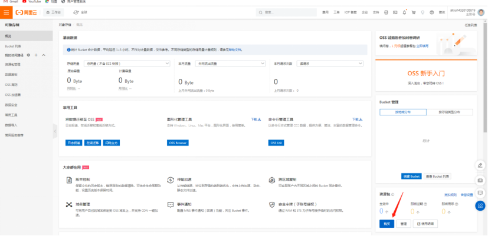
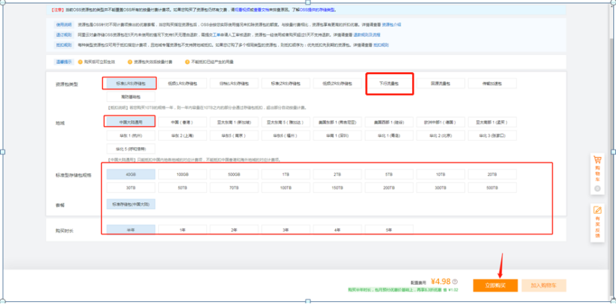

## 1.先去阿里云注册一个账号，直接手机号码注册就可以

实名认证用个人或者企业，个人选择支付宝直接授权即可

https://www.aliyun.com/activity/new?userCode=nhmg5tk9

## 2.购买oss

## 3.购买资源包

资源包类型选标准（LRS）储存包 地域选择中国大陆通用就可以  下面规格时长按照实际选择   然后再购买对应的下行流量包