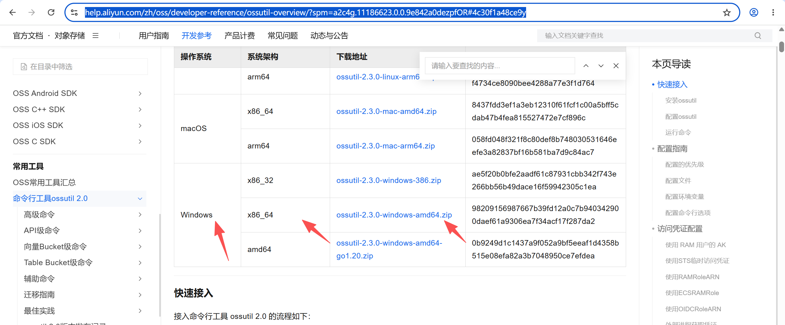
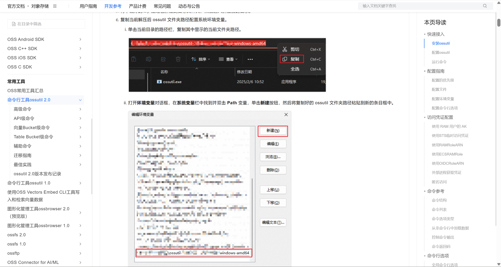
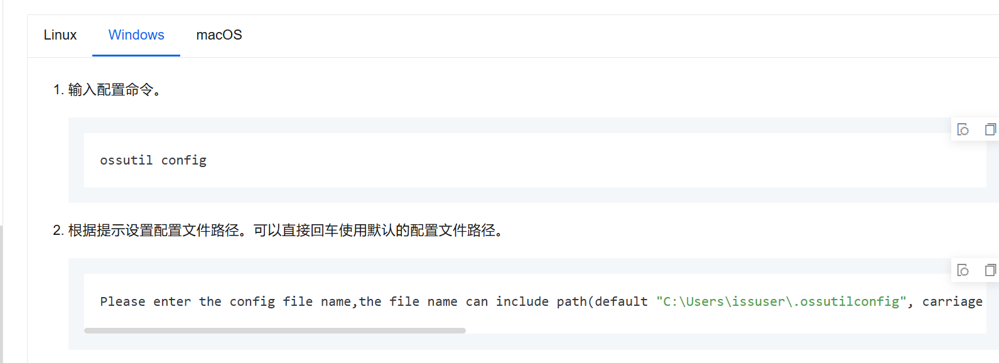
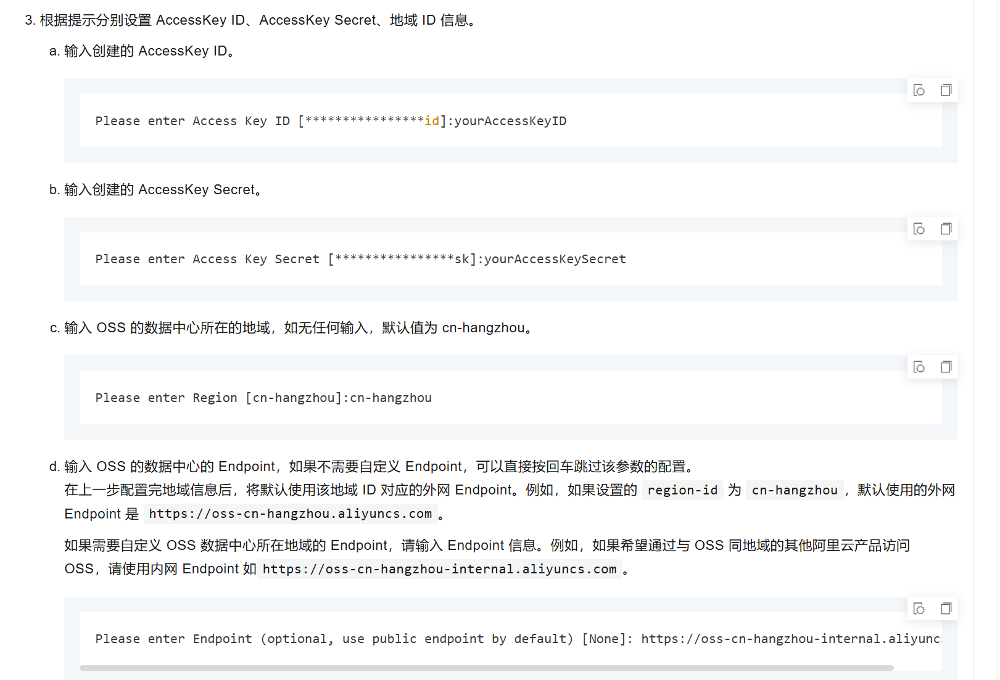
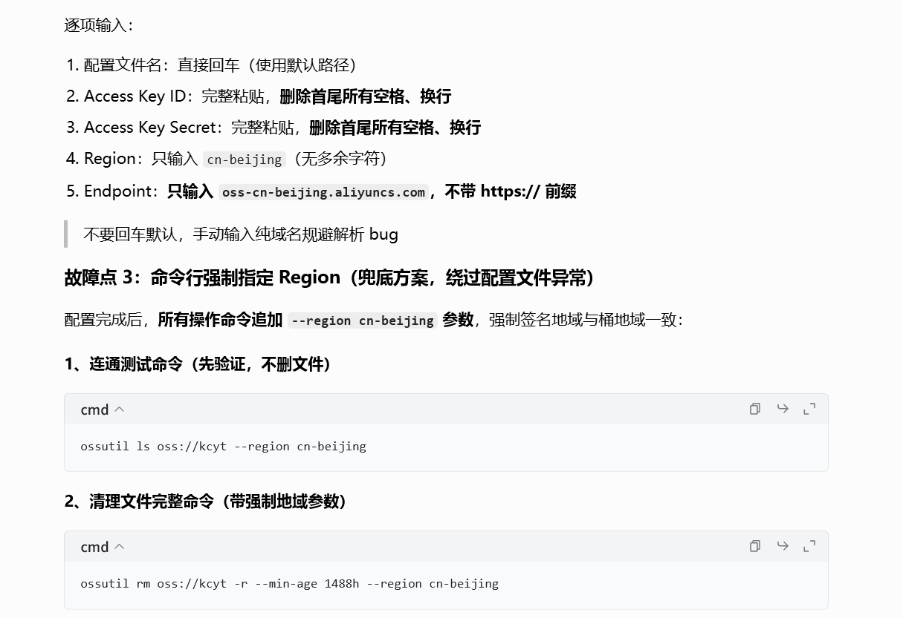

说明书：https://help.aliyun.com/zh/oss/developer-reference/ossutil-overview/?spm=a2c4g.11186623.0.0.9e842a0dezpfOR#4c30f1a48ce9y

第一步：下载命令行工具ossutil 2.0程序

第二步:解压

复制路径，打开环境变量对话框，在系统变量栏中找到并双击Path变量，单击新建按钮，然后将复制好的ossutil文件夹路径粘贴到新的条目框中。
第三步：登入阿里云
电脑上打开运行：cmd

第四步：运行代码删除图片
打开包代码：ossutil ls oss://xjyboss
回车后按 ctrl+C 结束
然后输入删除代码清理图片
删除代码：ossutil rm oss://xjyboss  --min-age 168h -r
168h=7天，这条代码的意思删除数据只保留7天的图片