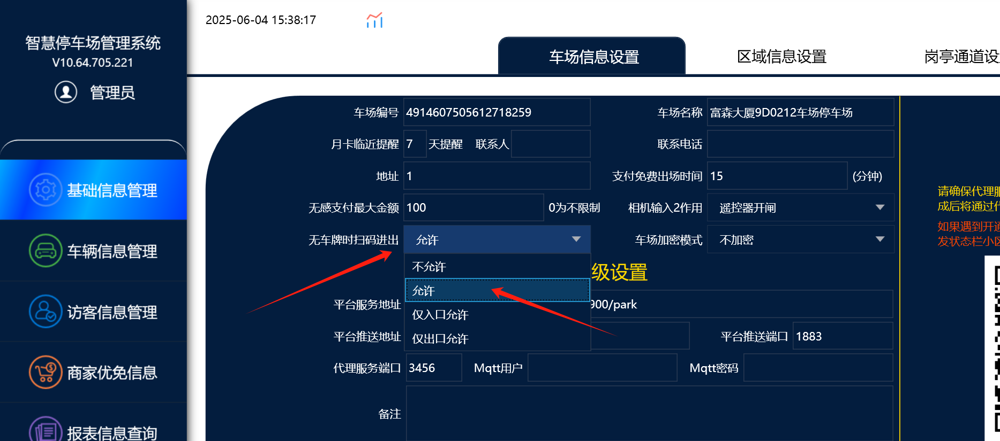
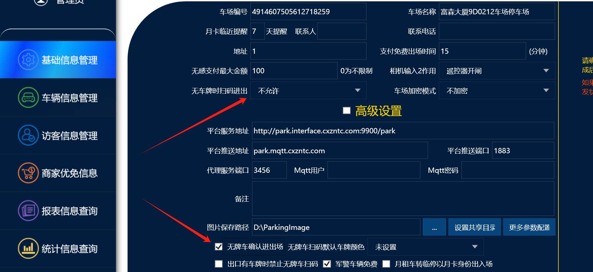
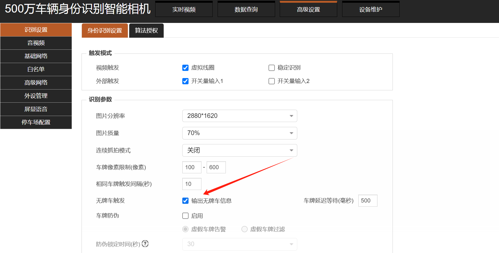
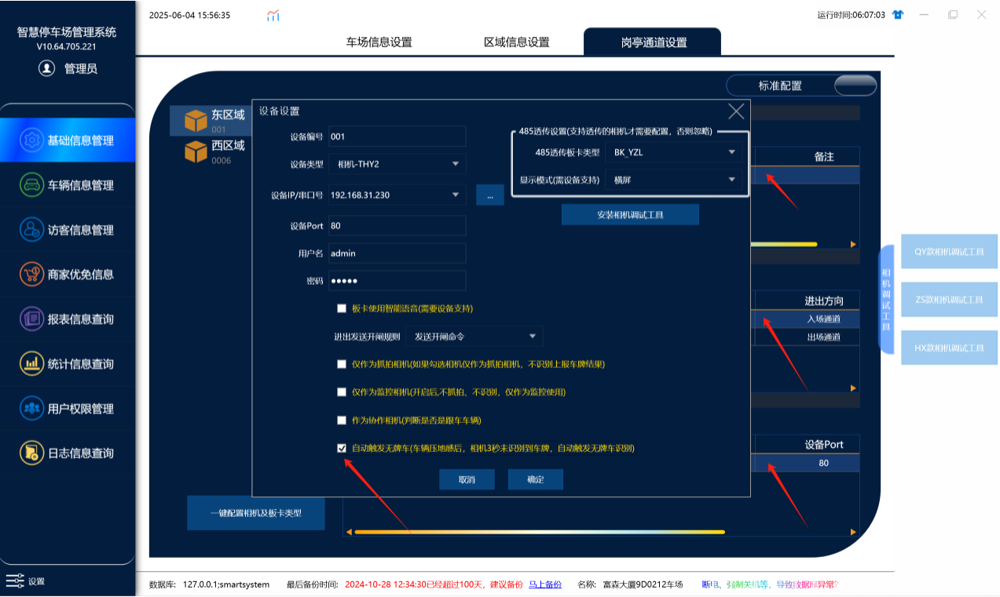
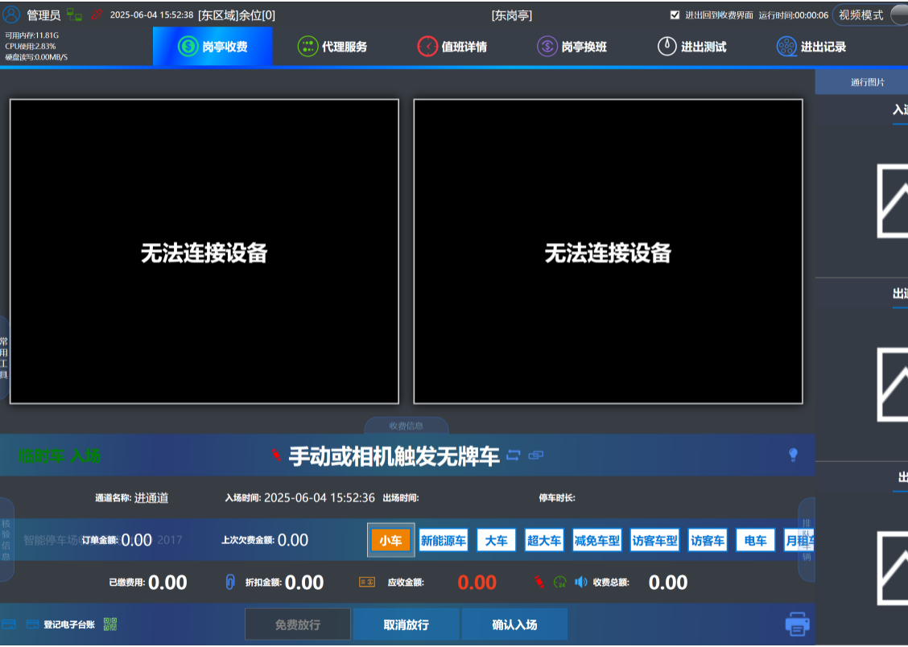

## 无牌车扫码进出有2种情况下，通道有车或者无车时是否允许扫码进出

### 1.通道无车时

#### 这里设置允许的情况下，就是代表不管该通道有没有车的情况下 车主都能扫码触发无牌车进出
#### 不允许：不允许的意思是进出口通道没车的情况下，不能直接扫码触发无牌车进出

#### 仅入口允许：意思是通道没车的情况下只能直接扫进口二维码入场，出口二维码不能直接扫码触发无牌车出场，需要通道有车触发无牌车的事件后才能扫码出场

#### 仅出口允许：同理只能出口没车的情况下可以扫码直接触发无牌车出场，进口就需要车触发无牌车的事件，任何才能扫码入场

### 2.通道有车时（需要车先触发无牌车的事件，触发无牌车事件有2种方式）

#### 首先需要在软件上设置不允许直接扫码进出和勾选无牌车确认进出场的功能

#### 第一种方式：相机触发无牌车事件，然后无牌车在确认入场的情况下，车主在扫码入场

##### 在相机里面勾选输出无牌车信息，这样相机在识别到无牌车后，会上传一条无牌车的入场信息到软件上，无牌车在确认入场的情况下，车主在扫码入场

##### 如图所示：相机识别到无牌车后，触发一条无牌车的入场事件，无牌车在软件上确认入场的情况下，这种情况车主才能扫码入场

#### 第二种方式：车压地感线圈，通过软件触发无牌车入场事件

##### 在软件上设备管理里面勾选自动触发无牌车的这个功能，这样就是车压地感后，相机3秒未识别到车牌，就会自动触发一个无牌车的事件记录

##### 然后无牌车在收费端软件上确认入场的情况下，车主扫扫码入场。
