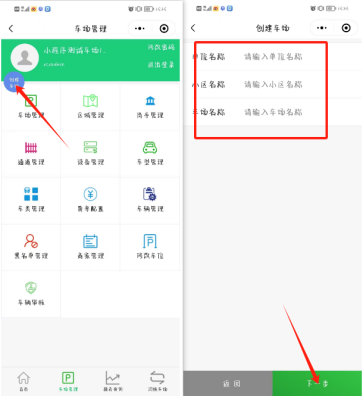
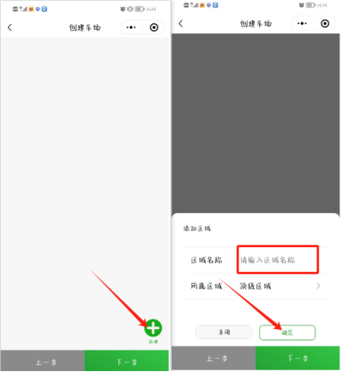
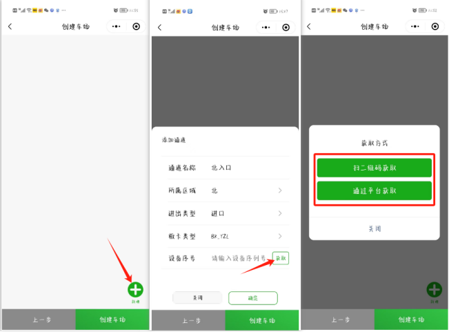
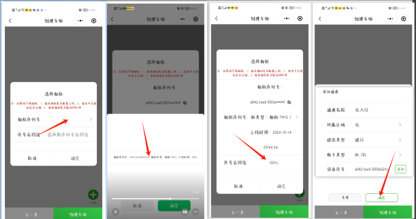

## 小程序一键上云
点击创建车场创建车场

具体步骤如下图

### 第一步输入对应  单位小区以及车场名称信息  点击下一步
:::caution
图片缺失：
:::

### 第二步  添加区域信息（可以添加多个）如果有下级区域，可以先创建上级区域，然后创建下级区域时  所属区域选择对应上级区域

### 第三步输入对应通道信息  以及设备基础信息，点击获取（两种添加序列号的方式）

（1）第一种方式直接通过扫描相机的序列号二维码获取
（2）第二种方式通过平台去获取二维码（选择对应设备序列号，然后输入序列号后四位点击确认）

### 最后点击创建车场