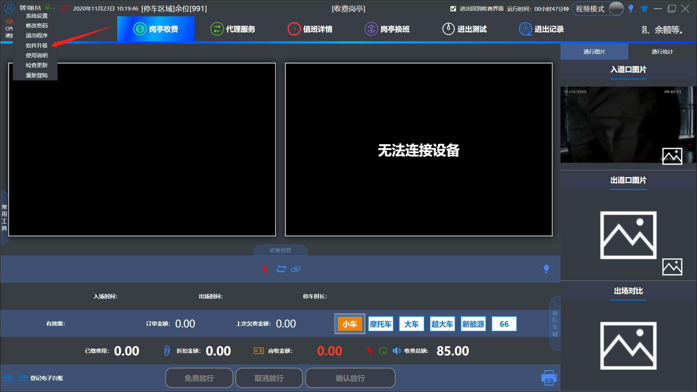
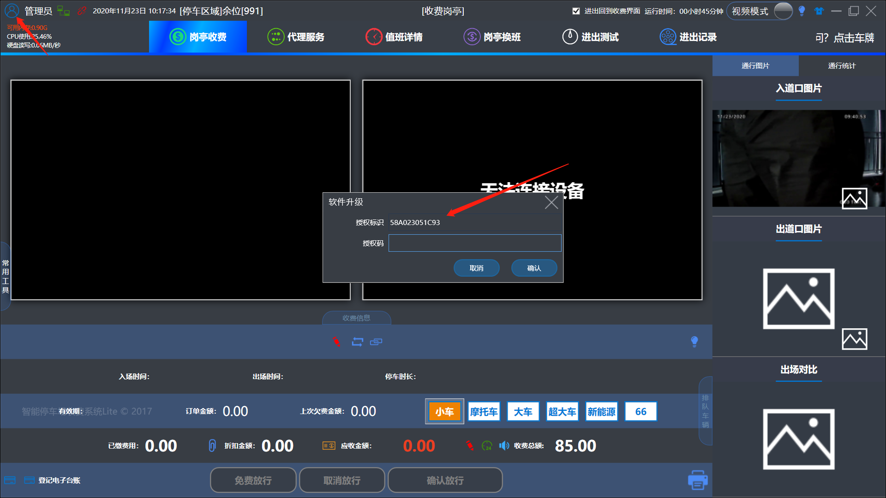

# ETC开通流程

## 1. **纯天线模式：**

### 第一步：获取软件授权

#### 一．收费端系统设置软件升级把授权标识发过来

#### 二．然后我们这边会根据授权标识生成一个授权码返回给你，然后你填入授权编码并升级

### 第二步：把管理端上的车场名称提供给我们,我们这边需要在平台上面开通并授权

## 2. **盒子模式**

### 一．收费端系统设置软件升级把授权标识发过来

### 二．我们这边会根据授权标识生成一个授权码返回给你然后你填入授权编码并升级

