# 迪虎语音对讲配置说明

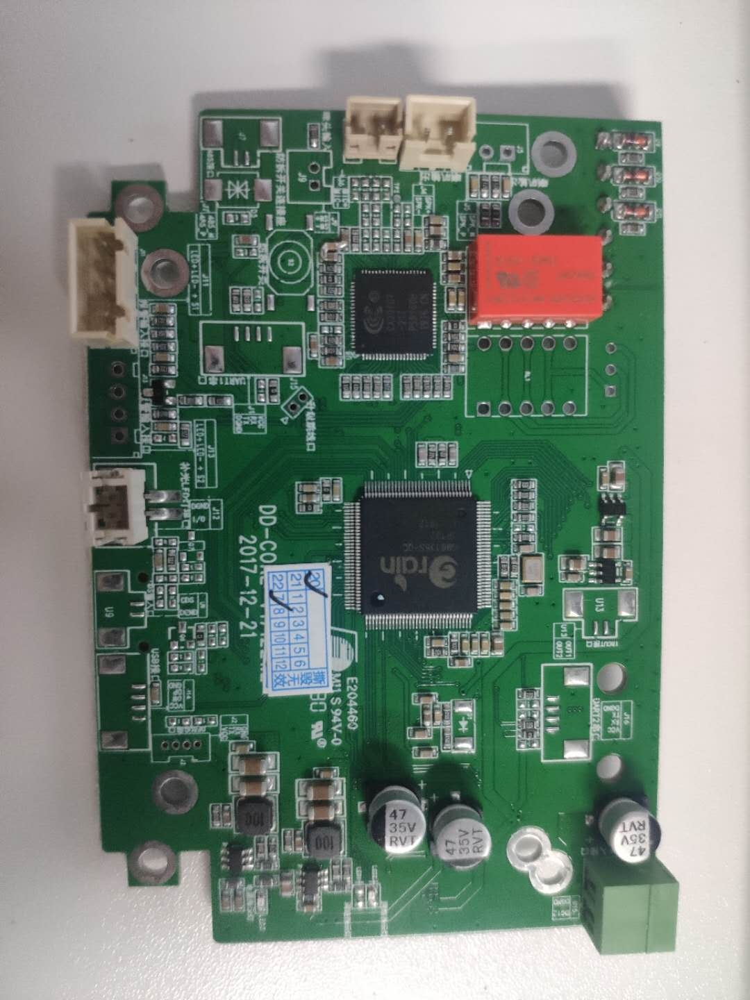
**正面**

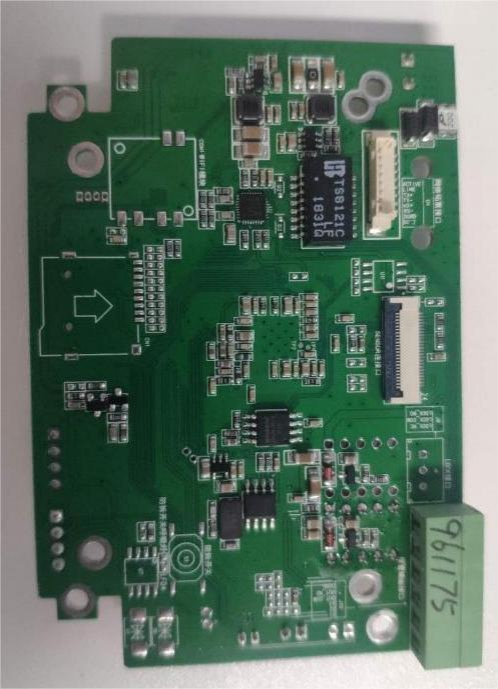

**反面**

---

## 1.安装对讲调试软件

http://image.cxyun.net.cn/door/%E4%BA%92%E8%81%94%E7%BD%91%E9%AB%98%E6%B8%85%E5%AF%B9%E8%AE%B2%E5%81%9C%E8%BD%A6%E5%9C%BA%E7%B3%BB%E7%BB%9F%E5%B9%B3%E5%8F%B0%E8%BD%AF%E4%BB%B61.1.2.19%20.zip

## 2.打开对讲服务器和设置软件

**注意:二个软件必须都打开的情况下才能修改主报警中心ip**

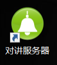

## 3.调试设置软件—>搜索设备—>修改主报警中心IP(修改为本机的IP)—>应用—>重连—>刷新—>最后提示注册成功 (如图:)		  																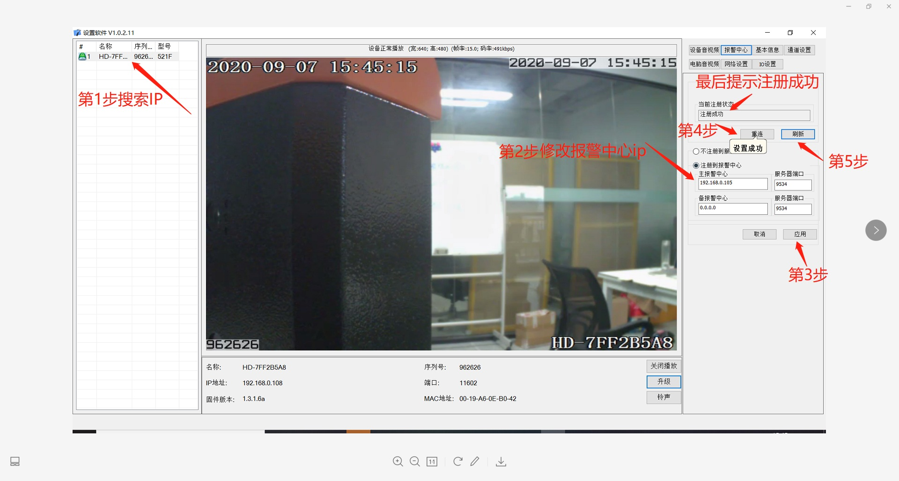
## 4.设置软件-基础信息可修改设备名称

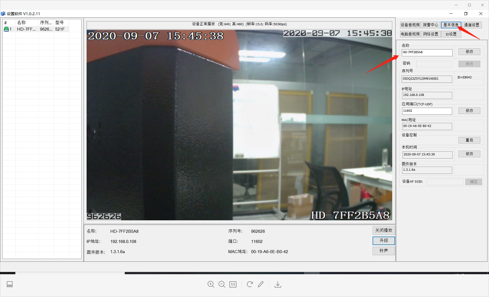

## 5.打开对讲服务器

### 1.添加一个分组名称

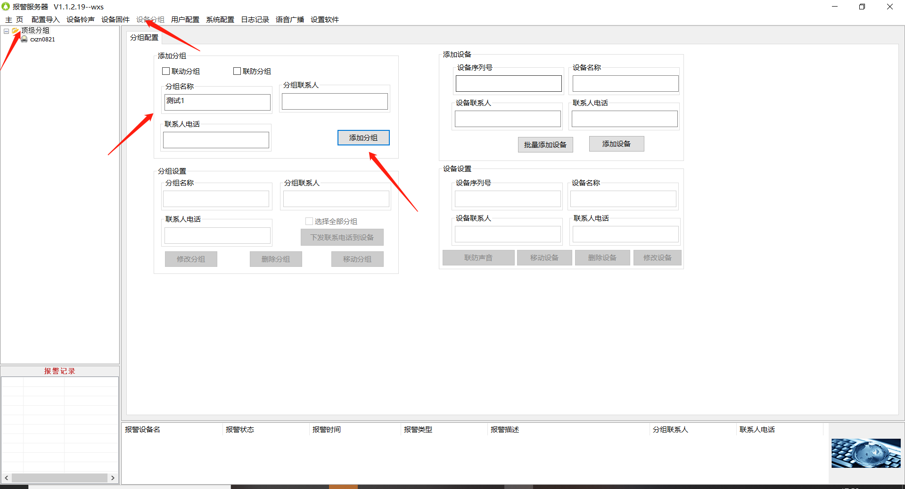

### 2.右击设备移动到添加的分组下面

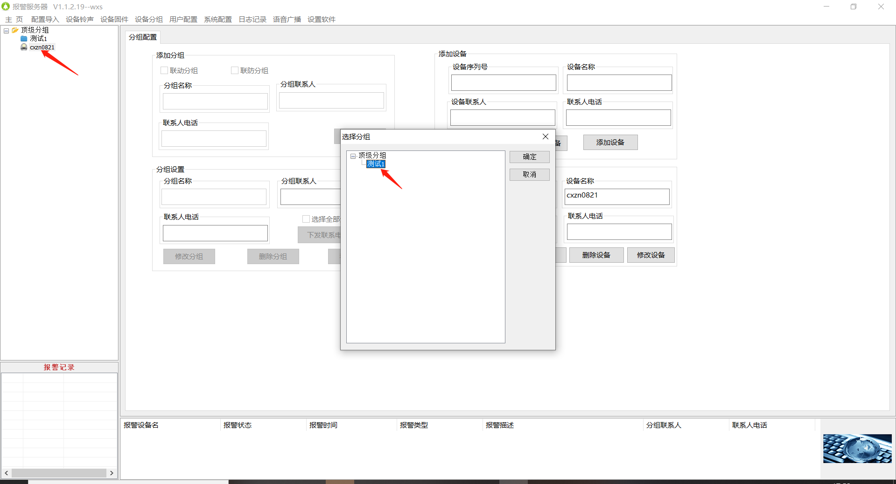

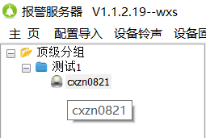

---

## 6.用户配置

### 1.添加一个用户

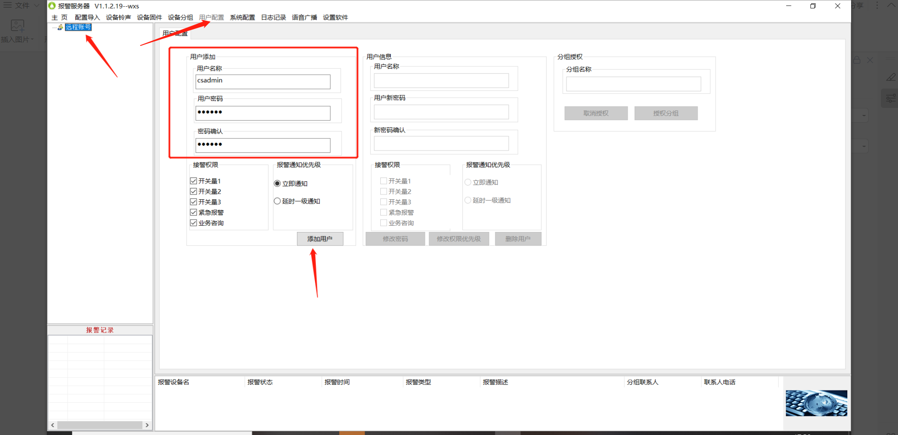

### 2.授权分组

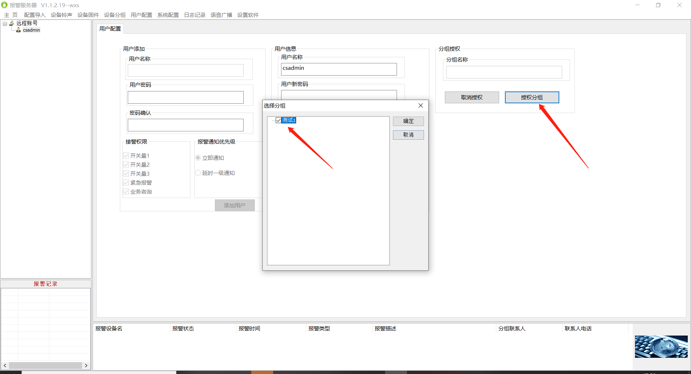

## 7.在管理端配置对讲设备信息

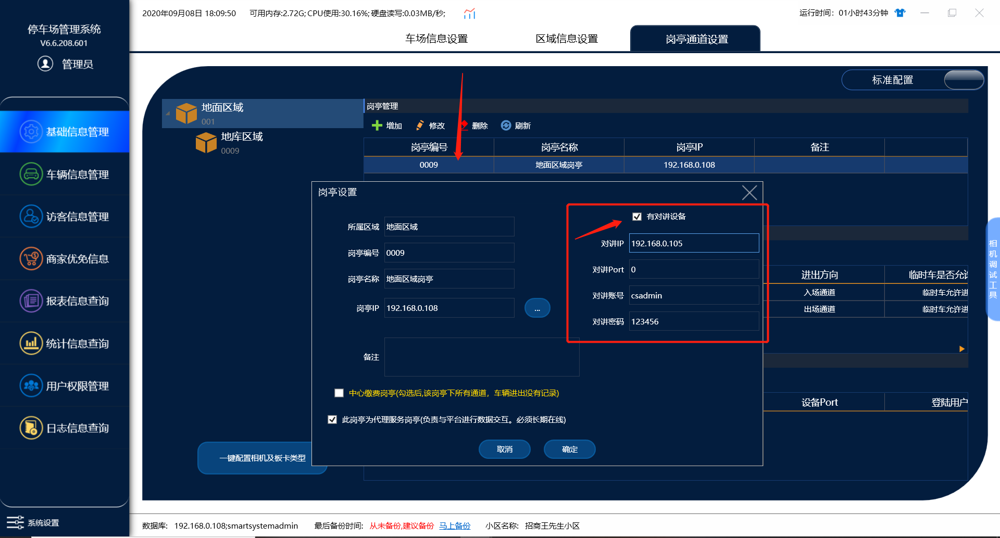

岗亭管理里面勾选有对讲设备

1.对讲ip：XXXXXXXX(**报警中心设置的ip: 192.168.0.105**)

2.对讲port：XXXXXX(**不用设置默认好的**)

3.对讲账号：XXXXXX(**在对讲服务器添加的用户：csadmin**)

4.对讲密码：XXXXXX(**在对讲服务器添加的密码: 123456**)

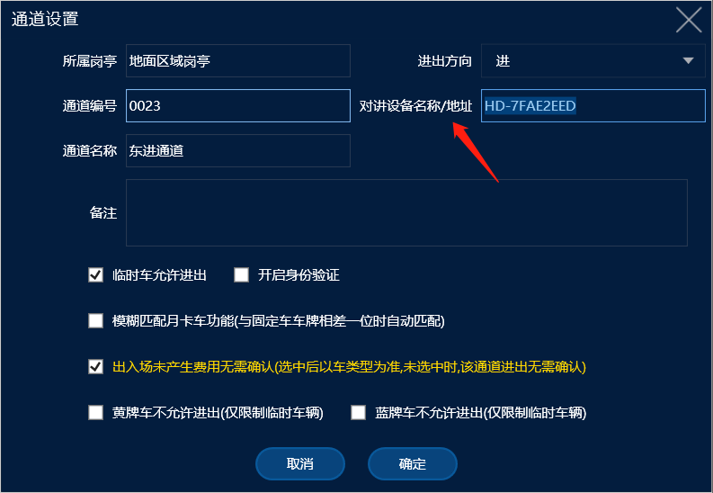

通道管理里面设置对讲设备名称：XXX(**HD-7FAE2EED**)

## 8.最后打开收费端

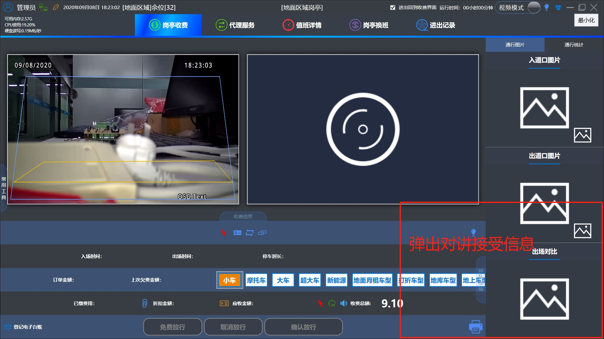

**通过对讲设备发起对讲信息收费端可接受并且发起对讲**
