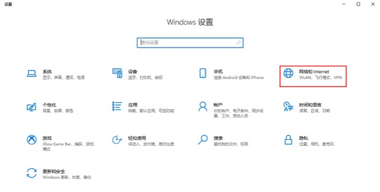
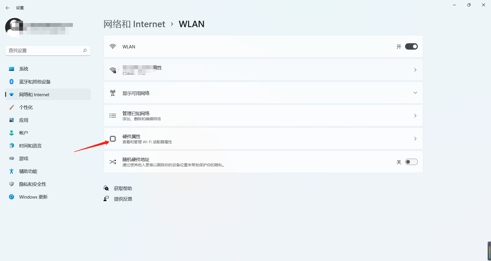
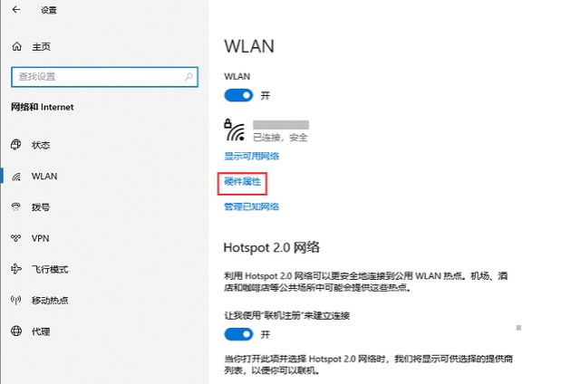
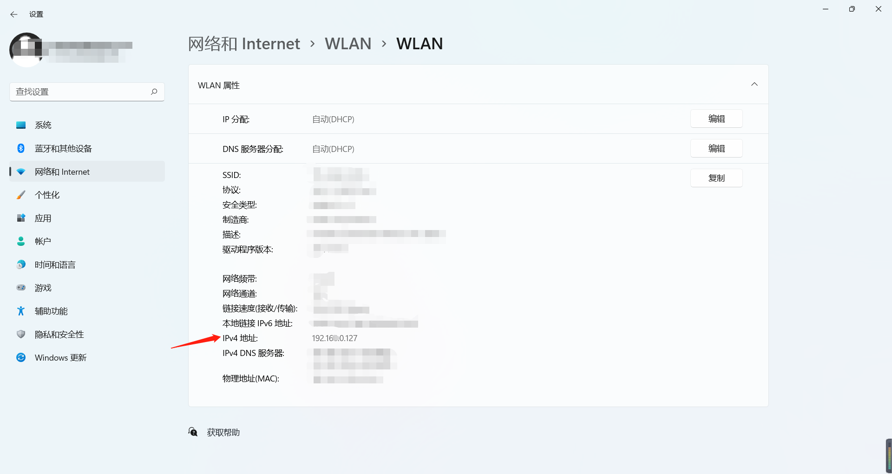
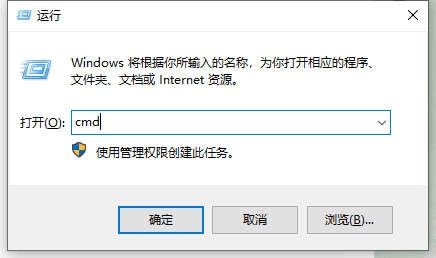
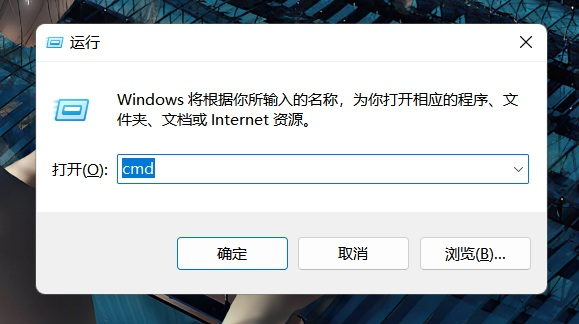
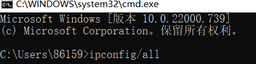
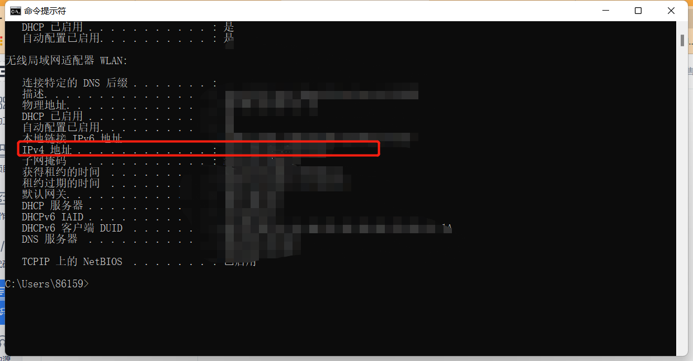

# 查看自己电脑的ip

在登录收费端的时候出现不同的ip 如何查看自己电脑的ip

## 方法一：在电脑设置中查看电脑 iP 地址

通过查看电脑硬件属性：

1.在电脑上左侧打开【设置】，选择“打开‘网络和 internet”设置选项。

2.打开“网络和 internet”设置，点击“硬件属性”,打开"WLAN“窗口。

3.在“WLAN”窗口中的 IPv4 地址，即可查看到自己电脑的 IP 地址。

## 方法二：通过运行程序查看电脑的 IP 地址

### 步骤 1.

在键盘上按WIN+R组合键，打开运行窗口，之后在运行窗口中输入cmd，点击确定

### 步骤 2

在打开的窗口中，输入 ipconfig/all，按下 Enter 键

### 步骤 3

查看 IPv4 地址，即为本地电脑上 IP 地址 
**查到电脑ip后再去收费端选择自己的ip然后就能进收费端了**
