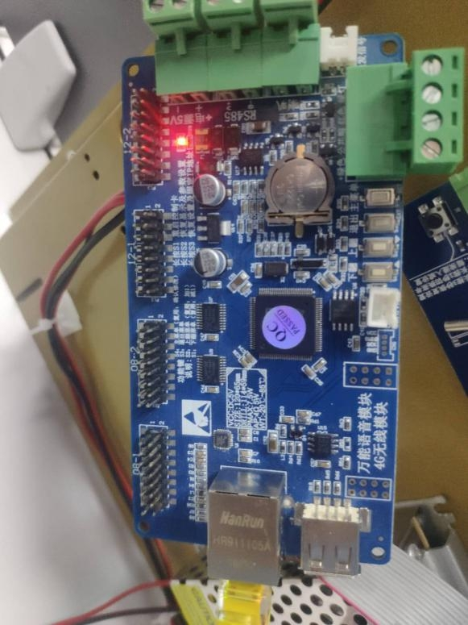
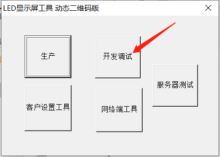
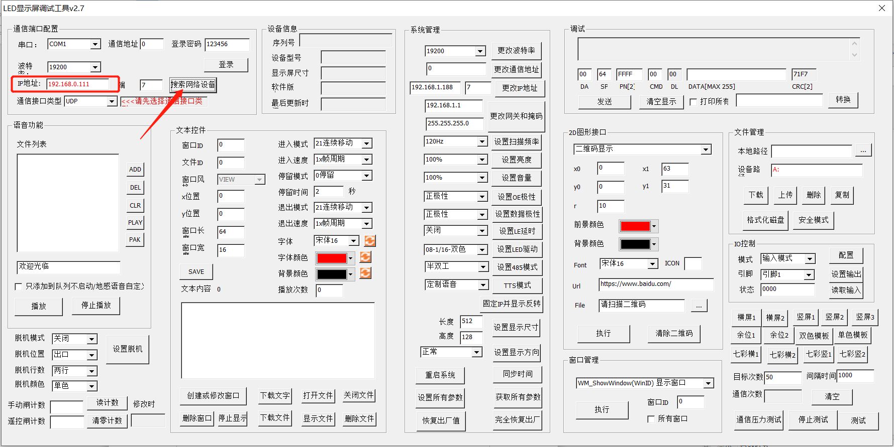
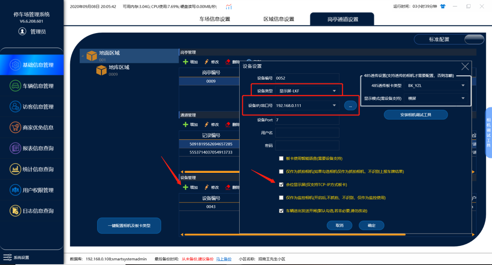
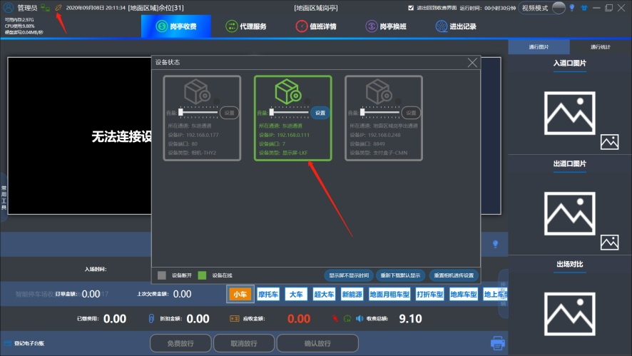
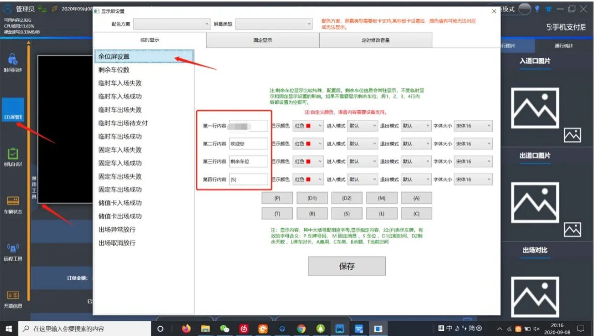

# 余位显示屏配置说明

<div class="img-hover-container">



</div>

**

```
正面
```

**

## 1.打开调试工具搜索余位屏板卡的IP




## 2.在管理端设备管理添加设备

<div class="img-hover-container">



</div>

1. 设备类型选择：**显示屏—LKF**
2. 添加板卡的ip：192.168.0.111
3. **勾选余位显示屏功能**
4. **其他的信息全部由软件这边默认好的不用修改**

## 3.打开收费端查看板卡连接状态

<div class="img-hover-container">



</div>

**状态连接正常便可以使用**

## 4.修改设置余位屏显示类容

<div class="img-hover-container">



</div>

LED屏设置里面余位屏设置4行信息可以任意添加平显示

**注意：设置 `字母` 的意义图中有描述，当前设置的 `S` 是剩余车位数的意思**
