# 岗亭收费

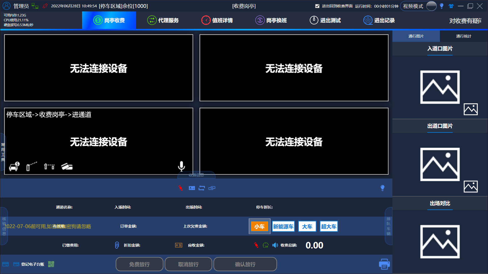

## 主界面

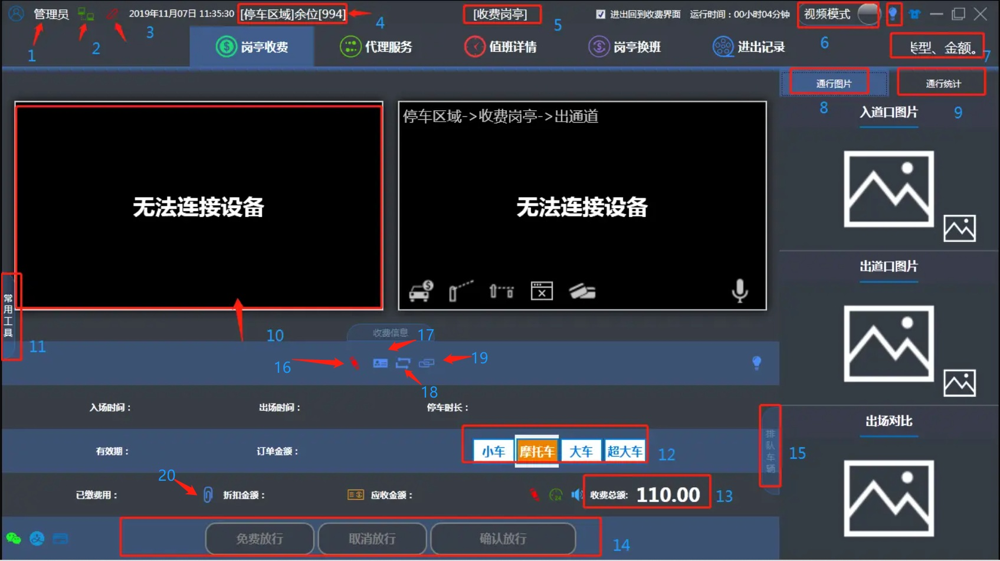

---

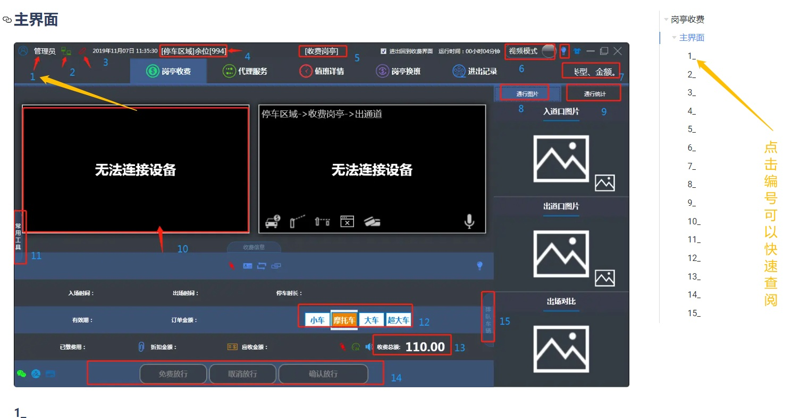

---

### 1_

**值班人员的信息**: 登录账号显示在这

### 2_

**数据库连接状态**：红色代表未连接，绿色代表正常连接

### 3_

**设备连接装填**: 红色代表未连接，绿色代表正常连接，黄色代表有设备未连接

### 4_

**车位数量** ：停车场的剩余车位数量

### 5_

**岗亭名称** ：管理端岗亭设置的名称

### 6_

**视频模式和图片模式切换** ：视频模式是默认模式，图片模式是指关闭视频画面，只用相机拍照功能，会降低对电脑硬件的需求，特定环节使用

### 7_

**小提示**：点击之后会出现提示框

对应的提示框对应对应的按钮，对按钮的功能做出详细解释
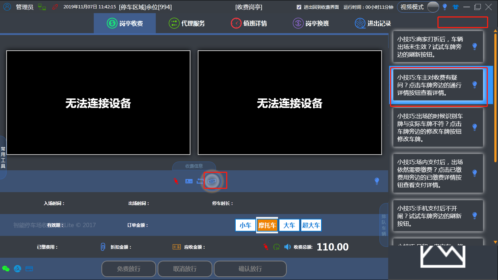

### 8_

**通行图片**：车辆进出会有进出图片在下面显示

### 9_

**通行统计**：按照通道统计对应通计道的进出数量，以天为单位

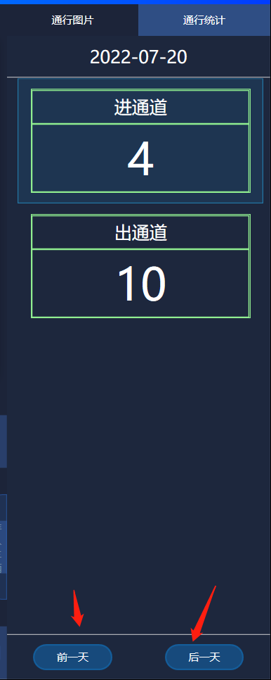

这里可以点击查看前一天或后一天的通行统计

### 10_

**视频监控画面**：一个通道对应一个框，双击能放大缩小

### 11_

**常用工具**：
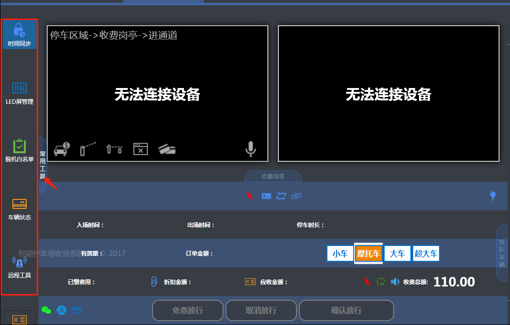

A.时间同步：将软件的时间和电脑系统的时间同步

B.LED屏管理

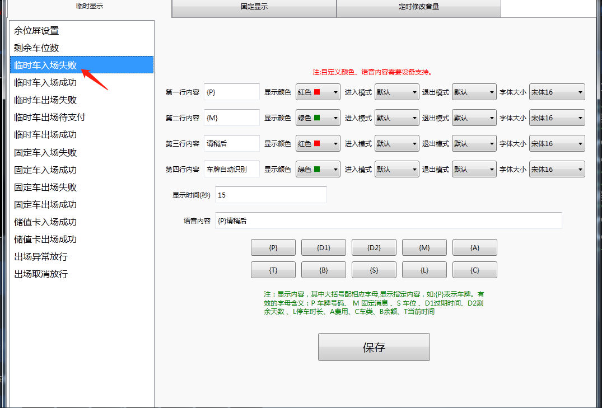

1. **时间同步**：同步软件和电脑时间（视频框显示的相机时间软件同步不了，需要到相机工具内同步）
2. **LED屏管理**：以临时车入场失败为例，右边有1-4行显示屏分别显示的内容，大括号带字母代表的意思在下方绿色字都有注释，显示时间按秒可以设置，
3. **语音内容**：默认不能去改动（需要修改语音请联系厂家购买带万能语音模块的主板）
4. **固定显示**：表示车进出或者出场后过了显示时间会跳转到固定显示
5. **定时修改音量**：修改每个时间段的音量大小（需要主板支持）
6. **余位屏和剩余车位不能添加显示内容，需要修改，请联系技术员**
7. **车辆状态**：里面可以查询车辆的状态（月卡，储值等车类以及有效期，金额方面的查询）
8. **远程工具**：下载远程软件

C.脱机白名单：

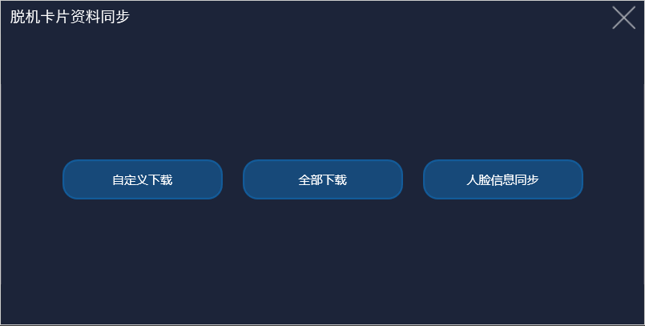

1.自定义下载：点击后出现下图内容

可以根据时间，车牌来筛选搜素白名单车牌并进行下载（下载到相机里）

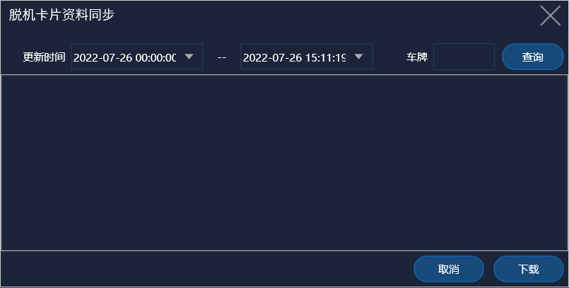

2.全部下载：字面意思，全部进行下载（下载到相机里）

3.人脸信息同步：将软件和相机（要支持人脸识别的相机）的人脸信息进行同步

**D.车辆状态：**

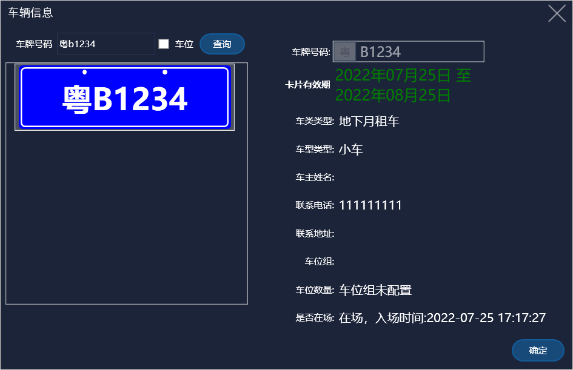

可以根据车牌号码快速搜素到车主录入的信息

---

### 12_

**车型**: 进出车辆的车型

### 13_

**收费总额**: 当班值班员收取停车场费用的统计，线上支付不算在里面（微信，支付宝等）

### 14_

**操作按钮**：

a:**免费**放行（车辆产生费用，点击免费放行会直接打开道闸放行车辆

b:**取消**放行（产生费用之后，取消放行）

c:**确认**放行：确认放行车辆（产生费用之后这个键会变成收费放行

d:**异常**放行：车场没有配置收费规则或者没有入场记录时，点击异常放行

---

**排队车辆**：车辆进出排队处理流程，点击对应的车牌号，可以选择提前处理的车牌号

### 16_

车牌修改：当相机识别错车牌时，可以在这里手动更改车牌（相机识别到车牌时使用）

更改后点击修改即可

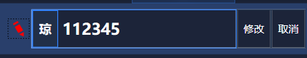

### 17_

卡片信息：当录入过软件的车辆进出时可以点击此处直接查看录入的车辆信息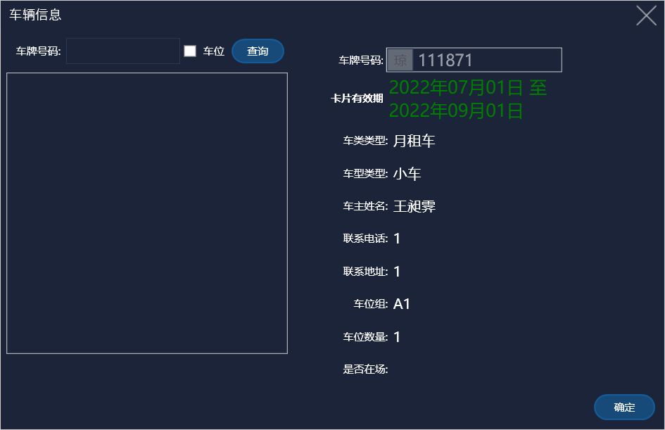

和常用工具中的车辆状态功能相同

### 18_

刷新：当车主在线上支付了临停金额软件仍没有开闸，可以点击此处进行刷新

## 画面与功能

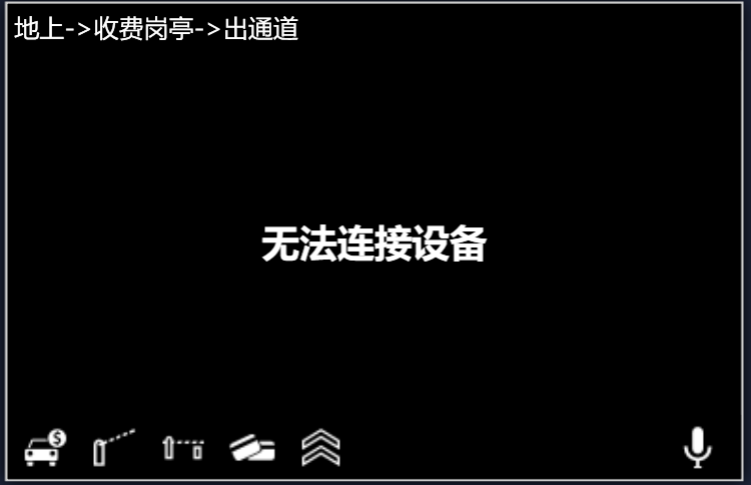

这个就是相机画面，连接正常的话这里就会有画面，每连接到的话就会像图片一样显示无法连接设备

点击后会出现这个界面

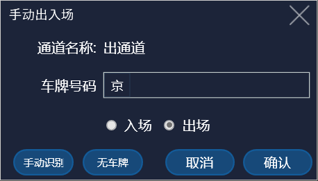

当车辆无法正常进出场是可以在对应的通道进行手出入场

1.**手动识别**：点击后相机会再次识别车牌

2.**无车牌**：用于无牌车进出场

点击后会在收费信息上显示这个画面

3.**手动开闸：**

点击后该通道便会开闸，会出现让你填写备注的情况，按照实际情况填写即可

4.**手动关闸**

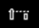

关闭该通道的闸门

5.**读卡录入**

一般用于摩托车刷卡进入

6.**车队模式**

要在系统设置里打开车队模式才会出现这个按钮，车队模式就是一直开启该通道的闸门

7.**对讲**

现在这个功能已经升级为云座席了，要设置云座席请联系技术人员

8.**打印小票**

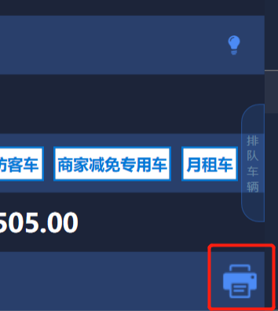

车辆进出后产生的费用可以在这里点击打印小票

9.**登记电子台账**

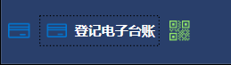

在这里可以点击登记电子台账进行人为手工地登记电子台账

10.**扫码支付**

有扫码设备时可以点击此处进行设备扫车主的支付码

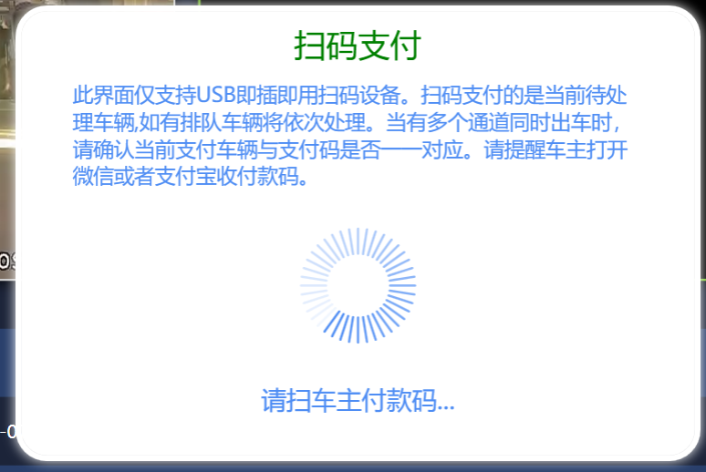

11.**更改应收金额**

当车辆收费出现计算错误时可以在这里进行修改（注意：这里更改时需要更改后再扫码支付，先扫码再更改不会显示更改后的金额）
