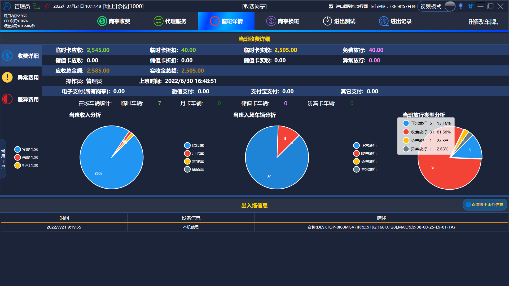
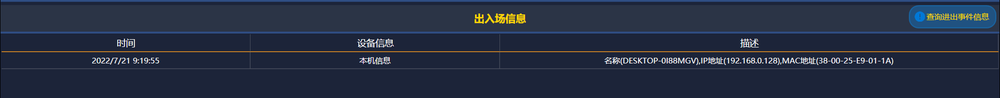
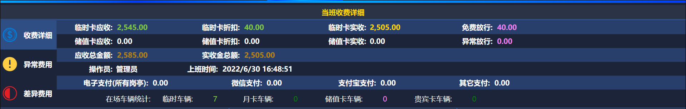
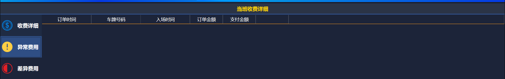
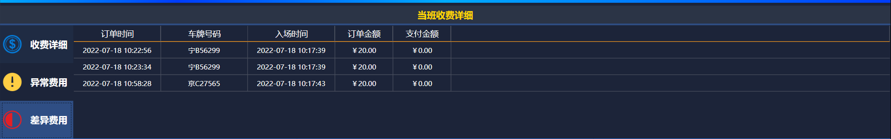
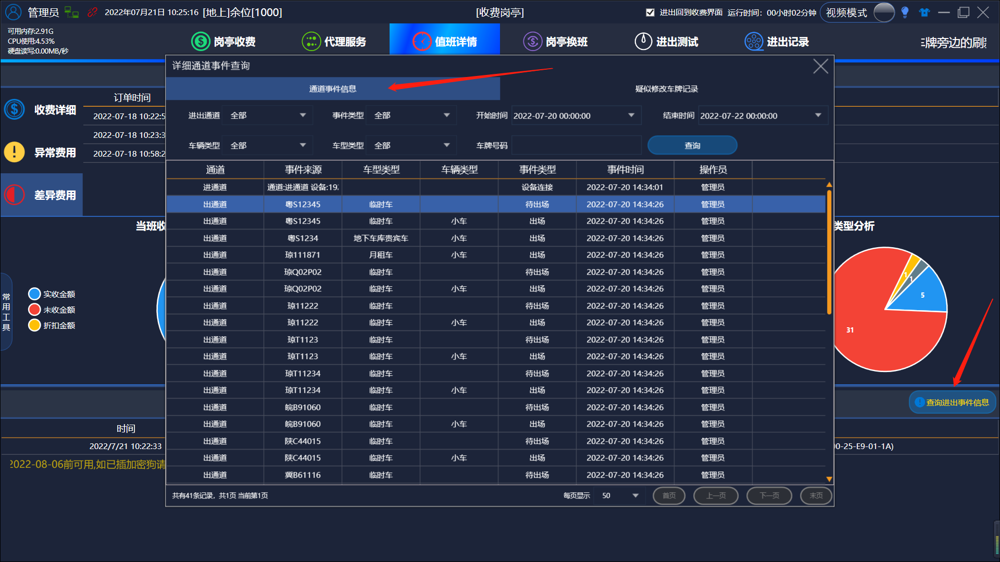

# 值班详情

当班人员收费的详细情况

### 1.出入场信息查询

### 2.当班收费的详细情况 

### 3.异常费用记录查询

### 4.差异费用查询

### 5.查询进出时间信息

1. 通道事件信息：这个功能和管理端里报表查询的通道时间信息相同，这个查询是为了更加方便用户的使用，不用两个软件来回切换

2. 疑似修改车牌记录：同样在管理端报表查询的疑似修改车牌记录相同，将这个信息放在这里也是为了用户更加便捷的使用这些功能
