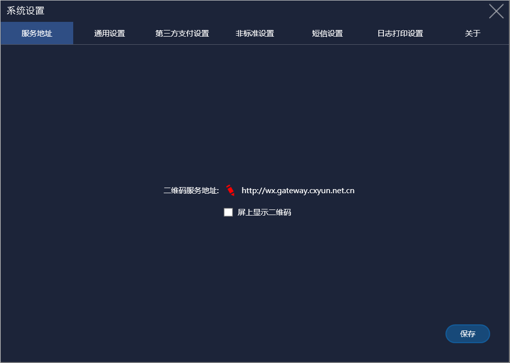
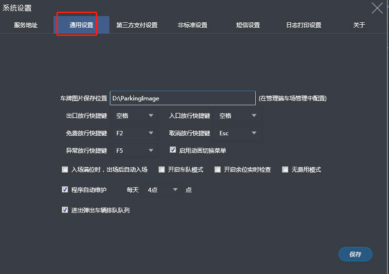
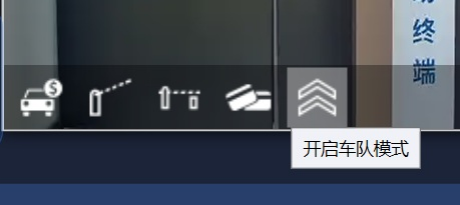
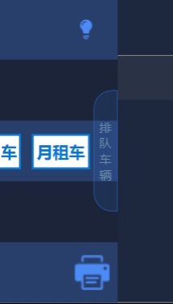
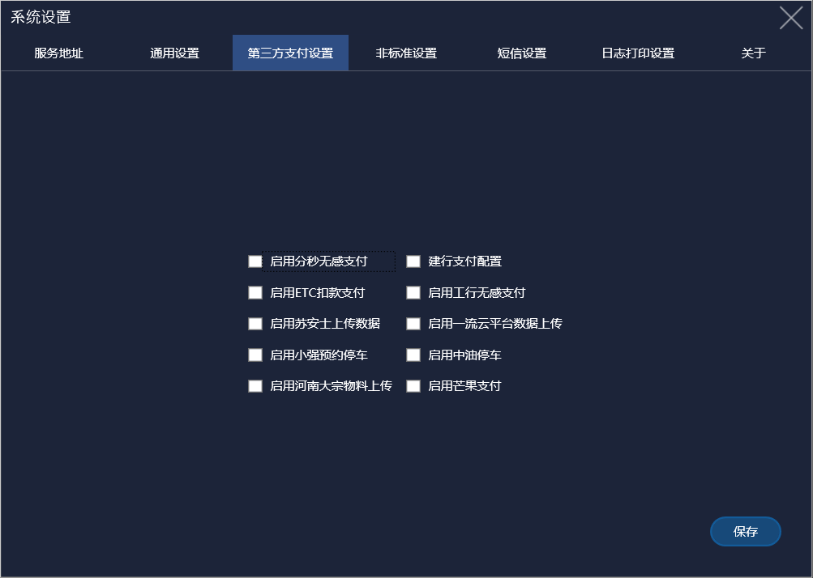
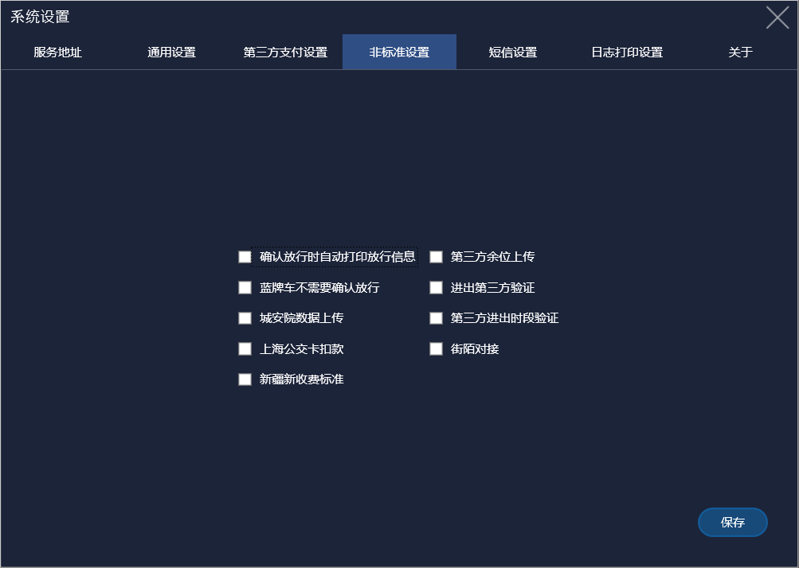
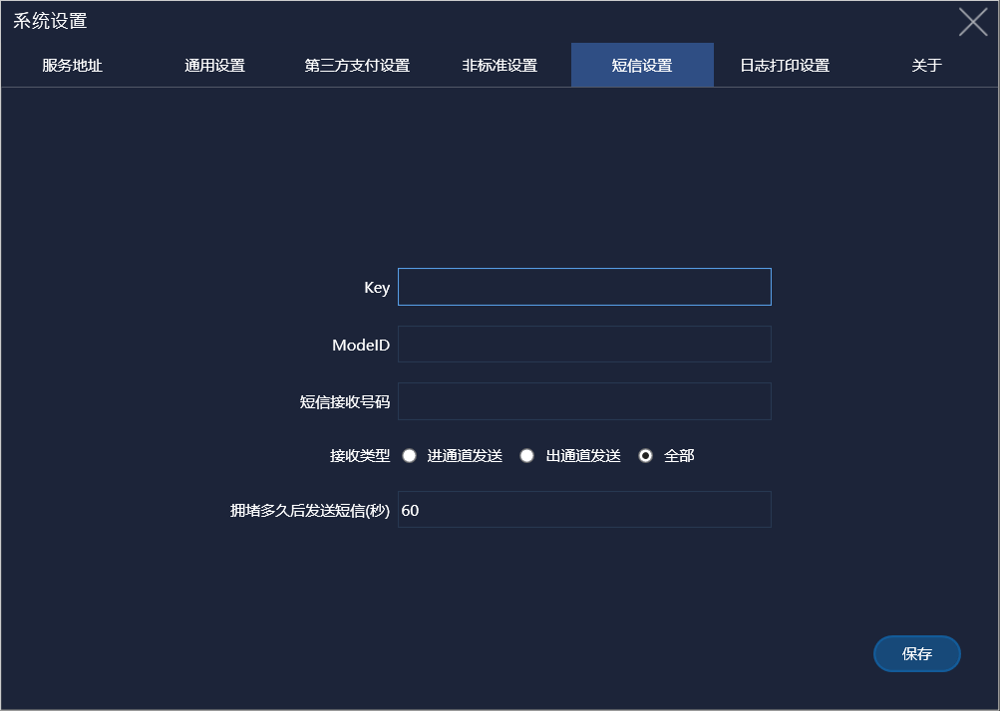
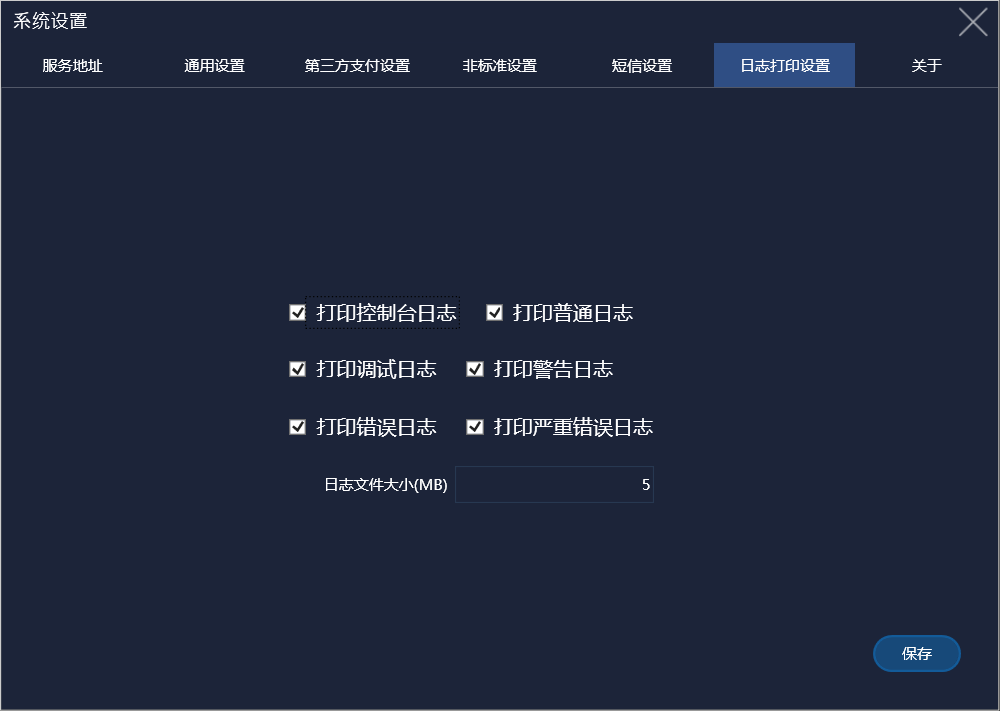
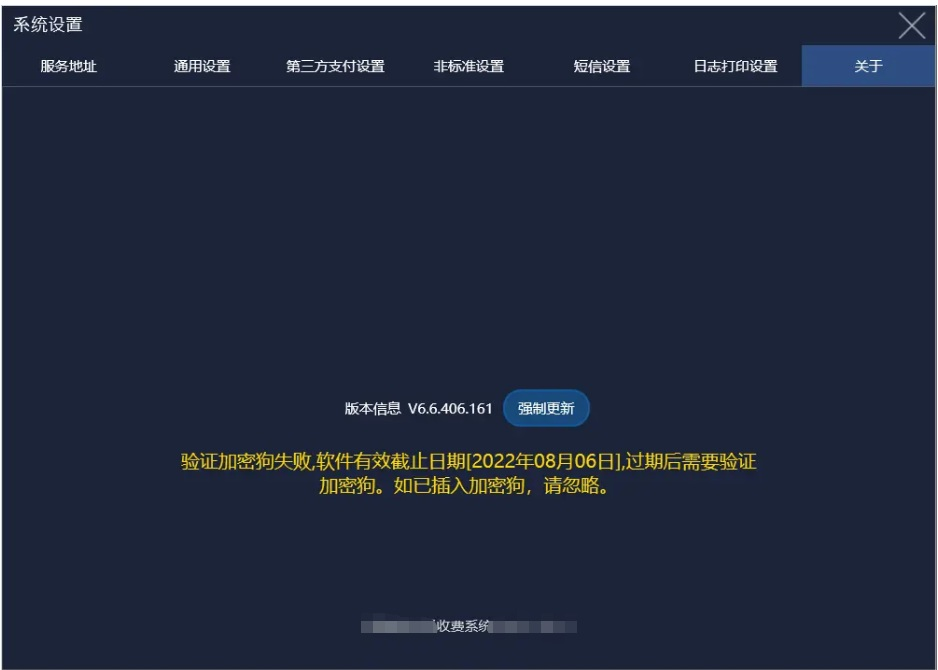

# 系统设置

### 1.服务地址

服务地址系统默认好的，**不要去更改！**

### 2.通用设置

1. **车牌图片的保存路径**：设置了路径之后，车辆进出抓拍产生的图片会保存到目录里面，管理端设置同样的目录就能访问图片
2. **快捷键设置**：点击选择框可以选择对应的快捷键按键
3. **启动动画切换菜单**：使界面切换流畅，默认勾选
4. **入场满位时，出场后自动入场**：在车场显示满位后，车辆就不允许进入了，勾选此功能后在有车辆出来后入口的车辆便可进入
5. **开启车队模式**：在设置中开启车队模式后，可以按照通道来打开其车队模式，点击开启车队模式后这个通道会一直开闸直到关闭车队模式

   
6. **开启余位实时检查**：在显示屏上会实时显示车辆余位
7. **无费用模式**：即停车场免费
8. **程序自动维护**：程序自动维护开启后会定时自动关闭开启软件，这个时间点可自行选择
9. **进出弹出车辆排队队列**：

   这个现在默认显示排队车辆了勾或不勾都可以

---

### 3.第三方支付设置

需要用到第三方支付设置时请联系我们技术员配合设置

### 4.非标准设置

顾名思义不是标准的设置，一般是特殊车场使用的，为非标功能一般不用勾选

### 5.短信设置

非标功能，主要作用于当车辆在入口或者出口一直没有出去时进行短信推送。

### 6.日志打印设置

可以选择打印日志的类型

### 7.关于

用于更新软件

