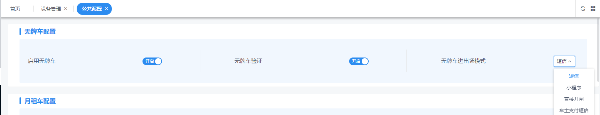
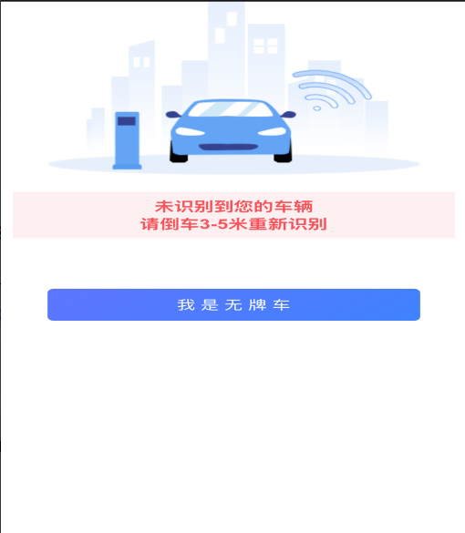
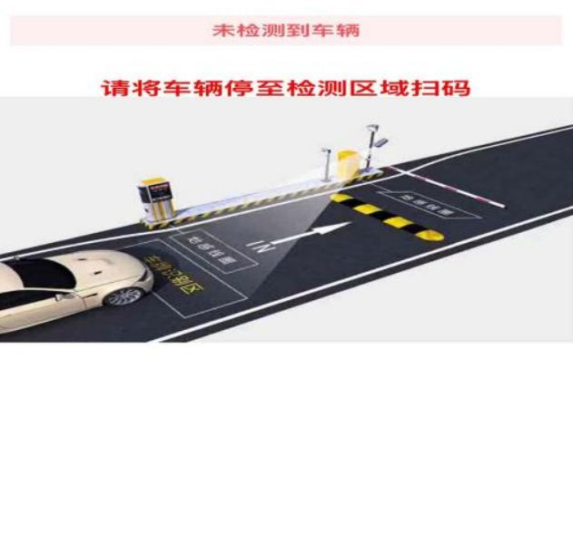
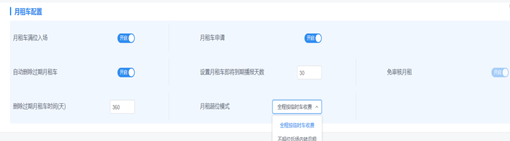
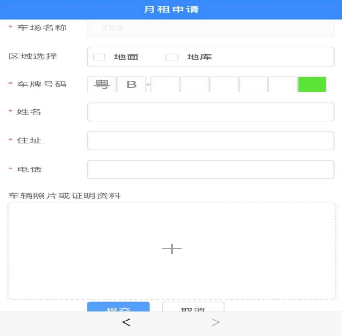
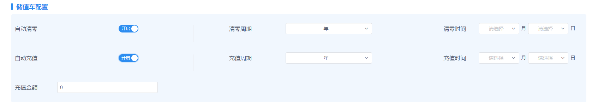
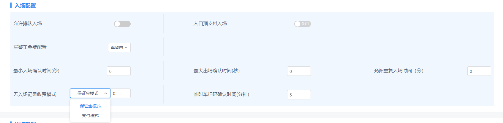
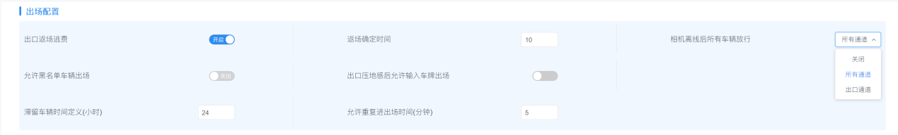
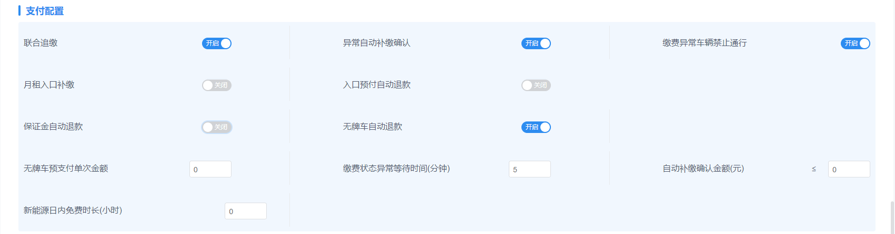
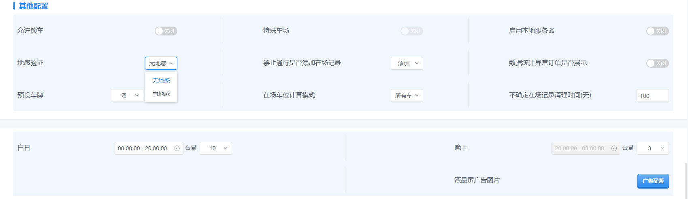

停车Boss公共配置说明书

公共配置包含无牌车、月租、出入场、支付、其它配置等，是车场上线后日常运营的核心设置项。

## 一、无牌车配置

1. **启用无牌车**：开启后，无牌车可以选择扫入口、出口二维码进出场。

2. **无牌车地感验证**：开启后现场有真实有效车辆才可触发无牌车开关，通过扫码不能直接开闸，避免车主用手机扫码输入（实际不存在车辆进场）导致开闸，同时也避免车主用无牌车方式在入口逃费。

3. **无牌车进出场模式**：提供小程序、短信、直接开闸、车主支付四种模式，平台默认短信模式。

   - **①短信模式**：车主扫入口码，点“我是无牌车”，填写手机号、输入验证码确定入场。
   - **②小程序模式**：车主扫入口码，点“我是无牌车”，跳转到小程序自动获取手机号入场。
   - **③直接开闸模式**：开启后只要识别无牌车就开闸，且不收取停车费（也包含因角度、光线等问题被识别成无牌车的有牌车）。
   - **④车主支付模式**：无牌车车主每次入场支付 0.1 元（无牌车入场短信验证费用）。

   > **说明：** 小程序、短信模式都需要验证码，均按 0.1 元/条收费；车场创建时平台免费提供 100 条短信，短信用完后会自动切换到车主支付模式，可在平台上自费充值短信数量。

## 二、月租车配置

1. **月租车满位入场**：开启后，月租车可以超车位入场（车场余位会出现负数），且月租车入场会占用临时车车位；关闭后，月租满位则禁止入场。
2. **自动删除过期月租车**：默认开启 3 个月（可改），超过设置时长，自动删除过期月租车。
3. **月租车申请**：开启后，车主可自行扫车场月租申请码登记上报月租车信息（注：开通免审核月租需与我司联系）。

4. **设置月租车即将到期播报天数**：剩余天数大于设置时间，只播报“一路顺风”；剩余天数在设置时间内，则播报剩余天数。
5. **月租超位模式**：在一位多车情况下，第二台（或多台）月租车要进车场，可选全程按临时车收费或场内转月租。
   - **①全程按临时车收费**：A 车在场，B 车入场即为超位，B 车全程按临时车收费标准计费；不管 A 车何时出场，只要 B 车停车时长超过免费分钟，就全程计费。
   - **②不超位后场内转月租**：A 车在场，B 车入场，A 车出场后 B 车转月租，则 B 车计费时间为 B 车入场到 A 车出场这段时间，大于免费分钟则计费，低于免费分钟则不计费。

## 三、储值车配置

平台支持储值车设置自动金额充值：

1. 设置固定月份和时间，根据配置时间完成每日赠送。
2. 设置固定月份和时间，根据配置时间完成清零。
3. 每日未用完的赠送储值，执行先清零再赠送的策略。

## 四、入场配置

1. **允许排队入场**：默认开启，车位已满时车辆可在入口等待，出口有车出去后入口不用倒车、自动开闸（建议搭配地感使用）。
2. **军警车免费配置**：有军警、军警白两种，配置后军警车可识别免费进出。
3. **入口预支付入场**：开启后可根据不同车牌颜色设置不同预付金额，车主在入口先预付再入场。
4. **最小入场确认时间**：针对所有通道，出场后设置多少秒内入场需扫码确认（避免车速或车辆抖动识别车辆尾部车牌造成异常开闸）。
5. **最大出场确认时间**：入场后在设置时间内出场，需要车主扫码确认出场。
6. **允许重复入场时间**：该功能需和入口预支付入场绑定使用。
7. **无入场记录收费模式**：分为保证金及支付两种模式。
   - **①保证金模式**：无入场记录的车辆出场时需缴纳设定的保证金出场（可退）。
   - **②支付模式**：无入场记录的车辆出场时需缴纳设定的金额，该订单为车场下发的支付订单（可退）。
8. **临时车扫码确认时间（分钟）**：设置扫码支付时间，超时订单失效需重新扫码。

## 五、出场配置

1. **出口返场逃费**：车辆入场后又到出口识别、倒车停回车位。

   - **开启**：会弹出返场确定时间，系统默认 10 分钟（可改）。在设置分钟内完成一进一出，系统保留上一次在场记录，把“确定在场”变为“不确定”。
     - 缺点：①大量不确定车辆导致车场盘点困难；②未有新入场记录匹配近一次入场记录，造成大额订单（进入异常记录进行追缴）。
   - **不开启**：车辆再出场时会导致无入场记录；如车场设置了无入场记录保证金，则需缴纳保证金出场，无车场则直接免费出场。

2. **允许黑名单车辆出场**：已添加的在场黑名单允许出场。
3. **出口压地感后允许输入车牌出场**：需联合地感，当车辆压出口地感后扫码可输入车牌出场。
4. **滞留车辆时间定义（小时）**：平台默认 72 小时（可改），72 小时后确定在场车辆转为滞留车辆（该车辆不占用车场余位）。
5. **允许重复进出场时间（分钟）**：例如车辆缴费后道闸开闸时间已过、落闸后车辆后退重新识别又可重新开闸（举例：商户住店车在住店时间内可重复进出场）。
6. **相机离线后所有车辆放行**：默认不开（可改），相机离线后可选择所有通道或仅出口通道免费放行。

## 六、支付配置

1. **联合追缴**：在 A 停车场产生的逃费记录，上传云平台后该城市所有本系统车场均可入口补缴该笔费用才可进场，且金额回到 A 停车场账户。
2. **异常自动补缴确认**：开启后弹出自动补缴确认金额，小于等于填写金额的订单达到设置金额后才自动进入补缴（每天 1 点至 3 点自动进入补缴）。
3. **月租入口补缴**：开启后，月租过期、录入月租前产生的临停费用、月租报停中产生的临停费用、所属车场不一致产生的费用，车辆再进入车场需在入口进行补缴方能入场。
4. **入口预付自动退款**：需开启入口预支付，并在车道配置中未登记车通行方式配置预支付入场。
5. **保证金自动退款**：开启后，无入场记录车辆出场时缴纳的保证金可自动退款，自动退款时间为每天 1 点至 3 点之间。
6. **无牌车自动退款**：开启后，无牌车入场时缴纳的预支付保证金可自动退款，自动退款时间为每天 1 点至 3 点之间。
7. **无牌车预支付单次金额**：填写金额后无牌车扫码需缴纳预付保证金才能进场（开启车主支付模式时该功能不可用）。
8. **缴费状态异常等待时间（分钟）**：平台默认 5 分钟（可改），5 分钟后缴费状态异常的订单将进入异常记录。
9. **新能源日内免费时长（小时）**：设置新能源 24 小时内（0 点–24 点）免费通行；设置时间内多次触发免费时长，累计超过设置时长后重新计费。
10. **缴费异常车辆禁止通行**：产生未支付订单的车辆进入异常记录后禁止通行（入口提示补缴，需扫码补缴完成后进场）。

## 七、其他配置

> **注意：** 允许锁车、特殊车场、启用本地服务器均针对特殊车场，如需开启请与我司联系。

1. **地感验证**：有地感时，车场安装前置地感，需要验证有车环境的业务（如排队入场、无牌车验证）需有车触发地感才继续执行；无地感表示未安装前置地感。
2. **预设车牌**：选择预设省份，车辆录入时会自动匹配预设省份。
3. **禁止通行是否添加在场记录**：禁止通行的车辆在入口识别后，平台会添加一条不确定的在场记录，且进出记录备注“车辆禁止通行”。
4. **在场车辆计算模式**：计算已扫码车辆或总车辆。
5. **数据统计异常订单是否展示**：针对岗亭端设置，开启后数据统计异常订单会在岗亭端展示。
6. **不确定在场记录清理时间**：
   - 设置：系统默认 100 天，车辆在场 72 小时后变为滞留车辆（确定在场变不确定），超过 103 天后系统清理在场记录，车辆再出场显示无入场记录。
   - 不设置：车辆显示在场，在场 72 小时后变为滞留车辆（确定在场变不确定）。
7. **白日/晚上音量、时间调试**：可设置时间区间以及音量大小。
8. **液晶屏广告图片**：闸机显示液晶屏广告配置。
