平台上线说明书（MQ 上线）

非我司出库的VZ C 系列相机以及非VZ品牌的相机，需使用 MQ 直连上线。非VZ且我司已对接的相机品牌有：HX、大华、芊熠、宇视、海康等（若有上述未列举的品牌可先询问我司工作人员）。具体上线流程文档由我司在群内分享或主动询问我司工作人员获取。本文档以VZ为例简述，详细流程参考正文内容。

## 一、创建车场

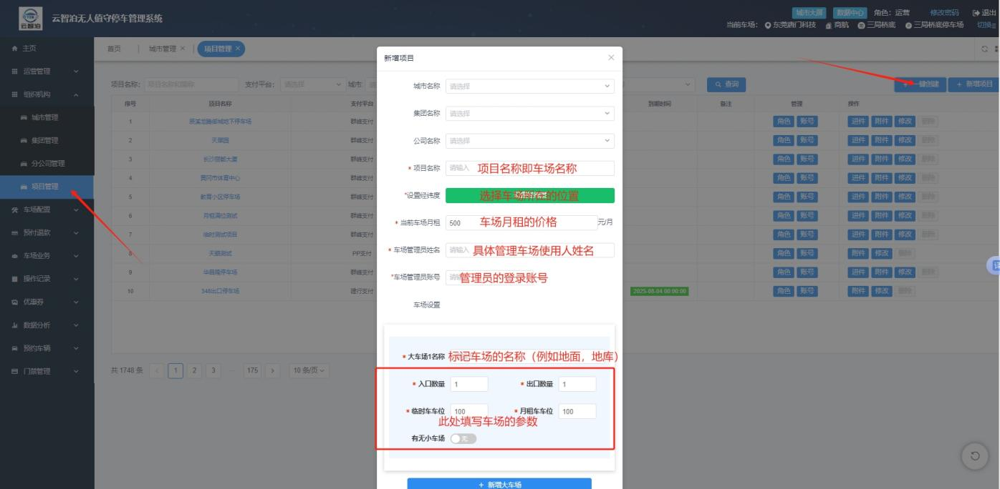

> **注意：**
> - 经纬度为必填项，若无法精确定位车场位置，可选大概位置。
> - 月租价格尽量填写车场真实月租价格，车主线上续费会根据此价格付费延期。
> - 若需增加多个车场（如地面、地库），可继续点加号新增车场。
> - 可先将车场创建完成后再去现场安装设备，现场设备通电通网后即可继续调试上线。

## 二、现场设备安装

- 现场设备安装可参考《停车Boss道闸设备安装》说明书，本说明书不再赘述。
- 现场网络尽量避免光猫 LAN 口直接连接相机设备，需在光猫下增设路由器，再由路由器给车牌识别设备供网。
- 我司出厂相机 IP 默认为 `192.168.1.100`，需将相机 IP 改为可上外网的网段，尽量避免 IP 冲突；非我司出厂相机，原始 IP 请询问厂家，再将相机 IP 设为可上外网网段。
- 若现场需要我司工作人员协助，请安装向日葵远程软件，在群内与我司员工联系。

### 调试

将相机 SN 填至车道（相机 SN 可通过网页输入相机 IP 进入查看，VZ相机账号密码均为 admin，也可在相机外壳上寻找）。

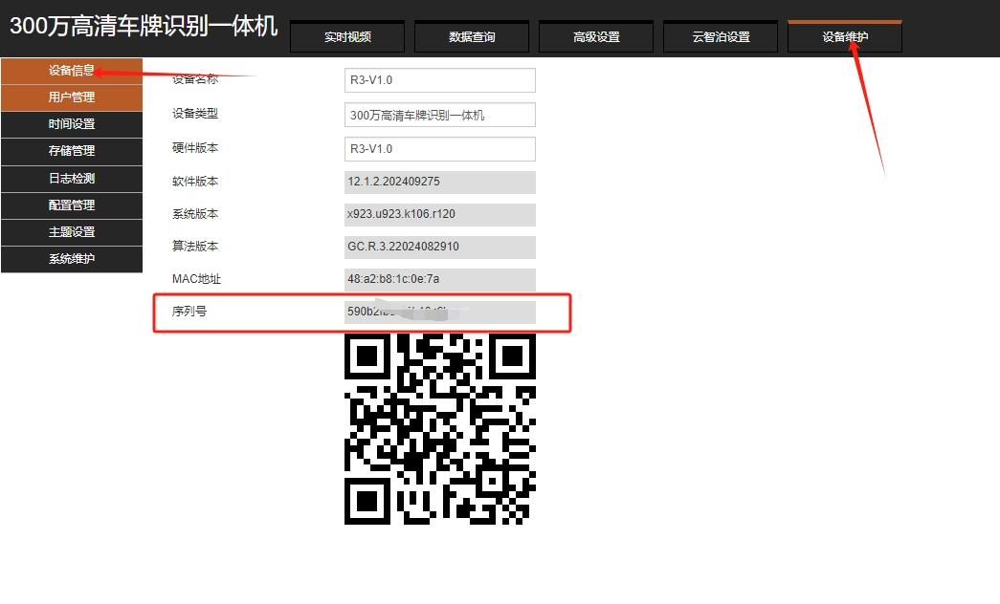

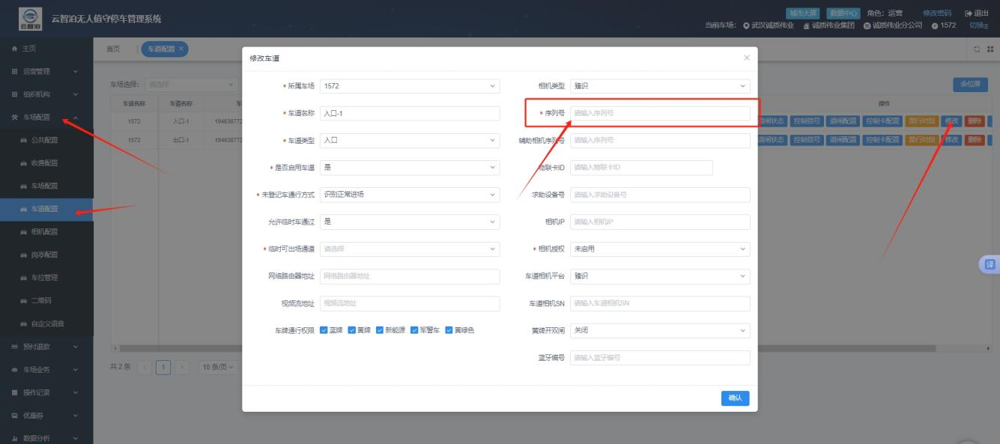

- SN 填写后保存，若提示下图内容，请联系我司商务授权。

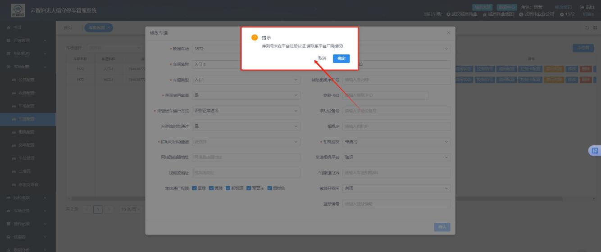

- 进入相机，**MQ 相机首先升级算法包，再进行 yzbmq 直连配置包导入上线**。

### 升级算法包

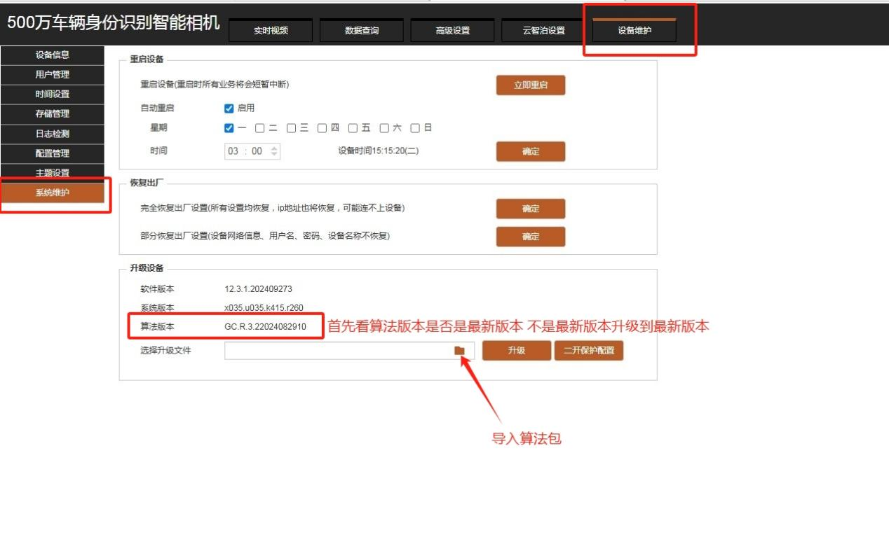

### 导入 MQ 配置

再点击 **高级设置 → 高级网络 → MQTT 设置**。

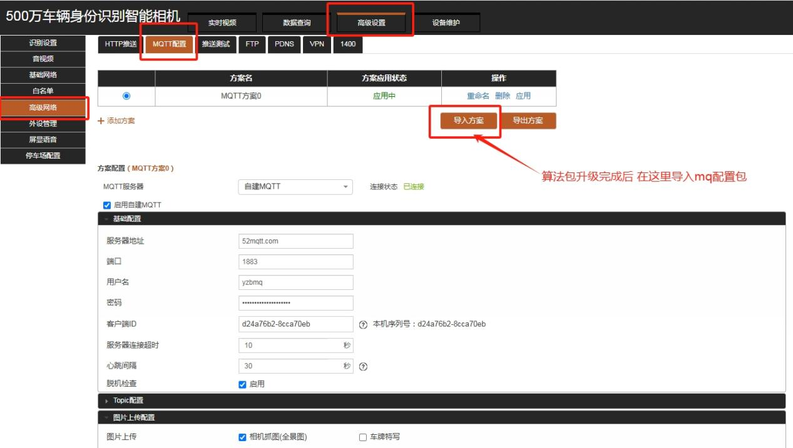

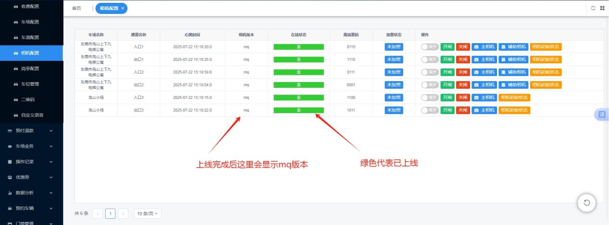

### 4. 设置控制卡

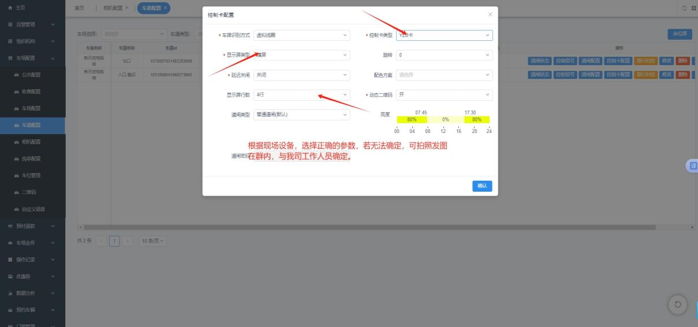

> **注意：** 控制卡的波特率需与相机波特率保持一致。

### 进出测试

完成上述操作后，准备车辆进出测试，测试内容包含屏显、语音、开关闸。

- 若现场设备不播报、不屏显，检查波特率和 485 AB 线。
- 若现场设备不开闸，请检查道闸接线（相机开闸接 OUT1，关闸接 OUT2）。
- 若自检无法解决上述问题，可联系我司工作人员协助。

### 收费配置

- 收费标准可将公示牌拍照发群，联系我司工作人员协助设置。
- 开账收费配置时间规则：平台自设置的开账收费时间开始计费，在此之前的时间段不计费。
- 正式开启收费前，请务必确认车场进件资料已提交我司开户，并确认开户完成后已配置车场。

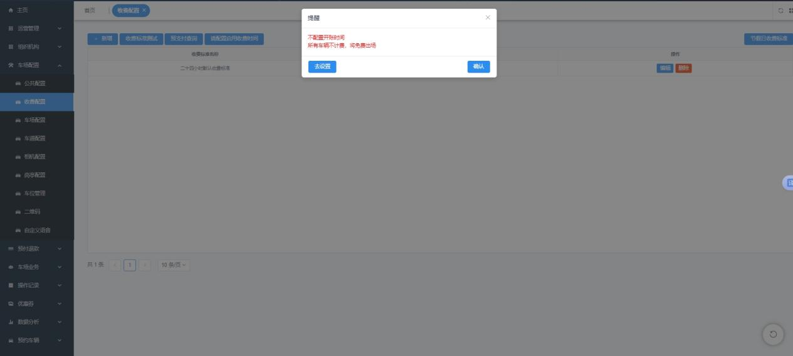

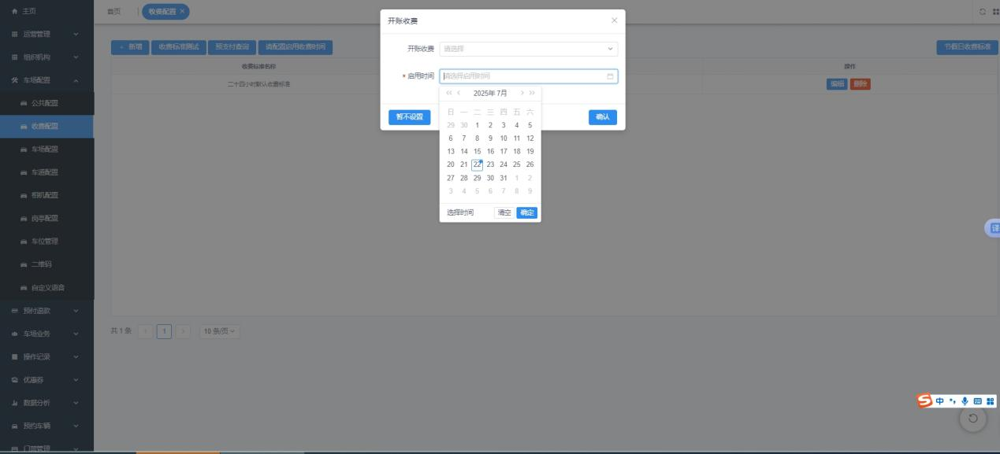

### 二维码

- 在平台配置二维码参数。

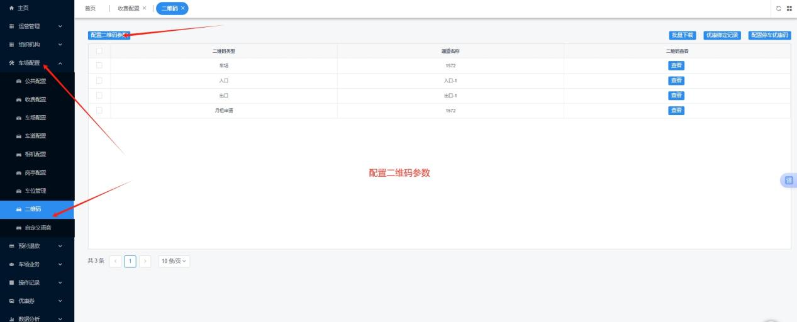

- 下载二维码，打印安装。

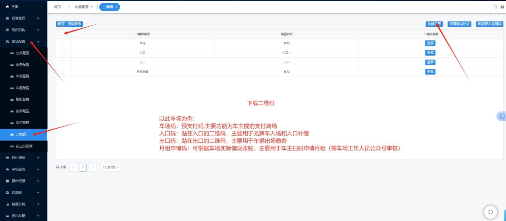

## 三、录入、导入车辆

此版块有单独的说明书，可参考《车辆管理相关说明文档》。
