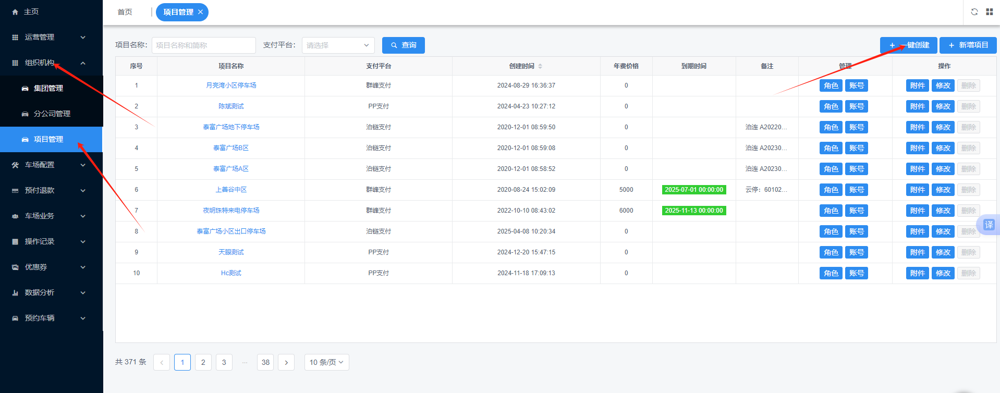

快速创建车场指南

## 一、操作步骤

### 1. 进入创建入口

在左侧菜单进入 **组织机构 → 项目管理 → 一键创建**。

### 2. 填写车场基本信息

填写车场基本信息，点击【确定】即可快速创建车场。

### 3. 开启小车场（如有大小车场）

若车场存在大小车场，可在此开启小车场。

### 4. 添加多个车场

若有多个车场，可点击【新增】继续添加，所有车场添加完毕后点击【确认】即可。

> **说明：** 快速创建的项目会默认一套收费标准（需自行调整设置）；月租车默认“过期直接入场”模式；若有大小车场，所属车场会默认全勾（均可自行调整）。
