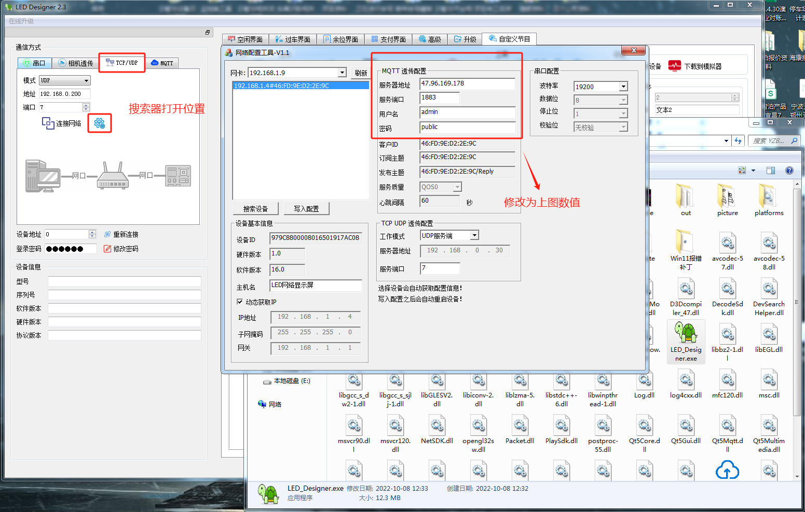
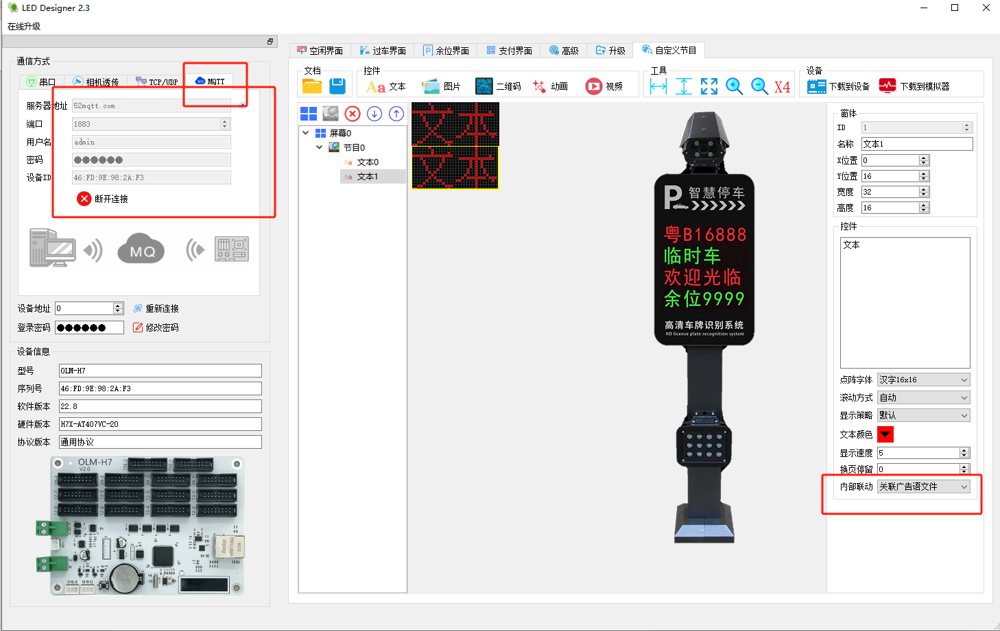
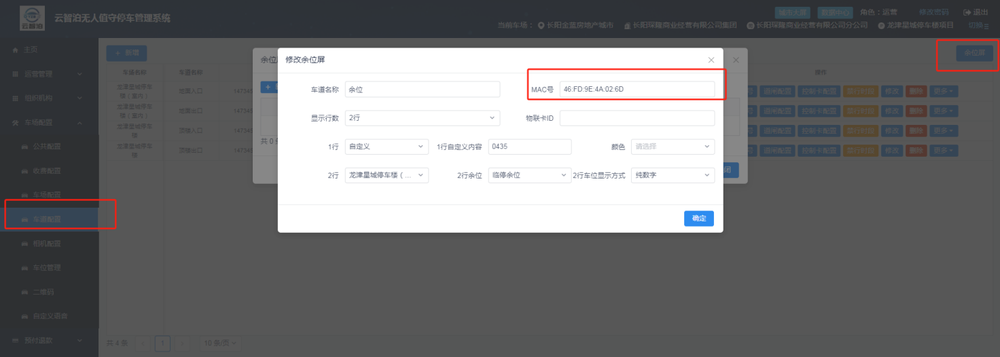
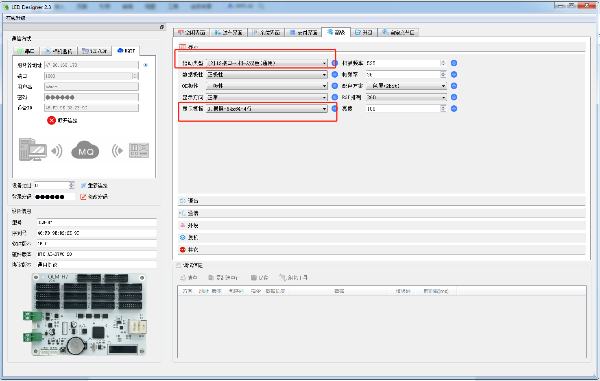

余位屏上线教程

## 一、操作步骤

### 1. 打开控制卡工具

打开停车Boss控制卡工具。

连接参数：服务器地址 `52mqtt.com`，用户名 `admin`，密码 `public`。

### 2. 测试控制卡连接

通过 MQTT 的连接方式测试控制卡是否已连上。

### 3. 填入控制卡 MAC 上线

把控制卡 MAC 填入平台即可上线。

### 4. 显示异常时调整

如碰到显示不正确，使用控制卡配置工具调整即可。

