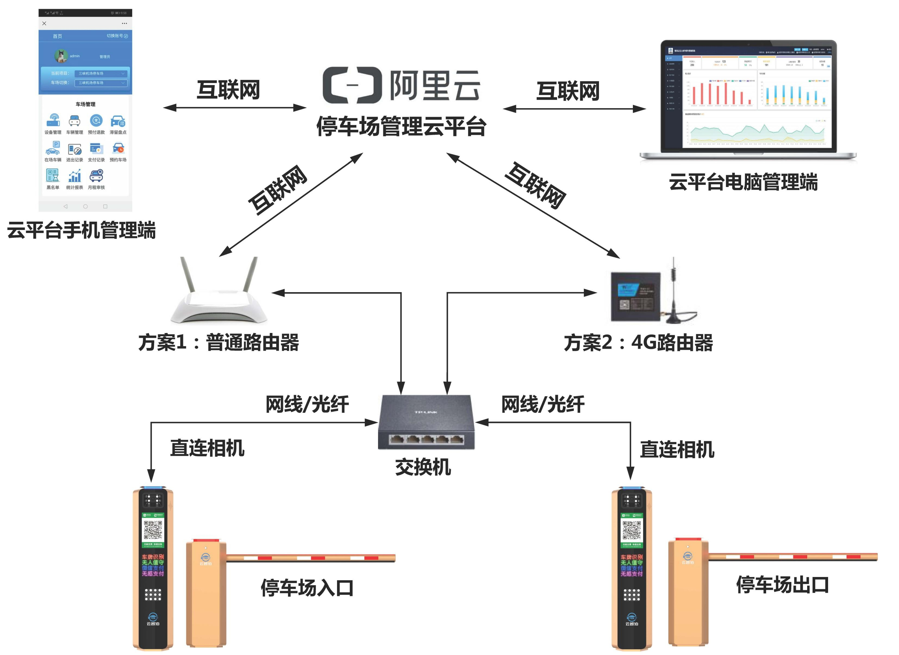
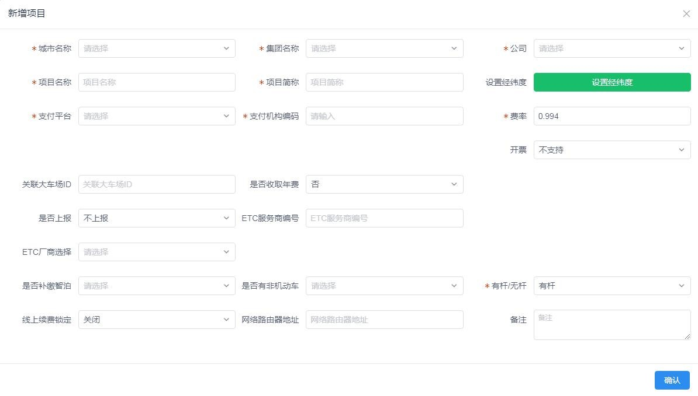
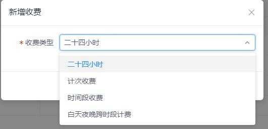
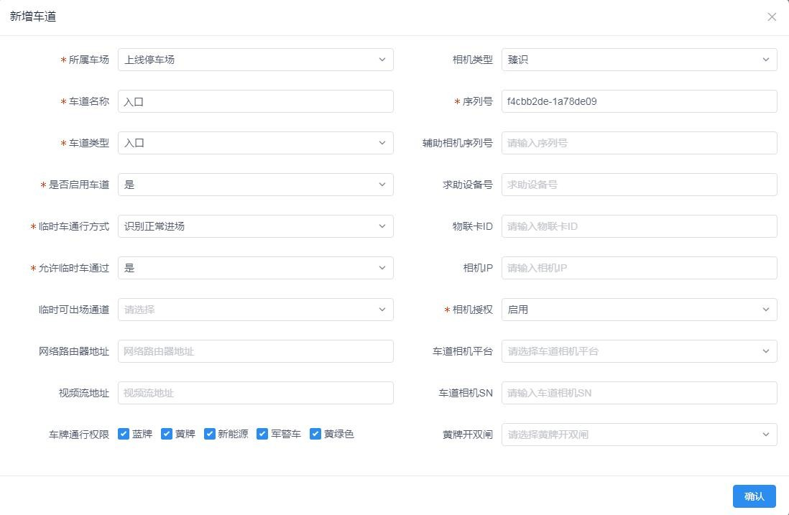
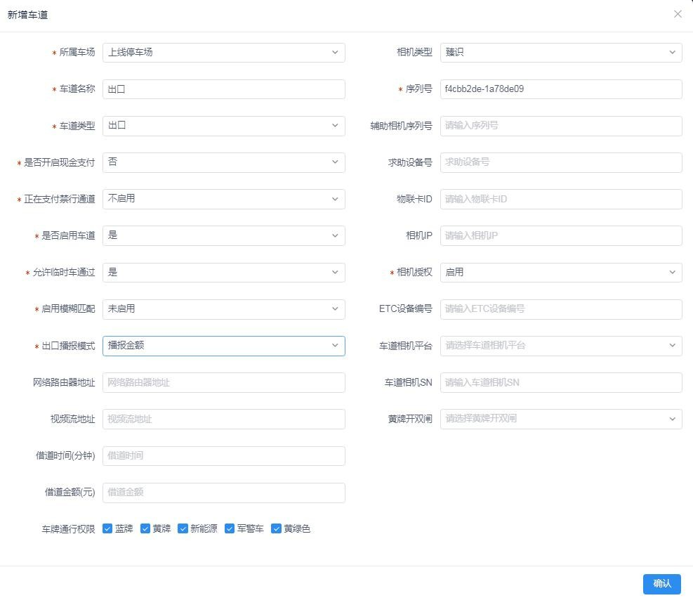
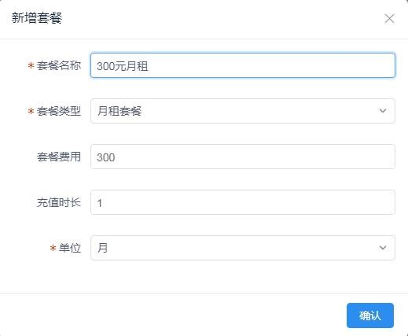
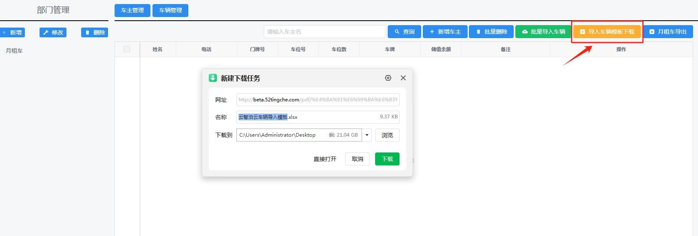
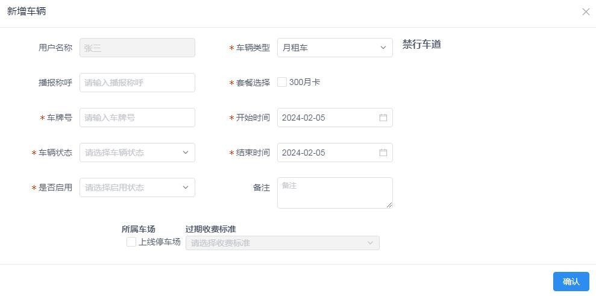

云平台系统上线说明书

本文档说明停车Boss云平台从设备安装、网络准备、开户到项目创建、车场配置上线的完整流程。

## 一、设备安装

1. **车牌识别设备**：安装请参考我司《说明书-车牌识别设备安装 2401 V1.0》进行安装调试。
2. **道闸设备**：安装请参考我司《说明书-道闸设备安装 2401 V1.0》进行安装调试。

## 二、网络准备

1. **有宽带**：我司云平台在本地无任何辅助硬件（盒子或终端），车牌识别相机直接接入互联网阿里云平台。现场建议开通一条家用宽带并自备一个家用小路由器，车牌识别相机网线**不能直接插在光猫上**（直连光猫容易断网掉线）。
2. **无宽带**：若现场无法开通宽带，则准备一个 4G 路由器（插好流量卡）代替宽带联网。联网拓扑图如下：

## 三、停车场开户

1. **标准**：停车场新项目收取停车费的，需提前在支付公司平台开户。开户前先与停车场运营方/管理方确定是对公账户收款还是对私账户收款，再联系我司相关服务人员进行支付公司停车场开户。
2. **对公账户**：一般需准备营业执照、法人身份证正反面、法人电话号码、开户许可证（或印鉴卡或基本户账户证明）的彩色照片或加盖公章的黑白复印件。开户还需法人进行实名认证和签订合同，均在手机上操作。
3. **对私账户**：一般需准备收款人身份证正反面、电话号码、银行卡正反面彩色照片及账户信息。开户流程中同样需进行实名认证和签订合同，均在手机上操作。

## 四、登录系统

打开浏览器访问 `<平台登录地址>`（由服务人员提供）登录系统首页，输入登录账号和密码（账号创建请联系我公司相关服务人员），如下图所示：

## 五、项目创建

- 联系我司相关服务人员进行城市级、集团级、分公司及账号权限设置，设置完毕后方可自行创建项目，进行云平台上线后续操作。
- 创建项目，选择城市、集团、分公司，填入项目名称和项目简称，一般为“xxx 停车场”。
- 选择支付平台，填写支付编码（在支付公司平台开户后生成，请及时联系我司相关服务人员获取开户信息填入）。
- 费率默认填写 `0.994`。

- “有杆/无杆”默认选择“有杆”。

## 六、车场配置

1. **公共配置**：里面设置项一般为默认选项，无需更改；若要更改请联系我司相关服务人员后酌情修改。
2. **收费标准配置**：根据停车场收费要求进行选择后配置收费标准，我司可配置的收费标准适用于市面上所有的收费模式。

3. **新增停车场**：
   （1）停车场名称：输入新建停车场的名字。
   （2）月租车位数：据实输入。
   （3）临时车位数：据实输入。
   （4）总车位数：自动相加生成。
   （5）余位类型：自行选择。
   （6）三种车辆收费标准：自行创建后选择。
   （7）过期月租车处理：自行选择。

4. **新增车道**：
   （1）**新增入口车道**：有几个进口就建几个通道；带红色星号项为必填项；相机序列号必须填写（一般在我司车牌识别外包装标签上，或打开箱门在接线说明板上）；点击“确认”后若提示“序列号未在平台注册认证，请联系平台厂商授权”，请与我司相关服务人员联系处理。

   

   
   

   （2）**新增出口车道**：有几个出口就建几个通道；带红色星号项为必填项；模糊匹配和出口播放模式根据实际需求选择；相机序列号必填，提示同上。

   

   
   

5. **车牌识别相机调试**：请参考我司《说明书-车牌识别设备安装 2401 V1.0》进行安装调试。
6. **添加导入月租车**：
   （1）创建套餐。

   

   
   

   （2）新增部门。

   

   
   

   （3）录入月卡车（两种方式）：
   - **①批量录入**：下载“停车Boss云车辆导入模板.xlsx”，按表内内容填写后点击“批量导入车辆”上传表格文件进行批量导入。

     

     
     

   - **②手动录入**：新增车主，填入姓名、所属部门、车位数等。

     

     
     

     填入车牌号、选择车辆状态、套餐、开始结束时间、勾选停车场、选择收费标准。

     

     
     

至此上线流程基本结束，若有问题，请联系我司相关服务人员！
