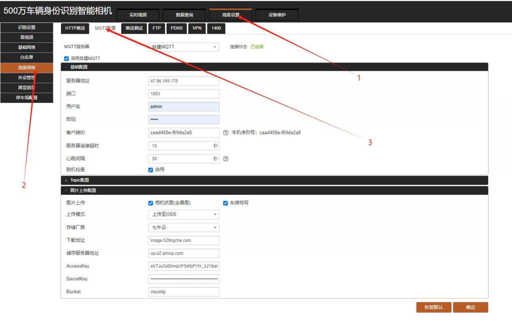
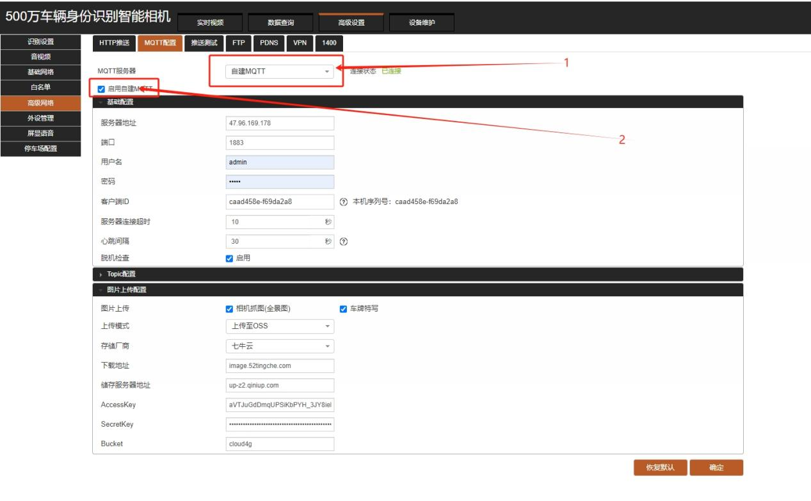
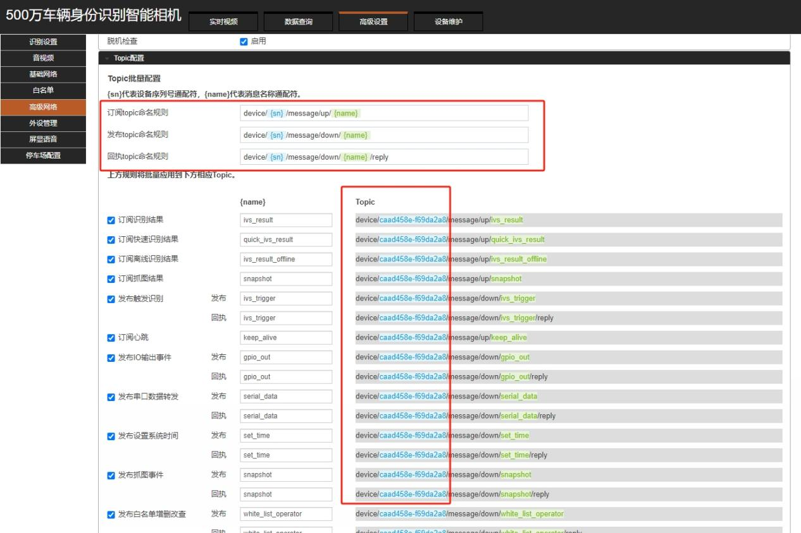
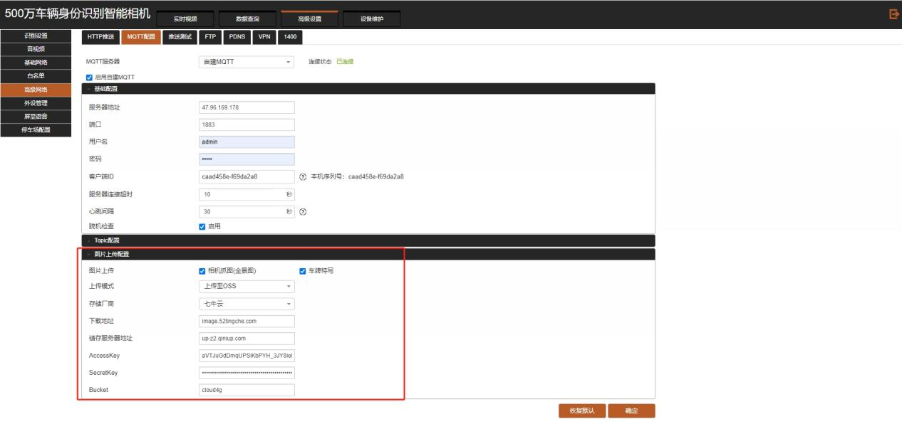
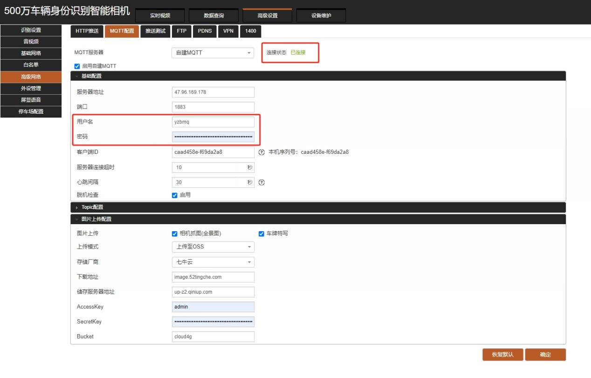

VZ相机 MQTT 上线流程

## 一、进入 MQTT 设置

打开相机，点击 **高级设置 → 高级网络 → MQTT 设置**。

## 二、启用自建 MQTT

MQTT 服务器选择 **自建 MQTT**，点击启用自建 MQTT。

## 三、配置 MQTT 基础参数

- 服务器地址：`47.96.169.178`
- 端口：`1883`
- 用户名：`yzbmq`
- 密码：`yzb123`
- 客户端 ID：本机序列号

## 四、检查 TOPIC 配置

因VZ相机版本、型号不同，各机型的 topic 配置存在差异，平台指定的统一格式为 `device/sn/格式`。若检查配置的格式不匹配，则需要手动修改顺序。

## 五、配置图片处理器

优先配置七牛云服务器，部分相机不支持七牛云，可改为配置阿里云。

**七牛云地址：**

- 下载地址：`<镜像/分发域名>`（由服务人员提供）
- 存储服务器地址：`up-z2.qiniup.com`
- AccessKey：`-i3LN8uaqhx_o8_d4zP3RqBoaNY8wltQS3abDz4G`
- SecretKey：`R_v0-AsUYvyKTAC-o1rQtvQkIYNrZ0fkgSRlSBOg`
- Bucket：`cloud4g`

## 六、确认连接状态

> **特别注意：** 修改其他参数以后，尽量把账号密码重新设置一次。因浏览器兼容问题，有可能出现“显示已连接，但实际验证账号密码并未通过”，从而导致相机并未真正上线的情况。

