*停车Boss*逃费追缴说明书

一、逃费定义

*停车场系统逃费指车辆在停车场停放后，未按规定缴纳停车费用，通过各类违规手段规避缴费流程，擅自驶离停车场的行为。此类行为违反停车场管理规定，同时可能触及相关法律法规，损害停车场运营方合法权益。*

*二、常见逃费方式*

*1，跟随前车：在道闸开启、前车通行时，紧随其后快速通过，利用道闸关闭的时间差逃避缴费，此方式易引发车辆剐蹭、道闸损坏等安全事故。​*

*2，恶意撞杆：强行撞击停车场道闸系统，破坏设备后驶离，不仅逃费，还涉嫌故意损坏财物。*

*3，**谎称已缴费：向停车场管理员虚构已线上缴费但系统未显示的情况，要求放行，实则未完成缴费。*

*4，万能遥控器：**这是近年来高发的技术逃费新手段，其核心是通过信号克隆设备窃取道闸控制指令实现逃费。*

*5，**篡改车牌：通过遮挡车牌、更换临时号牌、篡改车牌**、**在出口扫码填写手机号走无牌车流程**等方式，使停车场系统无法准确识别车辆信息，从而逃避计费和缴费。*

*6，返场逃费：***车辆入场后又到出口识别，再倒车停****回****车位****，造成车辆已经出场的假象，实际车辆依然在场，***从而逃避计费和缴费**。*

*三、停车Boss系统逃费异常记录的确认方式*

*车辆从进场到出场，通过逃费等方式未支付停车费的订单，就会进入异常记录，平台缴费状态异常等待时间默认5分钟（可改），5分钟后缴费状态异常的订单就会进入异常记录。*

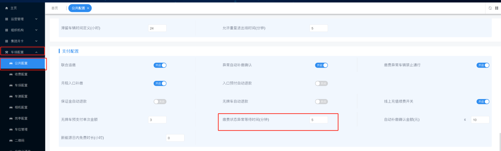

- *手动确认补缴*

*数据分析—异常记录—输入车牌—入口补缴  （车场管理员可根据车牌核实情况，然后自行决定是否进行追缴）*

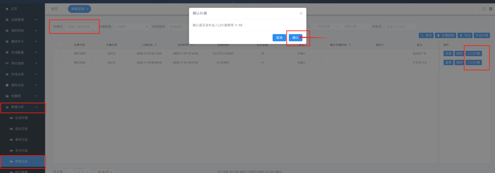

（手动补缴后，状态会变成确认，同时会显示对应的操作人）

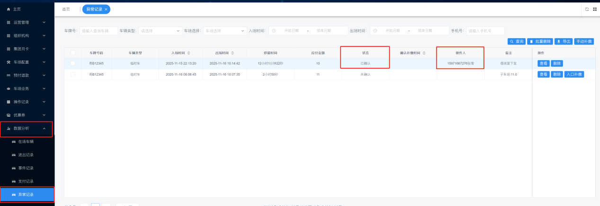

2，自动确认补缴

车场配置—公共配置—异常自动补缴确认开启—填写自动补缴确认金额

（小于或等于设定的金额，才会自动确认补缴，平台自动确认补缴时间为当日0点）

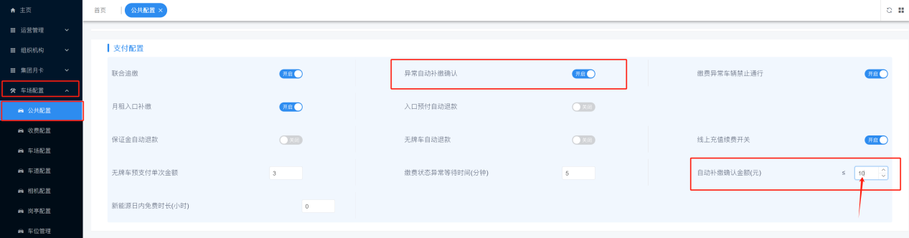

（自动补缴后可在异常记录中查询）

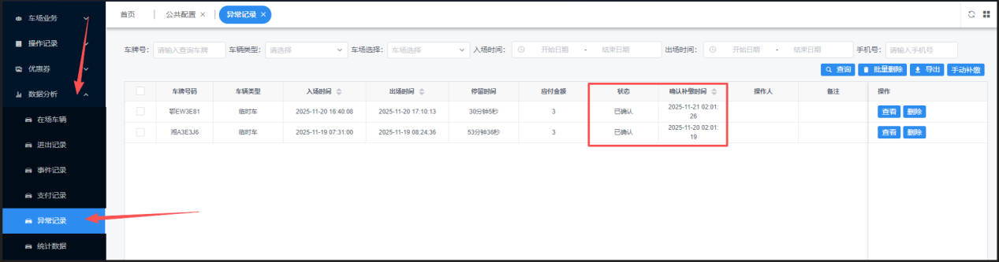

3，手动添加补缴

数据分析—异常记录—手动补缴—异常记录添加  （添加对应的车牌、选择入场出场时间、上传入场出场图片、填写补缴金额即可确认）

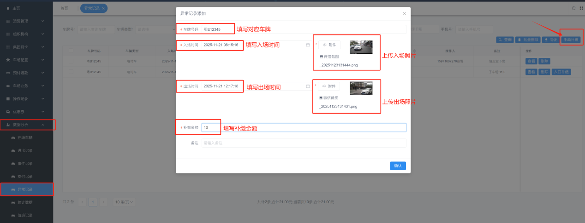

（添加成功后，异常记录中就会有对应的信息、操作人和备注）

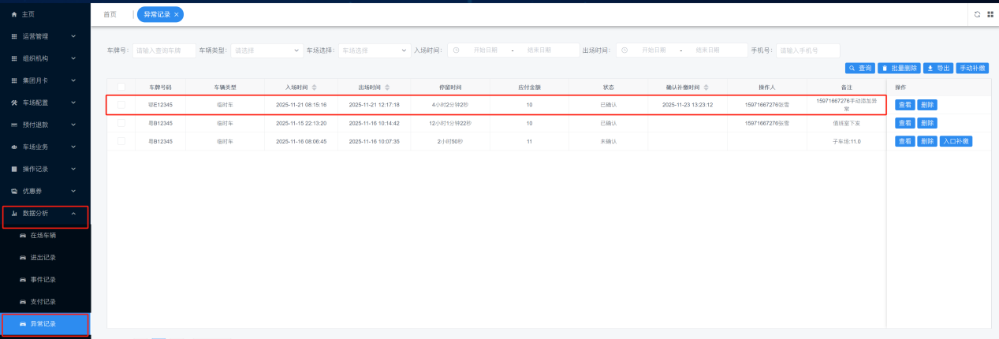

四、异常记录的删除

数据分析—异常记录—选择车牌—删除 （可搜索单个车牌删除或批量删除）

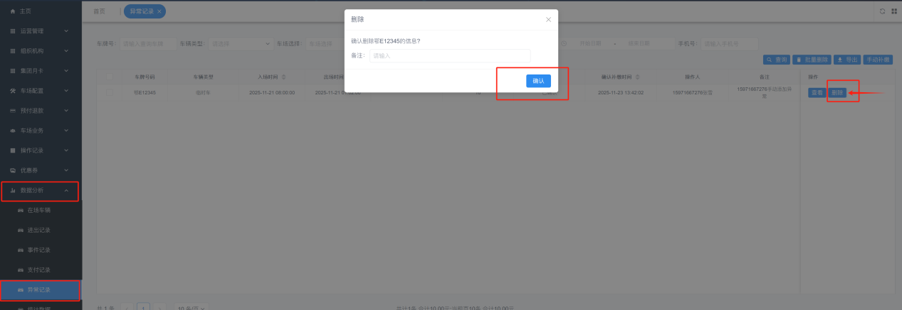

（删除后可在操作记录—异常删除里面查询删除记录，会有对应的操作人和操作时间）

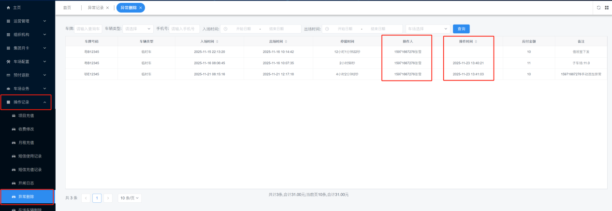

*五、停车Boss系统针对补缴的措施**—**追缴*

- 公共配置—联合追缴

联合追缴是停车Boss停车管理平台的特色功能，所有使用本平台的车场都可以进行联合追缴

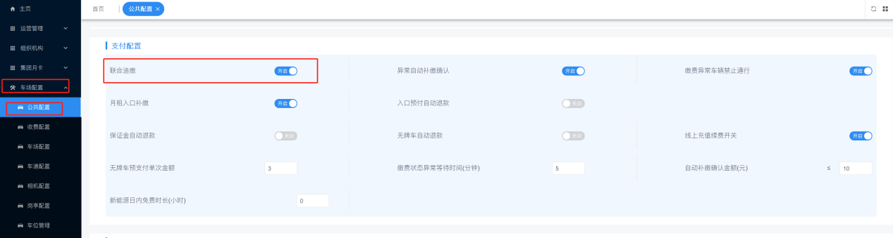

开启：确认补缴的车辆入口识别后，屏幕上提示您有欠费请扫码缴费，车主扫码进行补缴（可选择补缴单笔或批量补缴），补缴后方可入场，同时补缴的费用进入该车欠费车场的账户。（前提：车场必须使用*停车Boss停车管理系统打开全局补缴*）

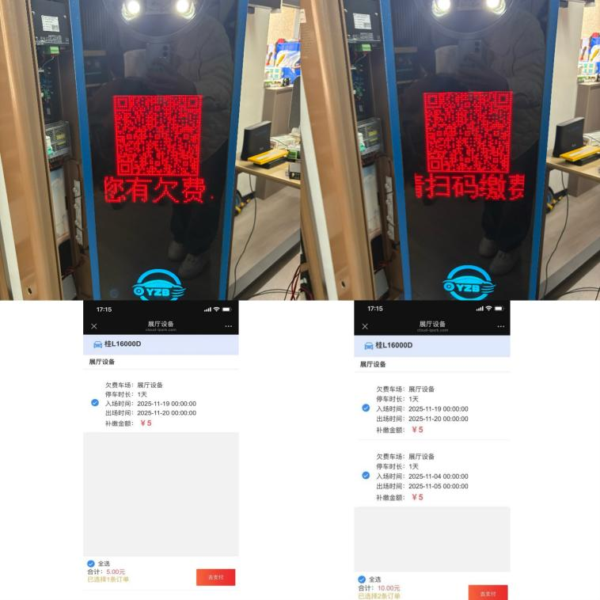

不开启：有补缴订单的车辆在入口将不会提示补缴，车场正常识别进出。

- 公共配置—缴费异常车辆静止通行

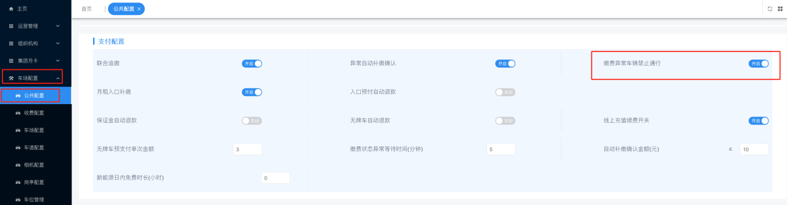

开启：已经欠费的车场再次进入会进行补缴，别的车场正常通行（前提：该车场关闭全局补缴）

不开启：在已经欠费的车场会正常识别进出，不会提示补缴。

- 公共配置—月租入口补缴

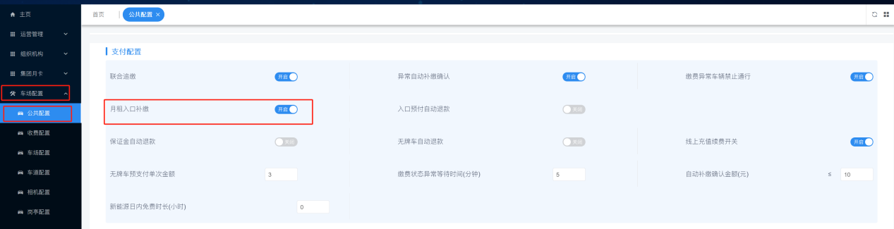

开启：月租过期、月租录入前产生的临停费用、月租报停产生的临停费用、所属车场不一致产生的异常费用，都将会在入口进行补缴。

不开启：在本车场欠费情况下进入本车场，不用补缴可正常进出。

（若开启全局补缴，在停车Boss*系统打开全局补缴的车场，进去也需要在入口补缴*）

- 数据分析—异常白名单

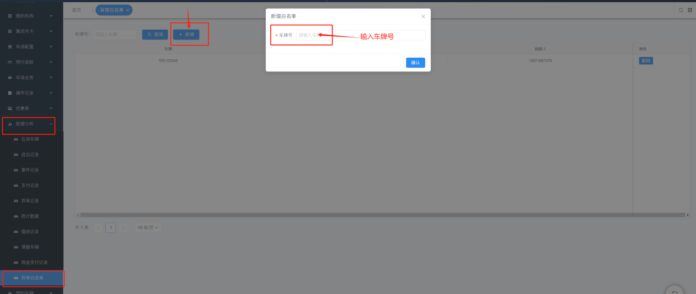

车场打开全局补缴，异常订单的车辆该车场只想在别的车场进行追缴，可添加至异常白名单（异常白名单的车辆仅在该车场入口不会补缴，在进入停车Boss*系统打开全局补缴的车场，进去需要在入口补缴*）

六、车场业务—黑名单

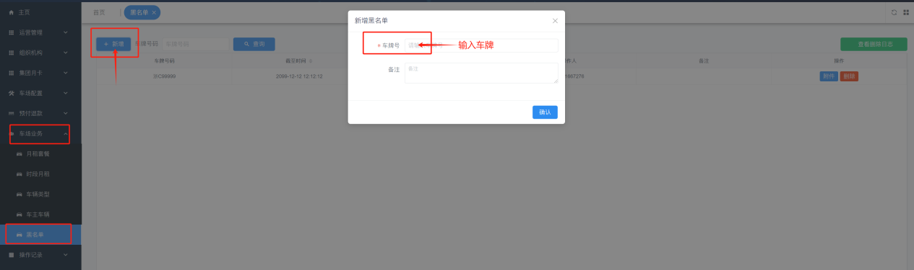

车场全局补缴、缴费异常车辆禁止通行、月租入口补缴均不开启的情况下，车场禁止异常缴费车辆进入，可将车辆添加至黑名单。添加黑名单后该车在入口识别，会提示您的车辆已加入黑名单，请联系车场管理员。

（入口识别后，数据分析—在场车辆和进出记录均可查询到记录和备注）

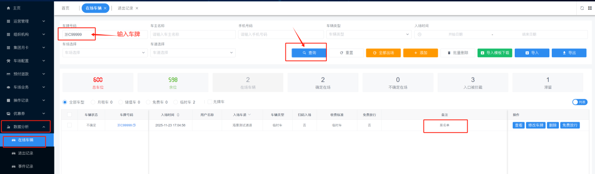

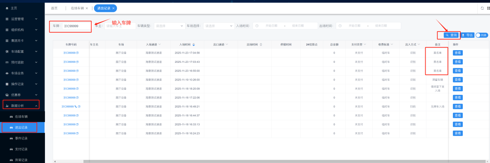

- 查询车辆追缴、补缴记录

- 数据分析—进出记录（可在备注中看见追缴和补缴车场的名字和费用）

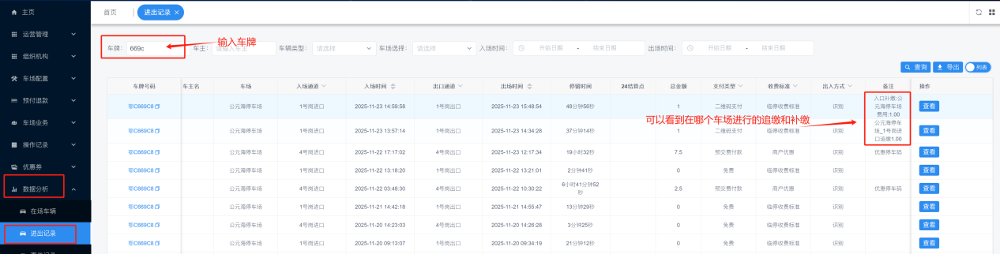

- 运营管理——全局补缴（可以看见未补缴和已补缴支付状态、备注信息、车辆照片和删除补缴记录）

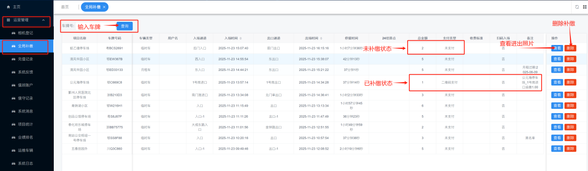

