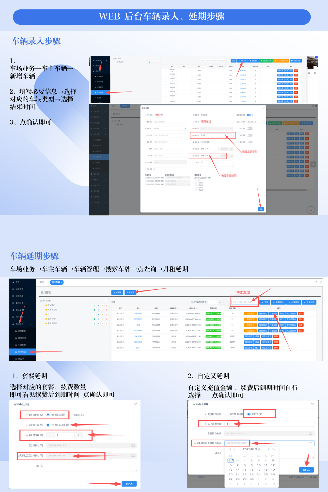

# 4.2 后台车辆录入与月租延期

本页说明如何在停车Boss WEB 后台完成月租车辆的首次录入，以及月租车到期后的延期续费操作。

## 车辆录入步骤

1. 进入 **车场业务 → 车主车辆 → 新增车辆**。
2. 在弹窗中填写必要信息：用户名、车牌号码、车辆类型、结束时间等。
3. 确认无误后点击「确认」即可保存。

## 车辆延期步骤

1. 进入 **车场业务 → 车主车辆 → 车辆管理**。
2. 输入车牌号并点击「查询」。
3. 在结果列表中找到目标车辆，点击「月租延期」。
4. 选择「套餐延期」或「自定义延期」，填写续费数量/金额与新的到期时间后确认。

